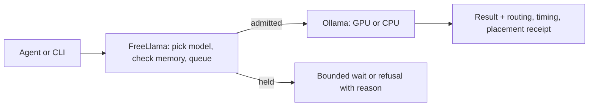
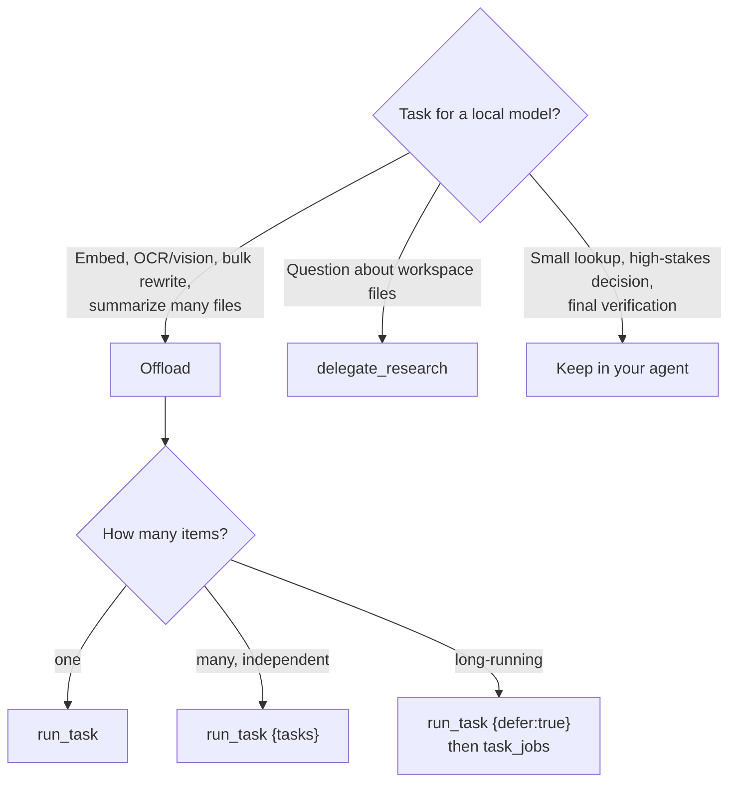
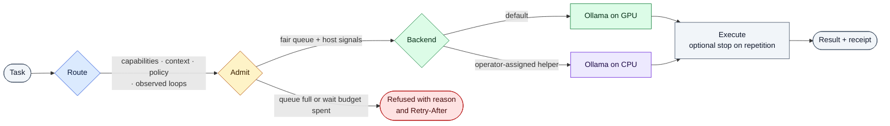
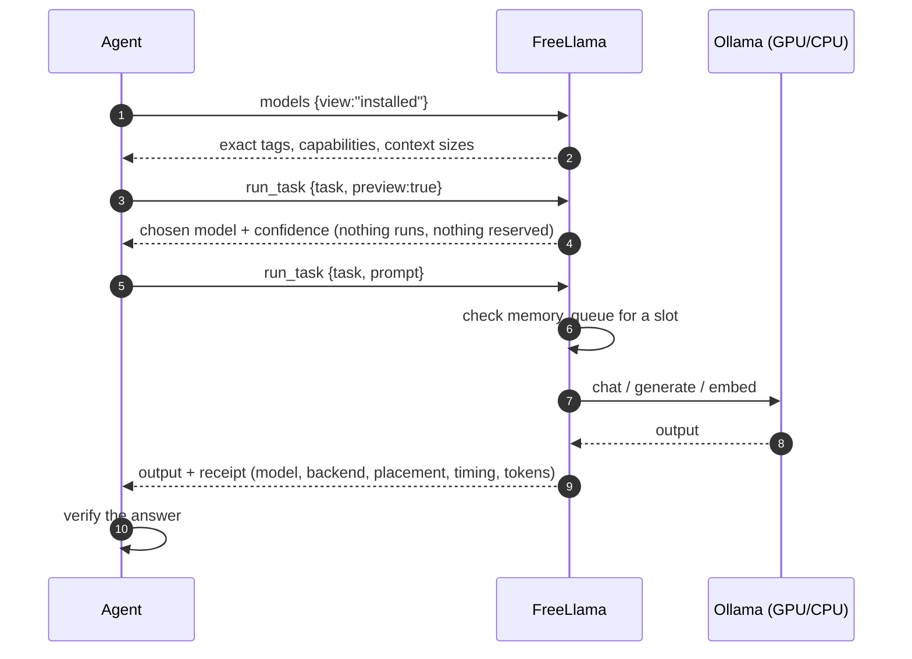
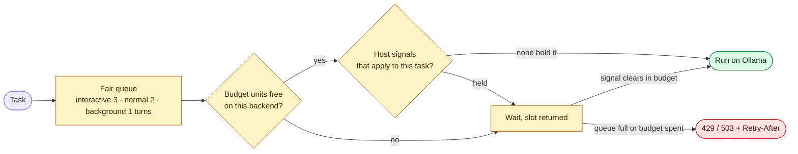
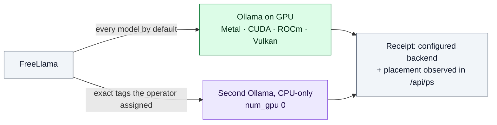

# FreeLlama


FreeLlama lets AI agents offload bounded tasks to **local Ollama models**. You or your agent submit a
task. FreeLlama picks an installed model, checks memory, queues or refuses work, and routes it to a GPU or
CPU Ollama backend. It returns the result plus evidence of where and how the task ran.

Good fits are embeddings, OCR/vision, bulk text transforms, and read-only repository lookups.
Your agent still decides what to delegate and verifies the answer.



## Requirements

- [Ollama](https://ollama.com/download) installed and running (`ollama list` works).
- Node.js 20.19+ or 22.12+ for the npm packages.
- At least one installed model. FreeLlama never downloads a model without your explicit approval.

Prebuilt native binaries cover macOS, Linux (glibc/musl), and Windows on arm64 and x64.
Keep npm optional dependencies enabled; they carry the native binary.

## Use with your agent (MCP)

Add the MCP server to your agent host. Claude Code:

```bash
claude mcp add freellama -- npx -y @octocodeai/freellama-mcp-server
```

Claude Desktop, Cursor, and other hosts use the same command in their JSON config:

```json
{
  "mcpServers": {
    "freellama": {
      "command": "npx",
      "args": ["-y", "@octocodeai/freellama-mcp-server"],
      "env": { "FREELLAMA_MCP_ALLOWED_ROOTS": "/absolute/path/to/your-project" }
    }
  }
}
```

The server starts its own FreeLlama service when none is running. It does not install or start
Ollama. `FREELLAMA_MCP_ALLOWED_ROOTS` is needed only for `delegate_research`, which runs its
research adapter with the same Node.js that runs the server.

### MCP tools

Nine tools cover inventory (`models`, `doctor`), execution (`run_task`, `task_jobs`), history and
affinity (`scope`, `session`), read-only research (`delegate_research`), and approved model
lifecycle (`ollama_manage`, `ollama_delete`). The canonical table is in the
[MCP reference](packages/mcp/README.md#tools).

Typical flow: `models` → `run_task {preview:true}` → `run_task` with the prompt → check the receipt.
A preview runs nothing and reserves nothing. Full schemas and the agent workflow are in the
[MCP reference](packages/mcp/README.md).

## Use from the terminal (CLI)

```bash
npx @octocodeai/freellama init        # check prerequisites, print a first-run plan
npx @octocodeai/freellama doctor      # verify Ollama
npx @octocodeai/freellama serve       # start the service on http://127.0.0.1:11435
```

Keep `serve` running. In another terminal:

```bash
npx @octocodeai/freellama models
npx @octocodeai/freellama route --task completion --model MODEL_TAG     # preview only
npx @octocodeai/freellama task  --task completion --model MODEL_TAG "Reply with exactly OK."
npx @octocodeai/freellama status      # queues, memory holds, loaded models
```

Replace `MODEL_TAG` with an exact tag from `models`. Other commands: `jobs`, `usage`, `config`,
`warm`, `scope`, `session`, `bench-all`, and `proxy`. Run `npx @octocodeai/freellama <command> --help`, or see the [CLI guide](docs/CLI.md).

While `serve` runs, a status page is available at `http://127.0.0.1:11435/_freellama/ui`.

## Features

| | Feature | What you get |
|---|---|---|
| 🧭 | [Smart model selection](#smart-model-selection) | The right installed model for the task, with a confidence level |
| 🚦 | [Resource admission](#resource-admission) | No out-of-memory surprises: tasks run, wait, or are refused with a reason |
| 🖥️ | [CPU + GPU backends](#cpu--gpu-backends) | Small helper models on CPU next to big GPU work, with proof of where they ran |
| ⚡ | [Batches, jobs, and history](#batches-jobs-and-history) | Fan-out, submit-now-collect-later, and multi-turn chat without resending history |
| 🔎 | [Grounded research](#grounded-research) | Read-only repository answers with file/line citations and a verdict |
| 🧳 | [Small agent context](#small-agent-context) | Compact results, paged details, receipts instead of raw dumps |
| 🔁 | [Loop control](#loop-control) | Stop a repeating answer early and keep every token; routing learns which model loops on what |
| 🌡️ | [Machine awareness](#machine-awareness) | GPU, cores, unified memory, thermal pressure and GPU load read from the OS |
| 📊 | [Observe and evaluate](#observe-and-evaluate) | Live status, usage, benchmarks, routing policies, Ollama-compatible passthrough |

### What to offload

FreeLlama is for **bounded** work whose result your agent can check. Keep judgment with the agent.



### The smart flow

Every managed task passes the same four gates. Each gate decides from evidence (installed metadata,
live host signals, observed behaviour), never from a model's name.



- **Route** (blue): filters installed models by task, capabilities, context window and policy, then
  ranks them. A model that keeps looping on this kind of task ranks last. An explicit `model` always
  wins.
- **Admit** (amber): a per-backend budget, a bounded fair queue and host signals decide whether the
  task runs now, waits, or is refused.
- **Backend** (green GPU, purple CPU): GPU by default; exact helper tags can run on a second,
  CPU-only Ollama.
- **Execute**: Ollama runs the model. With `stopOnRepetition` the answer streams and stops once it
  repeats itself.

### One task, end to end



The same flow as MCP calls:

```jsonc
// 1. Inventory
{ "tool": "models", "arguments": { "view": "installed" } }
// 2. Preview: routing fields only
{ "tool": "run_task", "arguments": { "task": "coding", "objective": "balanced", "preview": true } }
// 3. Execute: same routing fields plus the payload
{ "tool": "run_task", "arguments": { "task": "coding", "prompt": "Rename foo to bar in: ...", "options": { "num_predict": 512 } } }
```

### Smart model selection

Routing filters installed models by task, capabilities (`tools`, `vision`, `embedding`, ...),
context window, routing policy, and memory fit. Every decision reports a confidence level.
Set `minConfidence:"medium"` to refuse weakly evidenced routes, `objective:"quality"` to require a
policy-backed model, or pin `model` yourself. See [model selection](docs/MODEL_SELECTION.md).

FreeLlama treats every model the same way: it never ranks by name or architecture and adds no
model-specific request options. A bare name works like it does in Ollama (`name` is
`name:latest`, or the one installed tag of that family). What it learns instead is behaviour: a
model that keeps looping on a task kind (at least two loops in at most twice as many runs) ranks last
for that kind, and `models` lists the evidence as `observed_loops`.

### Resource admission



- **Budget:** two units per Ollama decoding slot (`OLLAMA_NUM_PARALLEL`); a chat costs 2, a vision
  task 4 (capped to the budget), an embedding 1 per four inputs. The GPU queue holds 16 tasks, the
  CPU queue 8; a task waits at most 120 s, or less with `maxWaitSeconds`.
- **Fairness:** priority classes get 3, 2 and 1 turns per round, FIFO inside a class, and the
  oldest blocked task reserves capacity after six bypasses, so nothing starves. Measured live: 4
  interactive tasks submitted last overtook 4 normal and 4 background tasks submitted first.
- **Refusals are fast and say when to retry:** a full queue answers 429 at once; an expired budget
  answers 503. `Retry-After` is estimated from tasks ahead, how many of that cost run at once, and
  recent service time.
- **Which host signal holds which task:**

| Signal | Holds |
|---|---|
| OS memory pressure | everything |
| Low available RAM, active swapping | new model loads (a model already loaded keeps serving) |
| CPU load, thermal throttling | CPU-backend work and new loads; not a model already resident on the GPU |

The memory a new load must leave free is the host reserve (15% of RAM, at least 1 GiB) but never more
than the load itself. On macOS a low estimate unloads idle models and then dispatches with a warning,
because macOS can reclaim cache the estimate misses; on Linux and Windows the load waits. Also wait
budgets (`maxWaitSeconds`), total deadlines (`timeoutSeconds`), and circuit breakers. See
[monitoring and tuning](docs/MONITORING.md).

### CPU + GPU backends



Each backend has its own budget, queue and model-transition lock, so a burst of GPU work never takes
the slot a CPU helper needs.

Optionally run a second, CPU-only Ollama for exact helper models so they never compete with GPU
work. The operator assigns models; agents may only express `executionPreference`. Ask for
`minPlacementEvidence:"observed"` when placement matters. See [CPU/GPU routing](docs/CPU_GPU_ROUTING.md).

### Loop control

Some models answer correctly and then repeat the answer until the output cap. Set
`stopOnRepetition:true` (CLI `--stop-on-repetition`): FreeLlama streams the answer, checks it every
16 tokens, and stops once it has repeated itself twice over 96+ characters. Closing the connection
cancels generation in Ollama. Nothing is trimmed: the full text is in `response`, and
`output_check` says where the first copy ends. Without the flag, a loop that ran to the cap is
flagged the same way. Either way the loop is recorded for routing.

### Machine awareness

`freellama machine` and `doctor {view:"status"}` report what the OS says about the host, read
without elevated privileges:

- **Machine:** chip, logical CPUs and (on Apple silicon) the performance/efficiency split, total
  memory and whether it is unified, and the GPU (on macOS the Apple model and core count from the
  I/O registry; on Linux the NVIDIA name and memory from `nvidia-smi`).
- **Live:** available memory and OS memory pressure, CPU load, GPU busy percent (Apple and NVIDIA)
  and, on Apple silicon, the memory the GPU driver has allocated. Heat on macOS is the system
  thermal pressure level (`nominal`, `moderate`, `heavy`, `trapping`, `sleeping`; throttled from
  `heavy`), plus `pmset`'s CPU speed limit on Intel Macs. Linux and Windows report heat as unknown.
- **Placement:** whether a loaded model sits fully on GPU, fully on CPU, or split, from Ollama.

### Batches, jobs, and history

| Need | Use |
|---|---|
| Many independent items | `run_task {tasks, maxParallelism}` with up to 64 `{id, independent:true, task}` items |
| Submit now, collect later | `run_task {defer:true}` returns `job.id`, then `task_jobs {action:"get", jobId}` |
| Multi-turn chat without resending history | `scope {action:"create"}`, then `run_task {scopeId, scopeRevision, prompt}` |
| Keep related calls on one model | `session {action:"create"}`, then `run_task {sessionId}` |
| Hot model before latency-sensitive work | `run_task {warm:true, model, contextTokens}` |

See [Scopes and warming](docs/SCOPES_AND_WARMING.md).

### Grounded research

`delegate_research {question, workspacePath}` gives a local model bounded, read-only search and
read tools over an allowed workspace. It returns an answer, file/line citations, and an independently
computed verification verdict. Discard `escalate` results; verify citations on the rest.

### Small agent context

Compact default views, cursor-paged details, embedding vectors omitted unless requested
(`returnEmbeddings:true`), and full adapter transcripts kept on disk instead of in your context.
Optional `telemetry.externalEquivalent` estimates avoided API cost from a rate card you configure.
See [token economics](packages/mcp/README.md#token-economics).

### Observe and evaluate

- **Live status:** queues, memory holds, loaded models, circuit breakers, usage per day and model
  (`doctor {view:"status"}`, `freellama status`, or the `/_freellama/ui` page).
- **Evaluation:** benchmark installed models (`bench-all`) and turn benchmark results into a routing
  policy. See [model selection](docs/MODEL_SELECTION.md).
- **Ollama compatible:** `/api/*` and `/v1/*` pass through to Ollama unchanged, including streaming.
  See [Ollama sidecar](docs/ARCHITECTURE.md#ollama-sidecar).

## Run local models efficiently out of the box

FreeLlama starts with safe defaults and never changes Ollama's settings for you. These are the
settings that matter most, from Ollama's docs and measured reports:

| Setting | What it does | Suggested start |
|---|---|---|
| `OLLAMA_NUM_PARALLEL` | Decoding slots per model. RAM scales with parallel slots times context ([Ollama FAQ](https://github.com/ollama/ollama/blob/main/docs/faq.mdx)); on Apple silicon the gain is small and some engines run one request at a time anyway ([MLX engine](https://github.com/ollama/ollama/issues/17280)) | `1`; raise only after measuring. FreeLlama's budget follows it (two units per slot) |
| `OLLAMA_FLASH_ATTENTION` + `OLLAMA_KV_CACHE_TYPE=q8_0` | A quantized KV cache roughly halves its memory and needs flash attention ([Ollama FAQ](https://github.com/ollama/ollama/blob/main/docs/faq.mdx)) | On, when the model's quality holds |
| Context length | Ollama defaults to 4k below 24 GiB of VRAM; its docs ask for at least 64k for agent and coding work ([context length](https://github.com/ollama/ollama/blob/main/docs/context-length.mdx)) | Size per task: FreeLlama sizes text tasks to the prompt, and `contextTokens` overrides |
| `OLLAMA_MAX_LOADED_MODELS` | How many runners stay resident | One large model at a time; FreeLlama unloads the idle model that is cheapest to reload when a load needs room |
| `keep_alive` | How long a runner stays loaded after use | Leave it out: FreeLlama picks a finite time from measured reuse |

What FreeLlama does for you: sizes the context for text tasks, keeps a loaded runner reusable
(asking for another `num_ctx` reloads it, so `models` shows `context_default` and
`resident_context`), admits by budget so the GPU stays busy without oversubscribing, holds new
loads on real memory pressure, and reports the receipt for every task.

## Good to know

- FreeLlama manages requests around Ollama; Ollama runs inference. Local inference still consumes
  hardware, memory, power, and time; offloading reduces the calling agent's context, not total cost.
- The name refers to reducing reliance on metered inference; any eligible Ollama model works, not
  only the Meta Llama family. FreeLlama targets one operator or a trusted team.
- Model searches and recommendations never download anything. Approve one exact tag and size before a pull.
- Managed tasks return one result; `stopOnRepetition` streams internally to stop a loop early.
  Raw Ollama passthrough keeps streaming.
- CPU assignment is configured by the operator. Trust the returned placement evidence, not the configuration.
- Memory checks keep a reserve of free RAM (never more than the load itself), so on Linux and Windows a
  model can wait while the OS still shows some free memory. See [CLI admission controls](docs/CLI.md#bound-admission).
- In a slim container without CA certificates FreeLlama still starts and serves plain-HTTP Ollama;
  install `ca-certificates` for HTTPS upstreams.
- Scopes, sessions, and deferred jobs live in memory and are lost when the service restarts.
- The service binds to loopback by default. For remote access, see [Production](docs/PRODUCTION.md).

## Build from source

Requires Rust 1.88+ (`rust-toolchain.toml` pins the exact compiler) and Node.js with Corepack (Yarn comes from `packageManager`).

```bash
corepack enable && yarn install && yarn build
./target/release/freellama serve
node packages/mcp/dist/index.js        # MCP server from this checkout
```

npm releases can lag this checkout. Checks are described in [Testing](docs/TESTING.md); the release
gate is `yarn verify:production`.

## Documentation

| Topic | Guide |
|---|---|
| All guides | [Documentation index](docs/README.md) |
| MCP tools, schemas, agent workflow | [MCP reference](packages/mcp/README.md), [MCP configuration](packages/mcp/CONFIGURATION.md), [agent skill](skills/freellama/SKILL.md) |
| CLI commands and flags | [CLI](docs/CLI.md) |
| How it works and who owns what | [Architecture](docs/ARCHITECTURE.md) |
| CPU/GPU setup and placement | [CPU/GPU routing](docs/CPU_GPU_ROUTING.md) |
| Queues, memory, live tuning | [Monitoring](docs/MONITORING.md) |
| Choosing models | [Model selection and metadata](docs/MODEL_SELECTION.md) |
| Deployment and releases | [Production](docs/PRODUCTION.md), [Release](RELEASE.md) |
| Token economics | [Token economics](packages/mcp/README.md#token-economics) |
| Embedding the Rust core | [Rust core](packages/rust-core/README.md) |

Licensed under [Apache-2.0](LICENSE-APACHE) or [MIT](LICENSE-MIT).
