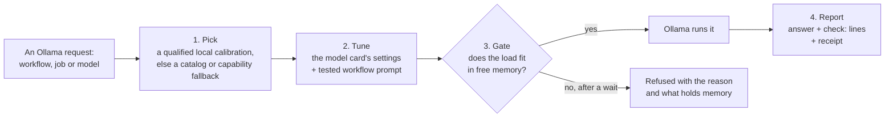
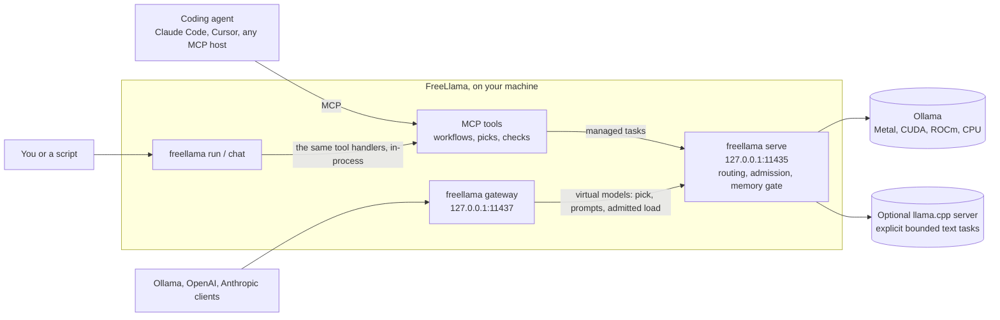
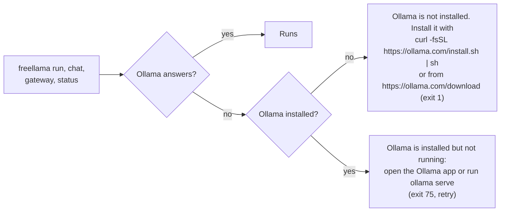
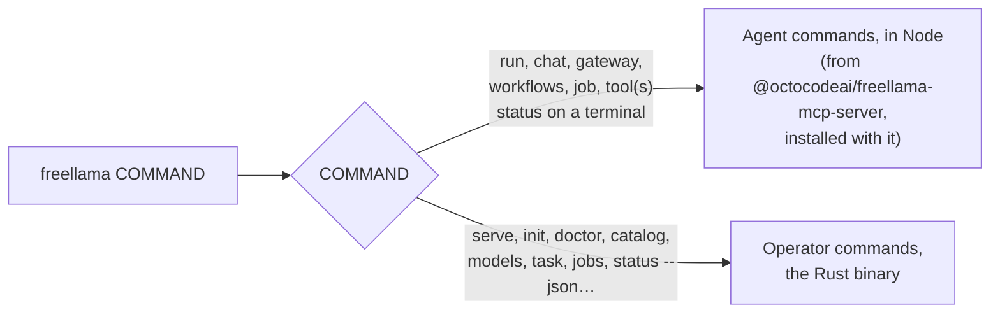
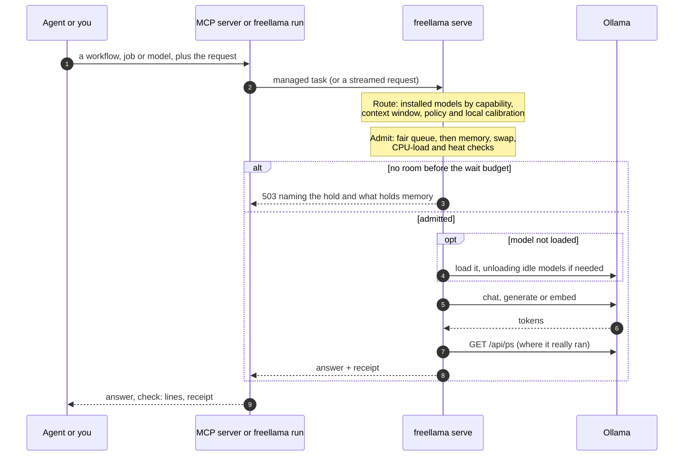

# FreeLlama


**Run local Ollama models the smart way: the right model for your machine right now, tuned
prompts, and new loads held until they fit in memory, for your coding agent and for you.**

FreeLlama sits between you (or your agent) and [Ollama](https://ollama.com). Ollama runs the
models; FreeLlama decides which model, how, and whether there is room for it.

An optional [managed llama.cpp engine](docs/LLAMACPP.md) also supports explicitly selected,
bounded text tasks through the Rust service. Automatic model selection, workflows and lifecycle
management still use Ollama. See the [current assessment](docs/ASSESSMENT.md) for ratings,
validation coverage and remaining gaps.

**In numbers** ([benchmark](docs/BENCHMARK.md), one Apple M2 Pro, 2026-11-14):

| | Measured |
|---|---|
| Speed | 274 ms median per task against 272 ms for Ollama alone; first streamed token 95 vs 93 ms |
| Cost of the layer | 3.7 ms per task (p95 9.8 ms), 9.7 ms of CPU, 26–31 MB of RAM |
| Answers | Built-in workflow prompts passed 45/46 completed graded cases (98%; 45/48 planned, 94%), against 25/48 (52%) for one-line prompts; mean output used 36% fewer tokens |
| Memory | A 7.2 GB load with 4.2 GB free was refused with the programs holding memory, instead of swapping |



| You are | Use | It feels like |
|---|---|---|
| A coding agent (Claude Code, Cursor, Codex, any MCP host) | The **MCP server** | Tools such as `run_task {workflow:"fix-bug", files:[…]}` |
| A person, a script, or an agent with only a shell | **`freellama run`** and **`chat`** | `ollama run`, with workflows, files and memory safety |
| Any Ollama, OpenAI or Anthropic client (the `ollama` CLI, Continue, opencode, Open WebUI, SDKs) | **`freellama gateway`** | A server that lists models such as `freellama/review-code` |



## Why not call Ollama directly?

Ollama runs the tag and settings you request. Choosing well on a shared workstation requires
metadata inspection, host observations and coordination. FreeLlama supplies that layer; the answer
is still yours to check. The [end-to-end review](docs/OLLAMA_REVIEW.md) explains the architecture,
implemented repairs and remaining evidence gaps.

| What goes wrong with a direct call | What FreeLlama does | What we measured |
|---|---|---|
| **The wrong model for this machine.** A tag name says nothing about capability, context or memory. One load too many and the machine starts swapping. | Uses a qualifying [machine-local route](docs/MODEL_SELECTION.md#turn-measurements-into-routing-evidence) first, then catalog or capability fallbacks. Throughput does not prove quality. A load that does not fit waits, then is refused with the reason and the programs holding the memory. | With 6.5 GB free, a code review moved from a 10 GB model to one that fit. A yes/no question ran on a 1.2 GB decision model instead of a 14.5 GB one that would have been refused. |
| **Default settings waste tokens.** Thinking models reason before every answer. Small models pad their output. | Applies each model card's documented sampling and think setting, plus step-by-step workflow prompts that were tested on the models. | A direct call spent 61 tokens (0.92 s) thinking before answering "OK"; FreeLlama answered in 2 tokens (0.47 s). Workflow prompts passed 45/46 completed cases against 25/48 for one-line prompts. |
| **No way to tell a good answer from a bad one.** Answers loop, pad, invent facts, or come back empty. | Returns `check:` lines for filler, numbers or quoted text absent from the source, and edits that do not match the file, plus execution receipts. [Measured misses and false alarms](docs/RELIABILITY.md) remain visible; clean checks do not prove accuracy. | An empty "thinking-only" answer exits 1 with the fix (`--think=false`) instead of looking like success. |

Over a session it also keeps the machine efficient:

| Mechanism | Effect | Measured |
|---|---|---|
| **Prompt cache kept** | Reuses a loaded model's context window and settings, so Ollama's prompt cache survives between turns | A second question about a 3,144-token document took 5.1 s instead of 11.9 s (attention models; Ollama does not cache hybrid models such as `lfm3` across turns) |
| **Managed local admission** | Managed Ollama loads, including streams, pass the memory gate; managed llama.cpp tasks reserve their configured memory budget. Direct engine calls and external server startup are outside this gate | — |
| **Indexed code search** | A repeated search embeds only the chunks that changed | `packages/mcp/src`: 55.9 s first, 0.13 s next |
| **Long tasks as jobs** | A long task returns a job id at once; the agent polls and stays free | Job id in 29 ms; an interactive task behind 8 queued ones answered in 1.40 s instead of 3.52 s |

*Measured on one Apple M2 Pro (32 GB) with Ollama 0.40.15 on 2026-11-14 (the thinking example on
2026-11-10). These are single-machine results, not general speed claims; method and limits:
[Benchmark](docs/BENCHMARK.md).*

The name means less metered inference, not only Meta's Llama models.

## Requirements

| You need | Why |
|---|---|
| [Ollama](https://ollama.com/download) running (`ollama list` works) with at least one model | Required for the agent workflows below. FreeLlama never downloads a model without your approval. Only the one-line installer offers to install Ollama, and only after asking you |
| Node.js 22 or newer | Runs the MCP server, the agent commands (`run`, `chat`, `gateway`…) and the npm launcher |
| One of the platforms below | npm installs the matching prebuilt binary as an optional dependency; do not install with `--omit=optional` |

| Platform | Prebuilt package |
|---|---|
| macOS, Apple silicon (arm64) | `@octocodeai/freellama-native-darwin-arm64` |
| Linux x64, glibc | `@octocodeai/freellama-native-linux-x64-gnu` |
| Linux arm64, glibc | `@octocodeai/freellama-native-linux-arm64-gnu` |
| Windows x64 | `@octocodeai/freellama-native-win32-x64-msvc` |
| Windows arm64 | `@octocodeai/freellama-native-win32-arm64-msvc` |

Intel Macs and musl Linux (such as Alpine) have no prebuilt binary: [build from source](docs/BUILD_AND_NOTES.md#build-from-source)
with Rust 1.89 or newer. A second, CPU-only Ollama for small helper models is optional
([CPU/GPU routing](docs/CPU_GPU_ROUTING.md)).

Published npm installs on supported platforms use prebuilt Rust binaries; they need Node 22+,
not a Rust toolchain. Source builds need Rust and, for the agent commands and MCP, Node. The
[explicit llama.cpp operator path](docs/LLAMACPP.md) can run without Ollama; `run`, `chat`,
`gateway` and global readiness still depend on Ollama.

When Ollama is missing, every command that needs it stops at once and says what to do:



## Install

One line installs FreeLlama and, if you agree, Ollama:

| System | Command |
|---|---|
| macOS, Linux | `curl -fsSL https://raw.githubusercontent.com/bgauryy/FreeLlama/main/scripts/install.sh \| sh` |
| Windows (PowerShell) | `irm https://raw.githubusercontent.com/bgauryy/FreeLlama/main/scripts/install.ps1 \| iex` |

It installs the npm package when npm is on PATH, otherwise the checksum-verified binary. When
Ollama is missing it asks before running Ollama's official installer; add `sh -s -- --with-ollama`
or `sh -s -- --no-ollama` to decide up front. It never downloads a model:
run `freellama init` next to see what is installed and what fits.

Or install one part yourself:

| For | Install | Then |
|---|---|---|
| Your agent (Claude Code) | `claude mcp add freellama -- npx -y @octocodeai/freellama-mcp-server` | Ask the agent in plain words |
| Your agent (Claude Desktop, Cursor, other hosts) | `{ "mcpServers": { "freellama": { "command": "npx", "args": ["-y", "@octocodeai/freellama-mcp-server"] } } }` | Same |
| You, scripts, shell-only agents, operators | `npm install -g @octocodeai/freellama` | `freellama run`, `chat`, `gateway`, `serve`, `doctor`… |
| Operators without Node.js | `cargo install freellama-cli` (Rust 1.89+) | The operator commands only (`serve`, `doctor`, `catalog`…) |

One `freellama` command covers both halves; the npm launcher sends each command to the right one:



| Note | Detail |
|---|---|
| Agent commands on npm | From 0.11.0. From a checkout: `yarn install && yarn build && node packages/cli/bin/freellama.js run --help` |
| Without installing | Prefix any command with `npx @octocodeai/freellama` |
| The service | The MCP server and the agent commands start `freellama serve` on `127.0.0.1:11435` if none is running. Neither installs or starts Ollama |
| `delegate_research` | Reads only the directories in `FREELLAMA_MCP_ALLOWED_ROOTS` (`:`-separated; `;` on Windows), for example `claude mcp add freellama -e FREELLAMA_MCP_ALLOWED_ROOTS=/absolute/path/to/your-project -- npx -y @octocodeai/freellama-mcp-server`. `run_task` `files` uses `FREELLAMA_FILE_ROOTS` instead |
| Every setting | [MCP configuration](packages/mcp/CONFIGURATION.md) |

## Quick start

### From your agent

Ask in plain words; the agent picks the tool:

- "Use FreeLlama to summarize these 40 log files with a local model, then check three summaries."
- "Read this screenshot with a local OCR model."
- "Find where CLI flags are parsed in src/, using a local embedding model."

Or name a workflow. FreeLlama then picks the model and gives it step-by-step instructions:

```jsonc
{ "tool": "run_task", "arguments": { "workflow": "fix-bug", "files": ["src/parser.ts"], "prompt": "drops the last token" } }
{ "tool": "models",   "arguments": { "view": "catalog", "job": "coding" } }
```

| Call | Returns |
|---|---|
| `models {view:"catalog", job}` | Shipped recommendations for a job, with current installation and estimated fit; automatic execution can use a qualifying local calibration first |
| `run_task {preview:true}` | The route, without running or reserving anything |

### From the terminal

`freellama run` takes the same flags as `ollama run`. It streams tokens on a terminal and prints
only the answer in a pipe.

```bash
freellama catalog                                          # catalog recommendations: installed, estimated fit
git diff | freellama run -w summarize-diff                 # review summary from the pick that fits
freellama run -w fix-bug -f src/parser.ts "drops the last token"
freellama run --ask "Is a refund requested?" < ticket.txt  # a yes/no answer with its probability
freellama run -j find-code -f 'src/**/*.ts' "where are CLI flags parsed"
freellama chat review-code                                 # the real ollama chat, on a workflow
freellama status                                           # memory, queues, loaded models, jobs
```

| Stream | Carries |
|---|---|
| stdout | The answer only |
| stderr | `check:` lines (read them before you rely on the answer) and notes |

| Exit code | Meaning |
|---|---|
| 0 | Answered |
| 75 | Busy, short of memory, or Ollama stopped; retry later. stderr says when |
| 1 | Refused, failed, empty, or Ollama not installed |
| 2 | Usage error |
| 130 | Interrupted |

Model management stays with Ollama: `ollama list`, `ollama pull`, `ollama rm`.

### From any Ollama, OpenAI or Anthropic client

```bash
freellama gateway                                          # 127.0.0.1:11437
OLLAMA_HOST=127.0.0.1:11437 ollama run freellama/explain-code
```

| Client | Point it at | Model |
|---|---|---|
| Ollama (CLI, Open WebUI, Continue…) | `OLLAMA_HOST=127.0.0.1:11437` | `freellama/review-code`, or any installed tag |
| OpenAI Chat and Responses (Codex) | base URL `http://127.0.0.1:11437/v1` | `freellama/review-code` |
| Anthropic Messages (Claude Code) | `ANTHROPIC_BASE_URL=http://127.0.0.1:11437` | `freellama/review-code` |

Each workflow is a model; responses stream token by token. Real tags pass through to Ollama with
FreeLlama's admission and telemetry.

## What you get

| Area | What it does | Where |
|---|---|---|
| **Model choice** | A qualifying machine-local Rust route takes priority over the shipped catalog. Capable workflows and OCR also require task-quality evidence for that route; otherwise catalog and capability fallbacks apply. The receipt names the selection and any caveats | [Model selection](docs/MODEL_SELECTION.md), `freellama catalog`, `models {view:"catalog"}` |
| **Second engine** | Explicit local llama.cpp text tasks share the Rust admission pools and resource governor. The operator starts the server and supplies context, output and memory bounds; placement remains unverified | [Managed llama.cpp](docs/LLAMACPP.md) |
| **Streaming with receipts** | Managed Ollama tasks stream tokens as server-sent events (`route`, `admission`, `delta`, then `done` with the full receipt); measured first token 95 vs 93 ms for direct Ollama. MCP shows "generating on MODEL: N tokens, R tok/s" while a job runs | `POST /_freellama/v1/tasks {stream:true}`, [Every API](docs/API.md) |
| **Where the time went** | Each receipt's `timing` splits a task by phase (discover, admission, Ollama's answer, placement, learning…) and gives FreeLlama's own `overhead_ms` | `--json`, `response_file`, [Architecture](docs/ARCHITECTURE.md#request-shapes) |
| **Workflows** | 15 tested instructions for small models: `fix-bug`, `change-code`, `implement`, `write-tests`, `review-code`, `explain-code`, `summarize-log`, `summarize-text`, `summarize-diff`, `extract-json`, `read-text`, `read-table`, `read-fields`, `answer-image`, `describe-screen`. Sampling comes from each model's card; the dated eval reports 45/46 completed passes against 25/48 for one-line prompts, with [denominators and limits](docs/BENCHMARK.md#built-in-prompts-measured) | `-w NAME`, `run_task {workflow}`, `scripts/local-test/workflows.mjs` |
| **Your own workflows** | A Markdown file per workflow (job, title, instructions) in `~/.octocode/freellama/workflows/`. It runs like a built-in, replaces one of the same name, and the receipt names the file and its digest; a bad file is skipped with the reason | [Your own workflows](docs/PROMPTS.md#your-own-workflows), `freellama workflows` |
| **Fallback chains** | Up to 4 models to try in order, each only after the one before was refused before it ran (no room, input over its context, not installed). Never after a model started; every attempt is in the receipt | `run_task {fallbackModels}`, `--fallback TAG` |
| **Structured output** | A field list (`'name, age int, tags list'`) or a JSON schema | `--schema` |
| **Decisions** | Yes/no, one of a list, or a level, with a probability | `--ask`, `--choice`, `--level` |
| **Embeddings and completion** | Shorter vectors; fill-in-the-middle on models that support it | `--dimensions`, `--suffix` |
| **Checkable answers** | Heuristics flag some padding, numbers or quoted text absent from the source, invalid edits, leaked thinking, input instructions, empty extraction fields and malformed tool calls. They miss errors and produce false alarms; a clean result still needs verification. Receipts distinguish configured from observed placement | stderr; MCP `response_file`; [measured reliability and limits](docs/RELIABILITY.md) |
| **Memory safety** | A model loads only if it fits with a reserve; idle models unload first, otherwise the load waits, then is refused with the reason | [The memory gate](docs/ARCHITECTURE.md#managed-task-execution) |
| **Fair sharing** | One queue per backend weights interactive, normal and background work 3:2:1; holds apply when the machine is busy, hot or swapping. An optional CPU-only Ollama runs helper models beside the GPU | [Monitoring](docs/MONITORING.md) |
| **Long answers** | Saved whole and returned as a short view | [Where an answer goes](packages/mcp/CONFIGURATION.md#where-an-answer-goes) |
| **Batches and jobs** | Up to 64 independent items; background jobs, optionally with durable receipts and idempotency keys; sweeps over a whole code tree or log set | `--each`, `run_task {tasks}`, `--defer` + `freellama job ID --wait`, `idempotencyKey`, `sweep` |
| **Agent-safe shell** | Answer-only stdout, stable exit codes, no hang on an agent's open stdin; every MCP tool callable from a shell | `freellama tool NAME JSON` |

## What to offload

Offload bounded work whose result can be checked. Keep judgment in the agent.

| Offload | Keep in your agent |
|---|---|
| Embeddings, code search and deduplication | Small lookups (describing the task costs more than doing it) |
| OCR and image reading | High-stakes judgment: security review, design, merge decisions |
| Bulk rewrites, summaries, classification of many files | Edits across files |
| Questions about workspace files (`delegate_research`) | Final verification of any local answer |

Treat local answers as candidates: spot-check a few before you rely on the rest.

## How it compares

Model loading, eviction, compatible APIs, MCP and presets are common. Ollama itself queues work and
evicts idle models; the llama.cpp router, llama-swap, LocalAI, Lemonade, LM Studio and oMLX each
manage model memory their own way. FreeLlama adds a specific combination for an agent offloading
work on a machine that is also doing other work:

- admission against live host signals (free memory with a reserve, OS pressure, swap, CPU load,
  heat) that holds a cold load but lets a loaded model keep serving;
- per-job selection using qualifying local calibration, with catalog fallbacks and tested workflow prompts;
- compact answers with `check:` lines and a receipt of what ran, where and why.

| Choose | When |
|---|---|
| FreeLlama | An agent offloads bounded, checkable work to local Ollama models on a shared workstation |
| Ollama alone | One application, one explicitly chosen model, little contention |
| LocalAI, Lemonade | You want the server to supply agents, many backends or routing policies itself |
| LM Studio, Open WebUI | You want a desktop or web app for people |
| LiteLLM | An organization-wide gateway with retries, budgets and caching across providers |
| llama.cpp, oMLX, vLLM | You want engine-level control: batching, KV caches, kernels |

FreeLlama does not make Ollama decode faster, has no chat UI, no automatic failover between engines
and no scheduling across machines. It does not automatically escalate failed checks to a cloud
model; the caller owns that decision. The second engine is currently limited to explicit text tasks.

### Benchmarks

Ollama alone, FreeLlama on Ollama, and the most popular alternatives by GitHub stars, on one task
and one hash-verified model file (Apple M2 Pro, 32 GB, 2026-11-14). All 300 answers were correct.


| | Ollama | **FreeLlama** | llama.cpp | LocalAI | llama-swap |
|---|---:|---:|---:|---:|---:|
| Median task time | 272 ms | **274 ms** | 336 ms | 802 ms | 332 ms |
| First token | 93 ms | **95 ms** | 128 ms | 541 ms | 130 ms |
| Tasks/min, 4 clients | 225 | **221** | 291 | 145 | 305 |

FreeLlama keeps Ollama's speed and adds what an agent needs on a shared machine:


The historical charts use completed-case accuracy: 45/46 (98%) for workflow prompts. Relative to
the nominal 48 planned cases, that is 45/48 (94%), with two completions missing from the retained
aggregate; the baseline is 25/48 (52%). This small public workload does not estimate general accuracy.

llama.cpp and llama-swap serve concurrent clients faster with Ollama's default settings, and
LocalAI trades speed for breadth. What to use for what you are building, and how every number was
measured: [Benchmark](docs/BENCHMARK.md).

## Under the hood

Every managed request, whether from MCP, the agent commands, the operator CLI or the HTTP API, goes through the same
Rust core: route, admit, load, run, observe. Nothing is decided from a model's name.

| Owner | Does |
|---|---|
| Your agent, or you | Decides what to run, writes the request, verifies the answer |
| FreeLlama | Picks the model, queues fairly, checks memory and host signals, coordinates loads, writes the receipt |
| Ollama, or the explicitly configured llama.cpp server | Executes inference; Ollama also supplies discovery, lifecycle operations and observed placement |

The sequence below shows the default Ollama workflow. The [llama.cpp guide](docs/LLAMACPP.md)
describes its narrower execution path and unsupported controls.



An explicit `model` always wins over routing; FreeLlama never swaps in another model unless you
list one in `fallbackModels`. The memory
gate, admission and routing are described in [Architecture](docs/ARCHITECTURE.md).

## Safety

- Never pulls a model without approval for one exact tag and its size. Never deletes one unless you
  name the exact installed tag.
- Never swaps in another model on its own: an explicit `model` always wins, and a `fallbackModels`
  chain moves on only after a refusal before execution, so no work is replayed.
- Checks each load against live free memory. A load that does not fit waits, then is refused with
  the reason; models already loaded keep serving.
- Unloads only models it loaded, or models you name. Idle models are unloaded under memory pressure.
- Holds CPU-bound work on a busy or hot machine and names the signal in the receipt.
- Binds to loopback. The gateway refuses browser requests from other origins and rebound DNS names.
  Over HTTP it reads no files and fetches no URLs. For remote access, see
  [Production](docs/PRODUCTION.md).

## Documentation

| Topic | Page |
|---|---|
| All guides | [Documentation index](docs/README.md) |
| Current ratings, evidence and remaining priorities | [Assessment](docs/ASSESSMENT.md) |
| End-to-end feature review and Ollama resource strategy | [Ollama review](docs/OLLAMA_REVIEW.md) |
| Every API on one page: MCP tools, agent commands, gateway, CLI, control API | [Every API](docs/API.md) |
| `freellama run`, `chat`, `gateway`: flags, virtual models, endpoints | [Agent commands](docs/AGENT_CLI.md) |
| Operator commands (`serve`, `doctor`, `catalog`…) and flags | [CLI](docs/CLI.md) |
| MCP tools, schemas, configuration | [MCP reference](packages/mcp/README.md), [MCP configuration](packages/mcp/CONFIGURATION.md) |
| Operating procedure for agents | [FreeLlama skill](skills/freellama/SKILL.md) |
| Features, routing and admission in depth | [Features](docs/FEATURES.md) |
| Actual vendor checks, numbers, limits and protocol | [Benchmark](docs/BENCHMARK.md) |
| Choosing a model | [Model selection](docs/MODEL_SELECTION.md), [local model catalog](docs/LOCAL_MODELS.md) |
| Explicit bounded text tasks on a second engine | [Managed llama.cpp](docs/LLAMACPP.md) |
| Check accuracy and public local-model tool-calling results | [Reliability](docs/RELIABILITY.md) |
| Model forms, measured results | [Model forms and results](docs/MODEL_FORMS_AND_RESULTS.md) |
| Recipes per job | [Cookbooks](docs/cookbooks/README.md) |
| CPU/GPU setup and placement | [CPU/GPU routing](docs/CPU_GPU_ROUTING.md) |
| Queues, memory, live tuning | [Monitoring](docs/MONITORING.md) |
| Faster, lighter local models; Ollama settings | [Tuning](docs/TUNING.md) |
| Background jobs, durable receipts and idempotency | [Deferred jobs](docs/DEFERRED_JOBS.md) |
| Writing your own workflows | [Local prompts](docs/PROMPTS.md#your-own-workflows) |
| History, affinity, warming | [Scopes and warming](docs/SCOPES_AND_WARMING.md) |
| Deployment and releases | [Production](docs/PRODUCTION.md) |
| Build from source, tests and evals | [Build and notes](docs/BUILD_AND_NOTES.md), [Testing](docs/TESTING.md) |
| Production panic/lock review and Windows memory evidence | [Rust resource audit](docs/RUST_RESOURCE_AUDIT.md) |
| Architecture and ownership | [Architecture](docs/ARCHITECTURE.md) |
| Embedding the Rust core | [Rust core](packages/rust-core/README.md) |

## License

Copyright (c) 2026 Guy Bary. Licensed under [Apache-2.0](LICENSE-APACHE) or [MIT](LICENSE-MIT),
at your option.
