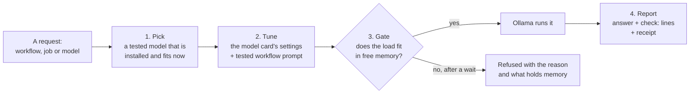
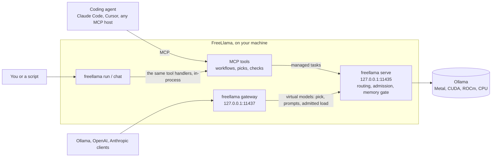
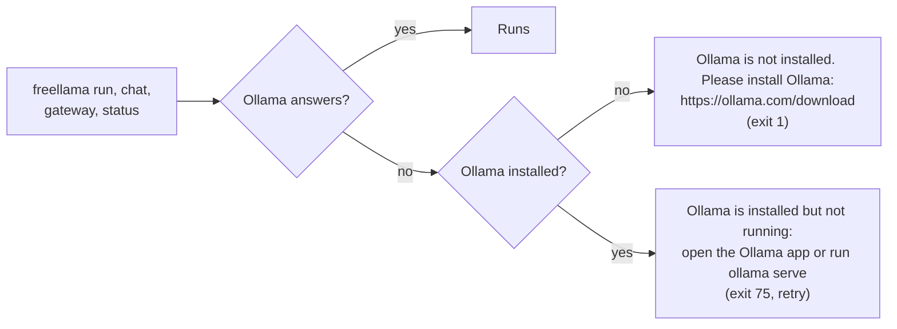
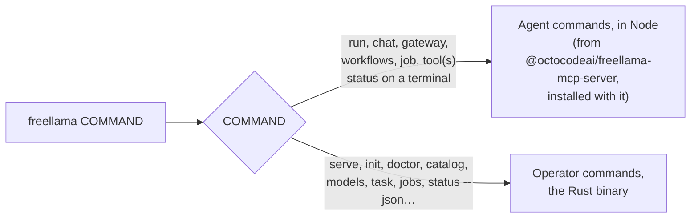

# FreeLlama


**Run local Ollama models the smart way: the right model for your machine right now, tuned
prompts, and new loads held until they fit in memory, for your coding agent and for you.**

FreeLlama sits between you (or your agent) and [Ollama](https://ollama.com). Ollama runs the
models; FreeLlama decides which model, how, and whether there is room for it.



| You are | Use | It feels like |
|---|---|---|
| A coding agent (Claude Code, Cursor, Codex, any MCP host) | The **MCP server** | Tools such as `run_task {workflow:"fix-bug", files:[…]}` |
| A person, a script, or an agent with only a shell | **`freellama run`** and **`chat`** | `ollama run`, with workflows, files and memory safety |
| Any Ollama, OpenAI or Anthropic client (the `ollama` CLI, Continue, opencode, Open WebUI, SDKs) | **`freellama gateway`** | A server that lists models such as `freellama/review-code` |



## Why not call Ollama directly?

Ollama runs whatever tag you name, with the model's default settings. Three things go wrong that a
caller cannot see. FreeLlama addresses each one; the answer is still yours to check.

| What goes wrong with a direct call | What FreeLlama does | What we measured |
|---|---|---|
| **The wrong model for this machine.** A tag name says nothing about capability, context or memory. One load too many and the machine starts swapping. | Picks the tested model for the job that is installed *and fits now*. A load that does not fit waits, then is refused with the reason and the programs holding the memory. | With 6.5 GB free, a code review moved from a 10 GB model to one that fit. A yes/no question ran on a 1.2 GB decision model instead of a 14.5 GB one that would have been refused. |
| **Default settings waste tokens.** Thinking models reason before every answer. Small models pad their output. | Applies each model card's documented sampling and think setting, plus step-by-step workflow prompts that were tested on the models. | A direct call spent 61 tokens (0.92 s) thinking before answering "OK"; FreeLlama answered in 2 tokens (0.47 s). On the workflow eval, the 1.7B model went from 7 of 12 to 11 of 12. |
| **No way to tell a good answer from a bad one.** Answers loop, pad, invent facts, or come back empty. | Returns `check:` lines (filler, invented facts, edits that do not match the file) and a receipt with the model, timing, cache hits and GPU/CPU placement. | An empty "thinking-only" answer exits 1 with the fix (`--think=false`) instead of looking like success. |

Over a session it also keeps the machine efficient:

| Mechanism | Effect | Measured |
|---|---|---|
| **Prompt cache kept** | Reuses a loaded model's context window and settings, so Ollama's prompt cache survives between turns | 95% of a multi-turn prompt served from cache (attention models; Ollama does not cache hybrid models such as `lfm3` across turns) |
| **Admitted loads only** | Every model load through FreeLlama, streamed requests included, goes through the memory gate (direct calls to Ollama bypass it) | — |
| **Indexed code search** | A repeated search embeds only the chunks that changed | 89 chunks: 7.3 s first, 0.28 s next |
| **Fast hand-off** | The service answers the moment a job is done | A short task on a loaded model in about 0.2 s |

*Measured on one Apple M2 Pro (32 GB) with Ollama 0.40.15, on 2026-11-10. These are single-machine
results, not general speed claims. Method and numbers: [Comparison](docs/COMPARISON.md) and
[Testing](docs/TESTING.md).*

The name means less metered inference, not only Meta's Llama models.

## Requirements

| You need | Why |
|---|---|
| [Ollama](https://ollama.com/download) running (`ollama list` works) with at least one model | FreeLlama manages Ollama. It does not install, start or replace Ollama, and it never downloads a model without your approval |
| Node.js 22 or newer | Runs the MCP server, the agent commands (`run`, `chat`, `gateway`…) and the npm launcher |
| One of the platforms below | npm installs the matching prebuilt binary as an optional dependency; do not install with `--omit=optional` |

| Platform | Prebuilt package |
|---|---|
| macOS, Apple silicon (arm64) | `@octocodeai/freellama-native-darwin-arm64` |
| Linux x64, glibc | `@octocodeai/freellama-native-linux-x64-gnu` |
| Linux arm64, glibc | `@octocodeai/freellama-native-linux-arm64-gnu` |
| Windows x64 | `@octocodeai/freellama-native-win32-x64-msvc` |
| Windows arm64 | `@octocodeai/freellama-native-win32-arm64-msvc` |

Intel Macs and musl Linux (such as Alpine) have no prebuilt binary: [build from source](docs/BUILD_AND_NOTES.md#build-from-source)
with Rust 1.89 or newer. A second, CPU-only Ollama for small helper models is optional
([CPU/GPU routing](docs/CPU_GPU_ROUTING.md)).

When Ollama is missing, every command that needs it stops at once and says what to do:



## Install

| For | Install | Then |
|---|---|---|
| Your agent (Claude Code) | `claude mcp add freellama -- npx -y @octocodeai/freellama-mcp-server` | Ask the agent in plain words |
| Your agent (Claude Desktop, Cursor, other hosts) | `{ "mcpServers": { "freellama": { "command": "npx", "args": ["-y", "@octocodeai/freellama-mcp-server"] } } }` | Same |
| You, scripts, shell-only agents, operators | `npm install -g @octocodeai/freellama` | `freellama run`, `chat`, `gateway`, `serve`, `doctor`… |
| Operators without Node.js | `cargo install freellama-cli` (Rust 1.89+) | The operator commands only (`serve`, `doctor`, `catalog`…) |

One `freellama` command covers both halves; the npm launcher sends each command to the right one:



| Note | Detail |
|---|---|
| Agent commands on npm | From 0.11.0. From a checkout: `yarn install && yarn build && node packages/cli/bin/freellama.js run --help` |
| Without installing | Prefix any command with `npx @octocodeai/freellama` |
| The service | The MCP server and the agent commands start `freellama serve` on `127.0.0.1:11435` if none is running. Neither installs or starts Ollama |
| `delegate_research` | Reads only the directories in `FREELLAMA_MCP_ALLOWED_ROOTS` (`:`-separated; `;` on Windows), for example `claude mcp add freellama -e FREELLAMA_MCP_ALLOWED_ROOTS=/absolute/path/to/your-project -- npx -y @octocodeai/freellama-mcp-server`. `run_task` `files` uses `FREELLAMA_FILE_ROOTS` instead |
| Every setting | [MCP configuration](packages/mcp/CONFIGURATION.md) |

## Quick start

### From your agent

Ask in plain words; the agent picks the tool:

- "Use FreeLlama to summarize these 40 log files with a local model, then check three summaries."
- "Read this screenshot with a local OCR model."
- "Find where CLI flags are parsed in src/, using a local embedding model."

Or name a workflow. FreeLlama then picks the model and gives it step-by-step instructions:

```jsonc
{ "tool": "run_task", "arguments": { "workflow": "fix-bug", "files": ["src/parser.ts"], "prompt": "drops the last token" } }
{ "tool": "models",   "arguments": { "view": "catalog", "job": "coding" } }
```

| Call | Returns |
|---|---|
| `models {view:"catalog", job}` | The tested picks for a job: installed or not, fits now or not |
| `run_task {preview:true}` | The route, without running or reserving anything |

### From the terminal

`freellama run` takes the same flags as `ollama run`. It streams tokens on a terminal and prints
only the answer in a pipe.

```bash
freellama catalog                                          # tested picks per job: installed, fits now
git diff | freellama run -w summarize-diff                 # review summary from the pick that fits
freellama run -w fix-bug -f src/parser.ts "drops the last token"
freellama run --ask "Is a refund requested?" < ticket.txt  # a yes/no answer with its probability
freellama run -j find-code -f 'src/**/*.ts' "where are CLI flags parsed"
freellama chat review-code                                 # the real ollama chat, on a workflow
freellama status                                           # memory, queues, loaded models, jobs
```

| Stream | Carries |
|---|---|
| stdout | The answer only |
| stderr | `check:` lines (read them before you rely on the answer) and notes |

| Exit code | Meaning |
|---|---|
| 0 | Answered |
| 75 | Busy, short of memory, or Ollama stopped; retry later. stderr says when |
| 1 | Refused, failed, empty, or Ollama not installed |
| 2 | Usage error |
| 130 | Interrupted |

Model management stays with Ollama: `ollama list`, `ollama pull`, `ollama rm`.

### From any Ollama, OpenAI or Anthropic client

```bash
freellama gateway                                          # 127.0.0.1:11437
OLLAMA_HOST=127.0.0.1:11437 ollama run freellama/explain-code
```

| Client | Point it at | Model |
|---|---|---|
| Ollama (CLI, Open WebUI, Continue…) | `OLLAMA_HOST=127.0.0.1:11437` | `freellama/review-code`, or any installed tag |
| OpenAI Chat and Responses (Codex) | base URL `http://127.0.0.1:11437/v1` | `freellama/review-code` |
| Anthropic Messages (Claude Code) | `ANTHROPIC_BASE_URL=http://127.0.0.1:11437` | `freellama/review-code` |

Each workflow is a model; responses stream token by token. Real tags pass through to Ollama with
FreeLlama's admission and telemetry.

## What you get

| Area | What it does | Where |
|---|---|---|
| **Model choice** | Tested picks per job (coding, summarizing, OCR, image questions, classification, code search, duplicates), each marked installed or not and fitting now or not. Strong-model workflows take the strongest pick that fits, light work the job's default; short memory falls back to a model that fits | `freellama catalog`, `models {view:"catalog"}` |
| **Workflows** | 15 tested instructions for small models: `fix-bug`, `change-code`, `implement`, `write-tests`, `review-code`, `explain-code`, `summarize-log`, `summarize-text`, `summarize-diff`, `extract-json`, `read-text`, `read-table`, `read-fields`, `answer-image`, `describe-screen`. Sampling comes from each model's card; prompts are checked by an eval | `-w NAME`, `run_task {workflow}`, `scripts/local-test/workflows.mjs` |
| **Your own workflows** | A Markdown file per workflow (job, title, instructions) in `~/.octocode/freellama/workflows/`. It runs like a built-in, replaces one of the same name, and the receipt names the file and its digest; a bad file is skipped with the reason | [Your own workflows](docs/PROMPTS.md#your-own-workflows), `freellama workflows` |
| **Fallback chains** | Up to 4 models to try in order, each only after the one before was refused before it ran (no room, input over its context, not installed). Never after a model started; every attempt is in the receipt | `run_task {fallbackModels}`, `--fallback TAG` |
| **Structured output** | A field list (`'name, age int, tags list'`) or a JSON schema | `--schema` |
| **Decisions** | Yes/no, one of a list, or a level, with a probability | `--ask`, `--choice`, `--level` |
| **Embeddings and completion** | Shorter vectors; fill-in-the-middle on models that support it | `--dimensions`, `--suffix` |
| **Checkable answers** | `check:` lines flag padding, numbers or names missing from the source, edits that do not match the file, leaked `<think>` text, instructions hidden in the input, and fields an extraction left empty. Receipts record the model and why, queue and load times, tokens (cached ones too) and GPU or CPU placement | stderr; MCP `response_file` ([local prompts](docs/PROMPTS.md)) |
| **Memory safety** | A model loads only if it fits with a reserve; idle models unload first, otherwise the load waits, then is refused with the reason | [The memory gate](docs/ARCHITECTURE.md#managed-task-execution) |
| **Fair sharing** | One queue per backend weights interactive, normal and background work 3:2:1; holds apply when the machine is busy, hot or swapping. An optional CPU-only Ollama runs helper models beside the GPU | [Monitoring](docs/MONITORING.md) |
| **Long answers** | Saved whole and returned as a short view | [Where an answer goes](packages/mcp/CONFIGURATION.md#where-an-answer-goes) |
| **Batches and jobs** | Up to 64 independent items; background jobs, optionally with durable receipts and idempotency keys; sweeps over a whole code tree or log set | `--each`, `run_task {tasks}`, `--defer` + `freellama job ID --wait`, `idempotencyKey`, `sweep` |
| **Agent-safe shell** | Answer-only stdout, stable exit codes, no hang on an agent's open stdin; every MCP tool callable from a shell | `freellama tool NAME JSON` |

## What to offload

Offload bounded work whose result can be checked. Keep judgment in the agent.

| Offload | Keep in your agent |
|---|---|
| Embeddings, code search and deduplication | Small lookups (describing the task costs more than doing it) |
| OCR and image reading | High-stakes judgment: security review, design, merge decisions |
| Bulk rewrites, summaries, classification of many files | Edits across files |
| Questions about workspace files (`delegate_research`) | Final verification of any local answer |

Treat local answers as candidates: spot-check a few before you rely on the rest.

## How it compares

Model loading, eviction, compatible APIs, MCP and presets are common. Ollama itself queues work and
evicts idle models; the llama.cpp router, llama-swap, LocalAI, Lemonade, LM Studio and oMLX each
manage model memory their own way. FreeLlama adds a specific combination for an agent offloading
work on a machine that is also doing other work:

- admission against live host signals (free memory with a reserve, OS pressure, swap, CPU load,
  heat) that holds a cold load but lets a loaded model keep serving;
- a per-job pick that is installed and fits now, with tested workflow prompts;
- compact answers with `check:` lines and a receipt of what ran, where and why.

| Choose | When |
|---|---|
| FreeLlama | An agent offloads bounded, checkable work to local Ollama models on a shared workstation |
| Ollama alone | One application, one explicitly chosen model, little contention |
| LocalAI, Lemonade | You want the server to supply agents, many backends or routing policies itself |
| LM Studio, Open WebUI | You want a desktop or web app for people |
| LiteLLM | An organization-wide gateway with retries, budgets and caching across providers |
| llama.cpp, oMLX, vLLM | You want engine-level control: batching, KV caches, kernels |

FreeLlama does not make Ollama decode faster, has no chat UI, no automatic failover between engines
and no scheduling across machines. The full comparison, with sources, what is and is not specific
to FreeLlama, and dated measurements, is in [Comparison](docs/COMPARISON.md).

## Under the hood

Every managed request, whether from MCP, the agent commands, the operator CLI or the HTTP API, goes through the same
Rust core: route, admit, load, run, observe. Nothing is decided from a model's name.

| Owner | Does |
|---|---|
| Your agent, or you | Decides what to run, writes the request, verifies the answer |
| FreeLlama | Picks the model, queues fairly, checks memory and host signals, coordinates loads, writes the receipt |
| Ollama | Stores models, loads runners, generates tokens |

```mermaid
sequenceDiagram
    autonumber
    participant A as Agent or you
    participant F as MCP server or freellama run
    participant S as freellama serve
    participant O as Ollama
    A->>F: a workflow, job or model, plus the request
    F->>S: managed task (or a streamed request)
    Note over S: Route: installed models by capability,<br/>context window and fit; the tested pick first
    Note over S: Admit: fair queue, then memory, swap,<br/>CPU-load and heat checks
    alt no room before the wait budget
        S-->>F: 503 naming the hold and what holds memory
    else admitted
        opt model not loaded
            S->>O: load it, unloading idle models if needed
        end
        S->>O: chat, generate or embed
        O-->>S: tokens
        S->>O: GET /api/ps (where it really ran)
        S-->>F: answer + receipt
    end
    F-->>A: answer, check: lines, receipt
```

An explicit `model` always wins over routing; FreeLlama never swaps in another model unless you
list one in `fallbackModels`. The memory
gate, admission and routing are described in [Architecture](docs/ARCHITECTURE.md).

## Safety

- Never pulls a model without approval for one exact tag and its size. Never deletes one unless you
  name the exact installed tag.
- Never swaps in another model on its own: an explicit `model` always wins, and a `fallbackModels`
  chain moves on only after a refusal before execution, so no work is replayed.
- Checks each load against live free memory. A load that does not fit waits, then is refused with
  the reason; models already loaded keep serving.
- Unloads only models it loaded, or models you name. Idle models are unloaded under memory pressure.
- Holds CPU-bound work on a busy or hot machine and names the signal in the receipt.
- Binds to loopback. The gateway refuses browser requests from other origins and rebound DNS names.
  Over HTTP it reads no files and fetches no URLs. For remote access, see
  [Production](docs/PRODUCTION.md).

## Documentation

| Topic | Page |
|---|---|
| All guides | [Documentation index](docs/README.md) |
| Every API on one page: MCP tools, agent commands, gateway, CLI, control API | [Every API](docs/API.md) |
| `freellama run`, `chat`, `gateway`: flags, virtual models, endpoints | [Agent commands](docs/AGENT_CLI.md) |
| Operator commands (`serve`, `doctor`, `catalog`…) and flags | [CLI](docs/CLI.md) |
| MCP tools, schemas, configuration | [MCP reference](packages/mcp/README.md), [MCP configuration](packages/mcp/CONFIGURATION.md) |
| Operating procedure for agents | [FreeLlama skill](skills/freellama/SKILL.md) |
| Features, routing and admission in depth | [Features](docs/FEATURES.md) |
| How it compares, with sources and measurements | [Comparison](docs/COMPARISON.md) |
| Choosing a model | [Model selection](docs/MODEL_SELECTION.md), [local model catalog](docs/LOCAL_MODELS.md) |
| Model forms, measured results | [Model forms and results](docs/MODEL_FORMS_AND_RESULTS.md) |
| Recipes per job | [Cookbooks](docs/cookbooks/README.md) |
| CPU/GPU setup and placement | [CPU/GPU routing](docs/CPU_GPU_ROUTING.md) |
| Queues, memory, live tuning | [Monitoring](docs/MONITORING.md) |
| Faster, lighter local models; Ollama settings | [Tuning](docs/TUNING.md) |
| Background jobs, durable receipts and idempotency | [Deferred jobs](docs/DEFERRED_JOBS.md) |
| Writing your own workflows | [Local prompts](docs/PROMPTS.md#your-own-workflows) |
| History, affinity, warming | [Scopes and warming](docs/SCOPES_AND_WARMING.md) |
| Deployment and releases | [Production](docs/PRODUCTION.md) |
| Build from source, tests and evals | [Build and notes](docs/BUILD_AND_NOTES.md), [Testing](docs/TESTING.md) |
| Architecture and ownership | [Architecture](docs/ARCHITECTURE.md) |
| Embedding the Rust core | [Rust core](packages/rust-core/README.md) |

## License

Copyright (c) 2026 Guy Bary. Licensed under [Apache-2.0](LICENSE-APACHE) or [MIT](LICENSE-MIT),
at your option.
