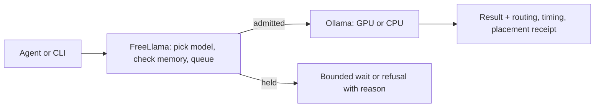
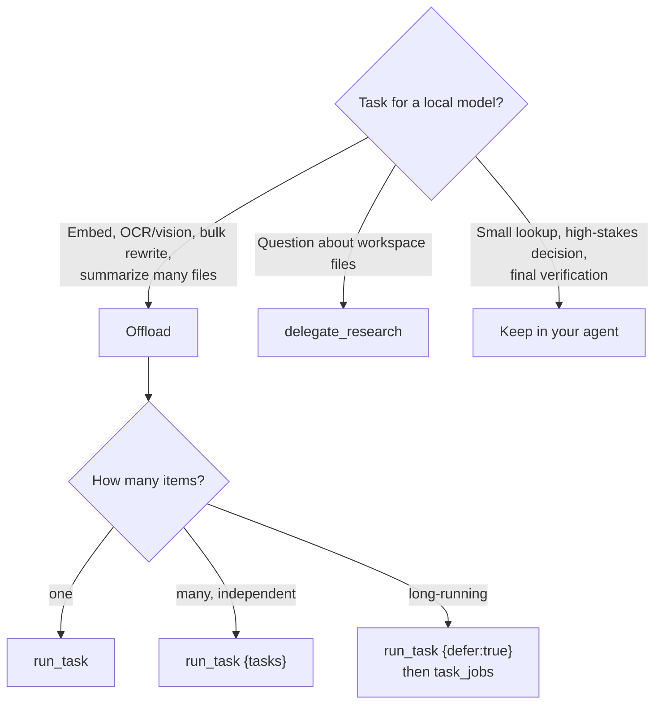
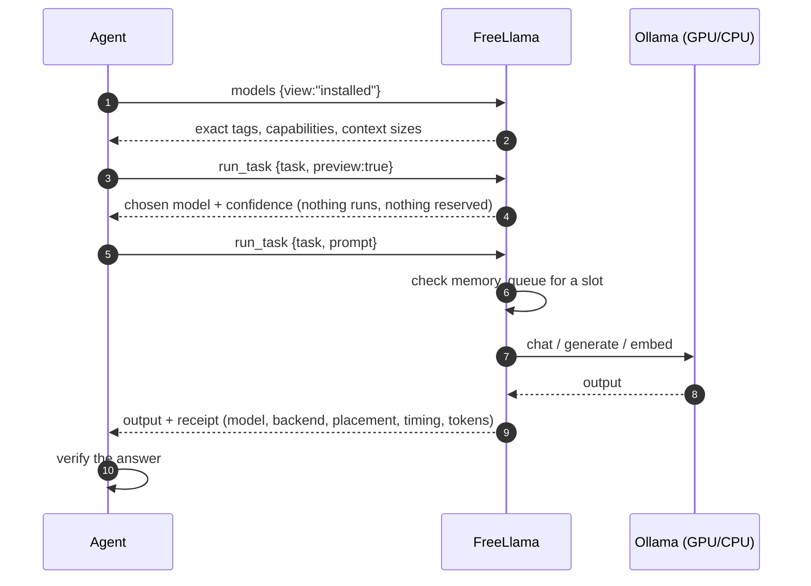
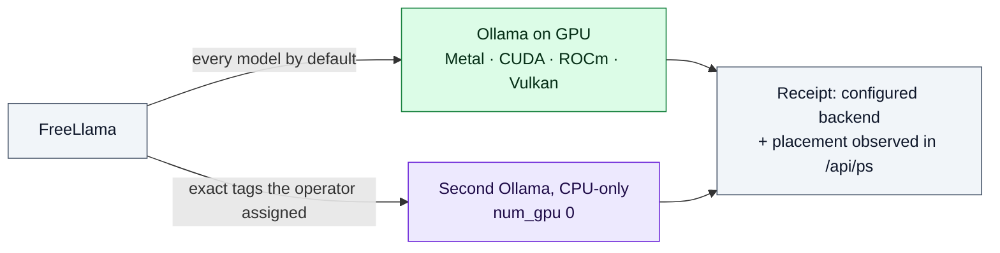

# FreeLlama


**Run your agent's bulk work on local models without overloading your machine.**

FreeLlama sits between an AI agent and [Ollama](https://ollama.com). The agent submits a task.
FreeLlama picks an installed model that fits, admits the task when the machine has room, and runs it
on the GPU or CPU. It returns the result with a receipt of where and how the task ran. Any Ollama
model works.



## Why FreeLlama

Coding agents spend paid tokens and context window on work a local model can do: embedding files,
reading screenshots and scanned pages, rewriting or summarizing many files. Ollama makes those
models easy to run, but an agent that calls it directly is left guessing:

- **Which model?** The agent sees tag names. It does not see which installed model has the
  capabilities, context window and memory footprint the task needs.
- **Is there room now?** A new model load can push the machine into swap, several agents can pile
  requests onto one GPU, and a busy or hot machine slows everything down.
- **Did it work?** A local model can repeat itself until the token cap, and nothing says whether
  the task ran on the GPU or fell back to the CPU.

FreeLlama answers these before and after every task. It routes from installed metadata and observed
behavior, admits work against live memory, CPU, GPU and heat signals, stops runaway repetition, and
returns a receipt the agent can check. The agent keeps the judgment: it decides what to offload and
verifies the answer.

The name refers to reducing reliance on metered inference. Any model Ollama runs works, not only
Meta's Llama family.

## How it compares

FreeLlama is not an inference engine. Ollama loads and runs the model; FreeLlama decides whether,
where and how each task runs, which neither Ollama nor the common local routers do for an agent.
Behavior of the other projects is taken from their own docs and source, checked on 2026-10-29.

| Decision | Other local stacks | FreeLlama |
|---|---|---|
| Can this load fit right now? | Ollama predicts a model's footprint and evicts when it exceeds 80% of free memory; its queue holds 512 requests, then returns 503 ([scheduler](https://github.com/ollama/ollama/blob/main/server/sched.go), [FAQ](https://docs.ollama.com/faq)). The llama.cpp router keeps a fixed 1024 MiB margin per device and loads anyway when nothing can be unloaded ([server docs](https://github.com/ggml-org/llama.cpp/blob/master/tools/server/README.md)). llama-swap has no memory reserve setting ([config](https://github.com/mostlygeek/llama-swap/blob/main/docs/config.example.yaml)); LocalAI caps VRAM by percentage but cannot estimate VRAM before a load ([docs](https://localai.io/docs/advanced/vram-management/)). | Admits each task against live host memory with a reserve sized to the load and unloads idle runners first. Where memory is short it holds or refuses with a reason and a `Retry-After` computed from service time (on macOS, where free memory undercounts reclaimable cache, it admits with a memory advisory). |
| Is the machine busy or hot? | Ollama and the llama.cpp router have no gate on host CPU load or heat. | Holds CPU-bound work and cold loads while the CPUs are saturated or a Mac reports thermal pressure. Inference on a model already resident on the GPU keeps running. |
| Who goes first? | LiteLLM sheds with 429 once a deployment's parallel limit is reached, with an optional priority queue ([routing](https://docs.litellm.ai/docs/routing), [scheduler](https://docs.litellm.ai/docs/scheduler)). | Weighted fair admission per backend (interactive 3 : normal 2 : background 1) with starvation prevention and bounded waits; GPU and CPU pools are separate. |
| Which model? | Ollama runs the tag it is given. LiteLLM picks among deployments by load, latency or cost; RouteLLM trains a strong/weak router ([RouteLLM](https://github.com/lm-sys/RouteLLM)). | Picks an installed model from its capabilities, context window, memory estimate and residency, and ranks a model last for a task kind it keeps looping on. |
| Did it loop? | Ollama aborts some loops with a "token repeat limit" error. | Streams and stops once the output repeats, keeping the text (`stopOnRepetition`), and reports `output_check` on every task. |
| Where did it run? | Ollama reports load and token timings. | Adds a receipt: chosen model and why, queue and resource waits, and the placement Ollama actually reported (`/api/ps`), so a silent CPU fallback is visible. |

Measured on one Apple M2 Pro (32 GB) unless noted:

| Workload | Without | With FreeLlama |
|---|---|---|
| OCR of 12 report strips, `glm-ocr`, 1,500-token cap | 12,948 output tokens, 126 s | `stopOnRepetition`: 6,452 tokens, 69 to 103 s, every label still read |
| Resident GPU tasks during a compiler build | 64 to 120 s waits (host-wide CPU-load hold, 0.5.0) | No wait: the hold applies only to CPU-bound work and cold loads |
| `Retry-After` for a queued burst | 76 s quoted for a 32 s wait (0.5.0) | 32 s |
| A GPU model and a CPU model side by side (M4 Pro, 48 GB) | 38.0 s median, one Ollama process | 28.2 s median with a second CPU-only Ollama process (1.35x; one of three runs was slower) |

These are single-machine measurements of specific workloads, not a general speed claim: Ollama's
decode speed is unchanged, and FreeLlama's gains come from not loading, waiting or generating what
the task does not need.

## Installation

**Requirements**

- [Ollama](https://ollama.com/download) running (`ollama list` works) with at least one model.
  FreeLlama never downloads a model without your approval.
- Node.js 20 or newer.

Prebuilt binaries cover macOS, Linux (glibc and musl) and Windows on arm64 and x64. They ship as npm
optional dependencies, so keep those enabled.

### CLI

```bash
npm install -g @octocodeai/freellama
freellama --version
freellama init          # check prerequisites and print a first-run plan; changes nothing
```

To try it without installing, prefix any command with `npx @octocodeai/freellama`. For a standalone
binary without Node.js, use the checksummed installer in [Production](docs/PRODUCTION.md) once a
GitHub release is tagged.

### MCP server

Claude Code:

```bash
claude mcp add freellama -- npx -y @octocodeai/freellama-mcp-server
```

Claude Desktop, Cursor and other hosts use the same command in their JSON config:

```json
{
  "mcpServers": {
    "freellama": {
      "command": "npx",
      "args": ["-y", "@octocodeai/freellama-mcp-server"]
    }
  }
}
```

The server starts its own FreeLlama service on `127.0.0.1:11435` at launch when none is running,
so the CLI is not required and other local clients can use that endpoint. It does not install or
start Ollama.

**Optional: research roots.** `FREELLAMA_MCP_ALLOWED_ROOTS` lists the directories
`delegate_research` may read, separated by `:` on macOS and Linux or `;` on Windows. Every other tool
works without it. If it is unset, `delegate_research` refuses each path and names the variable.
Set it only to use research:

```bash
claude mcp add freellama -e FREELLAMA_MCP_ALLOWED_ROOTS=/absolute/path/to/your-project \
  -- npx -y @octocodeai/freellama-mcp-server
```

In a JSON config, add `"env": { "FREELLAMA_MCP_ALLOWED_ROOTS": "/absolute/path/to/your-project" }`.
See [MCP configuration](packages/mcp/CONFIGURATION.md) for every setting.

## Quick start

### From your agent

Your agent's first task looks like this: list models, preview the route, then run it.

```jsonc
// 1. Inventory
{ "tool": "models", "arguments": { "view": "installed" } }
// 2. Preview: routing fields only; nothing runs and nothing is reserved
{ "tool": "run_task", "arguments": { "task": "coding", "objective": "balanced", "preview": true } }
// 3. Execute: same routing fields plus the payload
{ "tool": "run_task", "arguments": { "task": "coding", "prompt": "Rename foo to bar in: ...", "options": { "num_predict": 512 } } }
```

Nine tools cover inventory (`models`, `doctor`), execution (`run_task`, `task_jobs`), history and
model affinity (`scope`, `session`), read-only research (`delegate_research`), and approved model
lifecycle (`ollama_manage`, `ollama_delete`). Schemas and the full agent workflow are in the
[MCP reference](packages/mcp/README.md#tools).

### From the terminal

```bash
freellama serve         # start the service on http://127.0.0.1:11435
```

Keep `serve` running. In another terminal:

```bash
freellama models
freellama route --task completion --model MODEL_TAG     # preview only
freellama task  --task completion --model MODEL_TAG "Reply with exactly OK."
freellama status        # queues, memory holds, loaded models
```

Replace `MODEL_TAG` with a tag from `models`. Every command has `--help`; the
[CLI guide](docs/CLI.md) covers the rest. While `serve` runs, a status page is at
`http://127.0.0.1:11435/_freellama/ui`.

## How it works

### What to offload

Offload bounded work whose result your agent can check. Keep judgment in the agent.



### The smart flow

Every managed task passes the same gates. Each gate decides from evidence (installed metadata, live
host signals, observed behavior), never from a model's name.


- **Route** (blue) picks an installed model for the task. An explicit `model` always wins.
- **Admit** (amber) runs the task now, queues it, or refuses it with a retry time.
- **Backend** (green for GPU, purple for CPU) is the GPU by default. Exact helper tags can run on a
  second, CPU-only Ollama.
- **Execute** runs the model in Ollama and optionally stops an answer that repeats itself.

### One task, end to end



## Features

| Feature | What you get |
|---|---|
| [Model selection](#model-selection) | The right installed model for the task, with a confidence level |
| [Resource admission](#resource-admission) | Tasks run, wait or are refused with a reason |
| [CPU and GPU backends](#cpu-and-gpu-backends) | Helper models on CPU next to GPU work, with proof of where each ran |
| [Loop control](#loop-control) | A repeating answer stops early with every token kept |
| [Machine awareness](#machine-awareness) | GPU, cores, memory, GPU load and heat read from the OS |
| [Batches, jobs and history](#batches-jobs-and-history) | Fan-out, submit now and collect later, multi-turn chat without resending history |
| [Grounded research](#grounded-research) | Read-only repository answers with file and line citations |
| [Small agent context](#small-agent-context) | Compact results and paged details instead of raw dumps |
| [Observe and evaluate](#observe-and-evaluate) | Live status, usage, benchmarks, Ollama-compatible passthrough |

### Model selection

Routing filters installed models by task, capabilities (`tools`, `vision`, `embedding`, ...),
context window, routing policy and memory fit, and reports a confidence level. Set
`minConfidence:"medium"` to refuse weakly evidenced routes, `objective:"quality"` to require a
policy-backed model, or pin `model` yourself. A bare name resolves like it does in Ollama: `name`
means `name:latest`, or the only installed tag of that family.

Routing never ranks by a model's name or architecture and adds no model-specific request options.
It learns from behavior instead: a model that keeps looping on a task kind (at least two loops in at
most twice as many runs) ranks last for that kind. `models` lists the evidence as `observed_loops`.
See [model selection](docs/MODEL_SELECTION.md).

### Resource admission


- **Budget.** Each Ollama decoding slot (`OLLAMA_NUM_PARALLEL`) is worth two units. A chat costs 2,
  a vision task 4 (capped to the budget), and an embedding 1 per four inputs. The GPU queue holds
  16 tasks and the CPU queue 8. A task waits at most 120 s, or less with `maxWaitSeconds`.
- **Fairness.** Priority classes get 3, 2 and 1 turns per round, first in first out within a class.
  The oldest blocked task reserves capacity after six bypasses, so nothing starves. In a live run,
  4 interactive tasks submitted last finished before the normal and background tasks queued ahead
  of them.
- **Fast refusals.** A full queue answers 429 at once and an expired wait answers 503. Both carry
  `Retry-After`, estimated from the tasks ahead, how many of that cost run at once, and recent
  service time.

Each host signal holds only the work it affects:

| Signal | Holds |
|---|---|
| OS memory pressure | everything |
| Low available RAM, active swapping | new model loads; a loaded model keeps serving |
| CPU load, thermal throttling | CPU-backend work and new loads; not a model already resident on the GPU |

A new load must leave the host reserve free: 15% of RAM, at least 1 GiB, but never more than the
load itself. On macOS a low estimate unloads idle models and then dispatches with a warning, because
macOS can reclaim cache the estimate misses. On Linux and Windows the load waits. Total deadlines
(`timeoutSeconds`) and per-backend circuit breakers complete the picture; see
[monitoring and tuning](docs/MONITORING.md).

### CPU and GPU backends



An optional second, CPU-only Ollama runs exact helper models, such as an embedder, so they never
compete with GPU work. Each backend has its own budget, queue and model-transition lock. The
operator assigns models; agents can only state an `executionPreference`. Ask for
`minPlacementEvidence:"observed"` when placement matters. See [CPU/GPU routing](docs/CPU_GPU_ROUTING.md).

### Loop control

Some models answer correctly and then repeat the answer until the output cap. With
`stopOnRepetition:true` (CLI `--stop-on-repetition`), FreeLlama streams the answer, checks it every
16 tokens, and stops once the text has repeated twice over at least 96 characters. Closing the
connection cancels generation in Ollama. Nothing is trimmed: `response` holds the full text and
`output_check` says where the first copy ends. Without the flag, a loop that ran to the cap is
flagged the same way. Either way, routing records the loop.

### Machine awareness

`freellama machine`, `freellama status` and the MCP `doctor` tool report what the OS says about the
host, without elevated privileges:

- **Machine:** chip, logical CPUs, the performance and efficiency core split on Apple silicon, total
  memory and whether it is unified, and the GPU. macOS reports the Apple GPU model and core count;
  Linux reports the NVIDIA name and memory from `nvidia-smi`.
- **Live:** available memory, OS memory pressure, CPU load, GPU busy percent on Apple and NVIDIA, and
  the memory the GPU driver has allocated on Apple silicon. On macOS, heat is the system thermal
  pressure level (`nominal` to `sleeping`, throttled from `heavy`), plus the `pmset` CPU speed limit
  on Intel Macs. Linux and Windows report heat as unknown.
- **Placement:** whether a loaded model sits fully on the GPU, fully on the CPU or split, as Ollama
  reports it.

### Batches, jobs and history

| Need | Use |
|---|---|
| Many independent items | `run_task {tasks, maxParallelism}` with up to 64 `{id, independent:true, task}` items |
| Submit now, collect later | `run_task {defer:true}` returns `job.id`, then `task_jobs {action:"get", jobId}` |
| Multi-turn chat without resending history | `scope {action:"create"}`, then `run_task {scopeId, scopeRevision, prompt}` |
| Keep related calls on one model | `session {action:"create"}`, then `run_task {sessionId}` |
| Hot model before latency-sensitive work | `run_task {warm:true, model, contextTokens}` |

See [scopes and warming](docs/SCOPES_AND_WARMING.md).

### Grounded research

`delegate_research {question, workspacePath}` gives a local model bounded, read-only search and read
tools over an allowed workspace. It returns an answer, file and line citations, and an independently
computed verdict. Discard `escalate` results and verify the citations on the rest.

### Small agent context

Default views are compact, details are cursor-paged, embedding vectors are omitted unless you pass
`returnEmbeddings:true`, and full research transcripts stay on disk. The optional
`telemetry.externalEquivalent` estimates avoided API cost from a rate card you configure. See
[token economics](packages/mcp/README.md#token-economics).

### Observe and evaluate

- **Live status:** queues, memory holds, loaded models, circuit breakers and usage per day and model,
  from `doctor {view:"status"}`, `freellama status` or the `/_freellama/ui` page.
- **Evaluation:** `bench-all` benchmarks installed models, and `policy from-eval` writes a routing
  policy from quality-evaluation results. See [model selection](docs/MODEL_SELECTION.md).
- **Ollama compatible:** `/api/*` and `/v1/*` pass through to Ollama unchanged, including streaming.
  See [Ollama sidecar](docs/ARCHITECTURE.md#ollama-sidecar).

## Tune Ollama for local models

FreeLlama never changes Ollama's settings. These matter most, per Ollama's docs and measured reports:

| Setting | What it does | Suggested start |
|---|---|---|
| `OLLAMA_NUM_PARALLEL` | Decoding slots per model. RAM grows with slots times context ([Ollama FAQ](https://github.com/ollama/ollama/blob/main/docs/faq.mdx)). On Apple silicon the gain is small, and some engines run one request at a time ([MLX engine](https://github.com/ollama/ollama/issues/17280)) | `1`, raised only after measuring. FreeLlama's budget follows it |
| `OLLAMA_FLASH_ATTENTION` + `OLLAMA_KV_CACHE_TYPE=q8_0` | A quantized KV cache roughly halves its memory and needs flash attention ([Ollama FAQ](https://github.com/ollama/ollama/blob/main/docs/faq.mdx)) | On, when the model's quality holds |
| Context length | Ollama defaults to 4k below 24 GiB of VRAM and recommends at least 64k for agent and coding work ([context length](https://github.com/ollama/ollama/blob/main/docs/context-length.mdx)) | Size per task. FreeLlama keeps Ollama's default when it covers the prompt and otherwise sizes text tasks to the prompt; `contextTokens` overrides |
| `OLLAMA_MAX_LOADED_MODELS` | How many runners stay resident | One large model at a time. FreeLlama unloads the idle model that is cheapest to reload when a load needs room |
| `keep_alive` | How long a runner stays loaded after use | Leave it out. FreeLlama picks a finite time from measured reuse |

Asking for a different `num_ctx` than the loaded runner has reloads the model. `models` shows each
model's `context_default` and `resident_context` so you can match it.

## Good to know

- FreeLlama manages requests; Ollama runs inference. Local inference still costs memory, power and
  time. Offloading shrinks the calling agent's context, not the total work.
- Searches and recommendations never download anything. A pull needs approval for one exact tag
  and size.
- Managed tasks return one result. Raw Ollama passthrough keeps streaming.
- CPU assignment is operator configuration. Trust the placement in the receipt, not the
  configuration.
- On Linux and Windows a load can wait while the OS still shows some free memory, because of the
  reserve. See [admission controls](docs/CLI.md#bound-admission).
- Without CA certificates, as in slim containers, FreeLlama still serves plain-HTTP Ollama. Install
  `ca-certificates` for HTTPS upstreams.
- Scopes, sessions and deferred jobs live in memory and are lost when the service restarts.
- The service binds to loopback. For remote access, see [Production](docs/PRODUCTION.md).

## Build from source

Requires Rust 1.88+ (`rust-toolchain.toml` pins the compiler) and Node.js 20.19+ or 22.13+ with
Corepack.

```bash
corepack enable && yarn install && yarn build
./target/release/freellama serve
node packages/mcp/dist/index.js        # MCP server from this checkout
```

npm releases can lag this checkout. [Testing](docs/TESTING.md) describes the checks, and the release
gate is `yarn verify:production`.

## Documentation

| Topic | Guide |
|---|---|
| All guides | [Documentation index](docs/README.md) |
| MCP tools, schemas, agent workflow | [MCP reference](packages/mcp/README.md), [MCP configuration](packages/mcp/CONFIGURATION.md), [agent skill](skills/freellama/SKILL.md) |
| CLI commands and flags | [CLI](docs/CLI.md) |
| How it works and who owns what | [Architecture](docs/ARCHITECTURE.md) |
| CPU/GPU setup and placement | [CPU/GPU routing](docs/CPU_GPU_ROUTING.md) |
| Queues, memory, live tuning | [Monitoring](docs/MONITORING.md) |
| Choosing models | [Model selection and metadata](docs/MODEL_SELECTION.md) |
| Deployment and releases | [Production](docs/PRODUCTION.md), [release packages](docs/TESTING.md#verify-release-packages) |
| Embedding the Rust core | [Rust core](packages/rust-core/README.md) |

## License

Copyright (c) 2026 Guy Bary. Licensed under [Apache-2.0](LICENSE-APACHE) or [MIT](LICENSE-MIT),
at your option.
