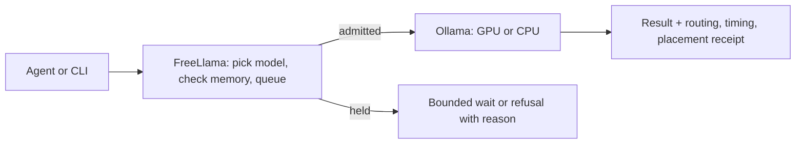
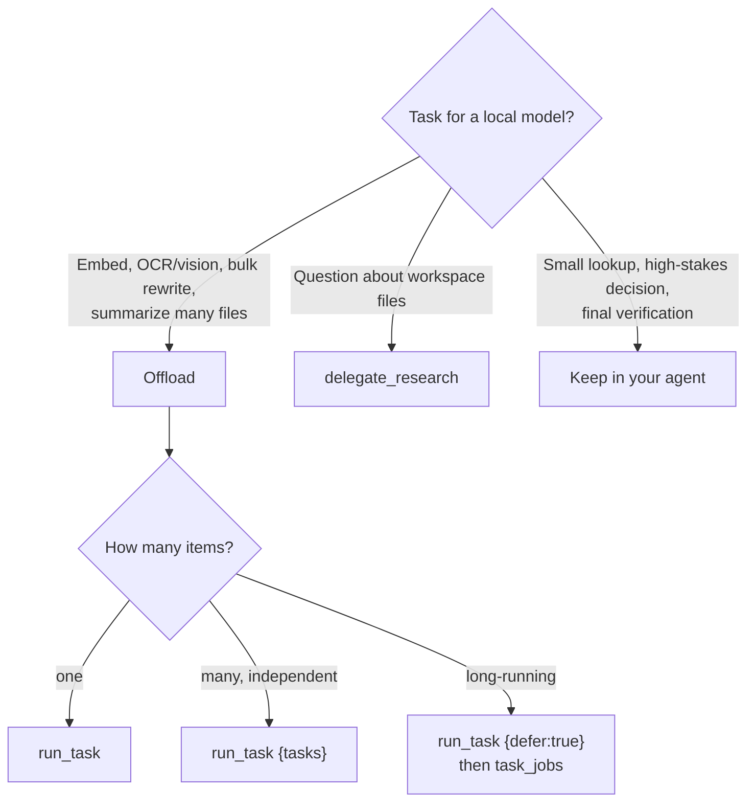
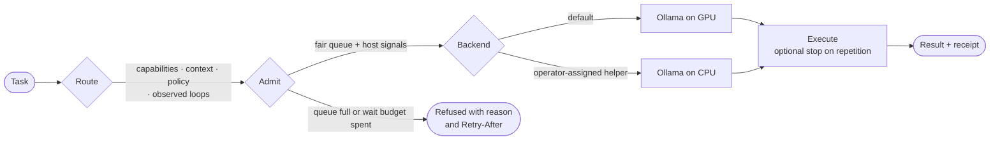
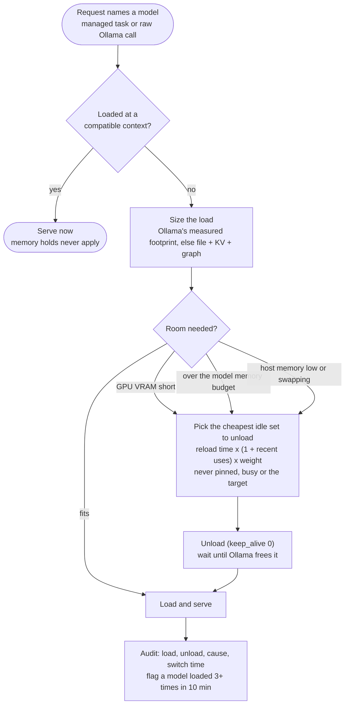

# FreeLlama


**Run your agent's bulk work on local models without overloading your machine.**

FreeLlama sits between an AI agent and [Ollama](https://ollama.com). For each task it picks an
installed model that fits, admits the task against live memory, CPU and heat signals, runs it on the
GPU or a CPU-only Ollama, and returns the result with a receipt of where and how it ran. Any Ollama
model works.



## Why FreeLlama

Coding agents spend paid tokens and context on work a local model can do: embedding files, reading
screenshots and scans, rewriting or summarizing many files. Calling Ollama directly, an agent cannot
tell:

- **Which model:** tag names do not show capabilities, context window or memory footprint.
- **Whether there is room:** a new load can push the machine into swap, several agents can pile onto
  one GPU, and a busy or hot machine slows everything.
- **Whether it worked:** a model can repeat itself until the token cap, and nothing says whether the
  task ran on the GPU or fell back to the CPU.

FreeLlama routes from installed metadata and observed behavior, admits against host signals, stops
runaway repetition, and returns a checkable receipt. The agent still decides what to offload and
verifies the answer. The name refers to less metered inference, not only Meta's Llama models.

## How it compares

FreeLlama is not an inference engine: Ollama loads and runs the model, FreeLlama decides whether,
where and how each task runs. Other projects' behavior is taken from their docs and source, checked
on 2026-10-31.

| Decision | Other local stacks | FreeLlama |
|---|---|---|
| Can this load fit right now? | Ollama predicts a footprint and evicts when it exceeds 80% of free memory; its queue holds 512 requests, then returns 503 ([scheduler](https://github.com/ollama/ollama/blob/main/server/sched.go), [FAQ](https://docs.ollama.com/faq)). The llama.cpp router keeps a fixed 1024 MiB margin per device and loads anyway when nothing can be unloaded ([server docs](https://github.com/ggml-org/llama.cpp/blob/master/tools/server/README.md)). llama-swap has no memory reserve ([config](https://github.com/mostlygeek/llama-swap/blob/main/docs/config.example.yaml)); LocalAI caps VRAM by percentage but cannot estimate it before a load ([docs](https://localai.io/docs/advanced/vram-management/)). | Checks each load against live available memory plus a reserve sized to the load, unloading idle runners first. A load that still does not fit waits, then is refused with a reason and a `Retry-After` from measured service time; resident models keep serving. While models are loaded, a background sweep unloads idle ones when the host runs short. |
| Is the machine busy or hot? | Ollama and the llama.cpp router do not gate on host CPU load or heat; llama-swap exports swap and GPU temperature as metrics without acting on them ([metrics](https://github.com/mostlygeek/llama-swap/blob/main/internal/perf/prometheus.go)). | Holds CPU-bound work (all work on a host without a GPU) while the 1-minute load average is at least 1.5 per CPU, and CPU-bound work and new loads under Mac thermal pressure; the receipt names the signal. Another program's CPU load never blocks GPU work. |
| What loads before it is asked for? | llama-swap, the llama.cpp router (`load-on-startup`) and LocalAI (`--load-to-memory`) load a fixed list at startup ([llama-swap](https://github.com/mostlygeek/llama-swap/blob/main/docs/config.example.yaml), [llama.cpp](https://github.com/ggml-org/llama.cpp/blob/master/tools/server/README.md), [LocalAI](https://github.com/mudler/LocalAI/blob/master/docs/content/reference/cli-reference.md)); none predicts. | A startup list, optionally with a prompt prefix evaluated into the runner's prompt cache, plus the model that usually comes next, loaded only when it fits without unloading anything. |
| Who may spend what? | LiteLLM enforces per-key budgets from its database ([users](https://docs.litellm.ai/docs/proxy/users)); llama-swap and the llama.cpp router accept a static key list. | Named client keys with per-key usage, a daily token budget that excludes prompt-cache reuse, and admin rights for model files, on managed and raw traffic alike. |
| Other engines? | LiteLLM, Olla and LocalAI route across engines and fail over between them ([LocalAI failover](https://github.com/mudler/LocalAI/blob/master/docs/content/features/model-failover.md)). | OpenAI-compatible engines (LM Studio, llama.cpp, vLLM, a cloud API) behind the same `/v1` endpoint, routed by model name. |
| Who goes first? | LiteLLM returns 429 once a deployment's parallel limit is reached, with an optional priority queue ([routing](https://docs.litellm.ai/docs/routing), [scheduler](https://docs.litellm.ai/docs/scheduler)). | Weighted fair admission per backend (interactive 3 : normal 2 : background 1) with starvation prevention and bounded waits; separate GPU and CPU pools. |
| Which model? | Ollama runs the tag it is given. LiteLLM picks among deployments by load, latency or cost; RouteLLM trains a strong/weak router ([RouteLLM](https://github.com/lm-sys/RouteLLM)). | Picks an installed model by capabilities, context window, memory estimate and residency; a model that keeps looping on a task kind ranks last for it. |
| Did it loop? | Ollama aborts some loops with a "token repeat limit" error. | Streams, stops once the output repeats and keeps the text (`stopOnRepetition`); `output_check` on every task. |
| Loading or waiting? | Ollama answers when done; a cold load or a full queue is a silent wait. | MCP progress notifications (when the client sends a `progressToken`): `queued`, `waiting for memory: need 9.1 GB, 6.4 GB available`, `loading MODEL (~N s)`, `running`; the answer line adds `loaded N s, evicted X`. `GET /ready` answers 503 naming what is missing (`ollama`, `cpu_backend`, `catalog`). |
| What reaches the agent's context? | The whole response, including thinking and embedding vectors. | A compact result (answer, verdict, model, tokens) plus a `response_file` holding thinking, vectors, research observations and receipts, read a section or page at a time with `read_response`. |
| Where did it run? | Ollama reports load and token timings. | A receipt with the chosen model and why, queue and resource waits, and the placement Ollama reported in `/api/ps`, so a silent CPU fallback is visible. |

Limits: FreeLlama does not change Ollama's decode speed, does not fail over between engines, and runs
CPU work only on a second, CPU-only Ollama process that you start.

Measured on one Apple M2 Pro (32 GB) unless noted; single-machine measurements of specific
workloads, not a general speed claim. The gains come from not loading, waiting or generating what the
task does not need:

| Workload | Without | With FreeLlama |
|---|---|---|
| OCR of 12 report strips, `glm-ocr`, 1,500-token cap | 12,948 output tokens, 126 s | `stopOnRepetition`: 6,452 tokens, 69 to 103 s, every label still read |
| Resident GPU tasks during a compiler build | 64 to 120 s waits (host-wide CPU-load hold, 0.5.0) | No wait: the CPU-load hold applies only to CPU-assigned work |
| `Retry-After` for a queued burst | 76 s quoted for a 32 s wait (0.5.0) | 32 s |
| A GPU model and a CPU model side by side (M4 Pro, 48 GB) | 38.0 s median, one Ollama process | 28.2 s median with a second CPU-only Ollama process (1.35x; one of three runs was slower) |
| Cost of a managed task over raw Ollama, resident embedding, n=20 (0.8.0, 2026-10-31) | raw passthrough: 2.7–2.9 ms median | 4.0 ms median, 5–7 ms p90, with routing, admission and a receipt (56 ms before the per-task process probe was cached) |
| CPU placement through a second CPU-only Ollama (0.8.0, 2026-10-31) | — | `nomic-embed-text:v1.5` reported `processor: "cpu"`, `size_vram: 0`, verified from `/api/ps`; 265 ms load |

## Installation

Requires [Ollama](https://ollama.com/download) running (`ollama list` works) with at least one model
(FreeLlama never downloads one without your approval) and Node.js 22 or newer. Prebuilt binaries for
macOS, Linux (glibc and musl) and Windows on arm64 and x64 ship as npm optional dependencies; keep
those enabled.

### CLI

```bash
npm install -g @octocodeai/freellama
freellama --version
freellama init          # check prerequisites and print a first-run plan; changes nothing
```

Without installing, prefix any command with `npx @octocodeai/freellama`. Without Node.js, use
`cargo install freellama-cli` (Rust 1.89+; the command is still `freellama`) or, once a GitHub
release is tagged, the checksummed installer in [Production](docs/PRODUCTION.md).

### MCP server

Claude Code, then the JSON config for Claude Desktop, Cursor and other hosts:

```bash
claude mcp add freellama -- npx -y @octocodeai/freellama-mcp-server
```

```json
{ "mcpServers": { "freellama": { "command": "npx", "args": ["-y", "@octocodeai/freellama-mcp-server"] } } }
```

At launch the server starts its own FreeLlama service on `127.0.0.1:11435` if none is running, so the
CLI is optional and other local clients can share that endpoint. It does not install or start Ollama.

**Optional: research roots.** `FREELLAMA_MCP_ALLOWED_ROOTS` lists the directories
`delegate_research` may read (`:`-separated on macOS and Linux, `;` on Windows). Unset, that tool
refuses every path and names the variable; every other tool works without it.

```bash
claude mcp add freellama -e FREELLAMA_MCP_ALLOWED_ROOTS=/absolute/path/to/your-project \
  -- npx -y @octocodeai/freellama-mcp-server
```

In a JSON config, add `"env": { "FREELLAMA_MCP_ALLOWED_ROOTS": "/absolute/path/to/your-project" }`.
[MCP configuration](packages/mcp/CONFIGURATION.md) lists every setting.

## Quick start

### From your agent

List models, preview the route, then run it:

```jsonc
// 1. Inventory
{ "tool": "models", "arguments": { "view": "installed" } }
// 2. Preview: routing fields only; nothing runs and nothing is reserved
{ "tool": "run_task", "arguments": { "task": "coding", "objective": "balanced", "preview": true } }
// 3. Execute: same routing fields plus the payload
{ "tool": "run_task", "arguments": { "task": "coding", "prompt": "Rename foo to bar in: ...", "options": { "num_predict": 512 } } }
```

Ten tools cover inventory (`models`, `doctor`), execution (`run_task`, `task_jobs`), saved results
(`read_response`), history and model affinity (`scope`, `session`), read-only research
(`delegate_research`), and approved model lifecycle (`ollama_manage`, `ollama_delete`). Schemas and
the agent workflow are in the [MCP reference](packages/mcp/README.md#tools).

### From the terminal

```bash
freellama serve         # keep running: the service on http://127.0.0.1:11435
# in another terminal
freellama ready         # can work be served now, or what is it waiting for
freellama models
freellama route --task completion --model MODEL_TAG     # preview only
freellama task  --task completion --model MODEL_TAG "Reply with exactly OK."
freellama status        # queues, memory holds, loaded models
```

Replace `MODEL_TAG` with a tag from `models`. Every command has `--help`; the [CLI guide](docs/CLI.md)
covers the rest. While `serve` runs, a status page is at `http://127.0.0.1:11435/_freellama/ui`.

## How it works

### What to offload

Offload bounded work whose result your agent can check; keep judgment in the agent.



### The smart flow

Every managed task passes the same gates, each deciding from installed metadata, live host signals
and observed behavior, never from a model's name.



An explicit `model` always wins over routing.

## Features

Each feature is reachable from MCP, the CLI and the HTTP control API under `/_freellama/v1` unless a
cell says otherwise.

| Feature | What you get | MCP tool | CLI | HTTP |
|---|---|---|---|---|
| [Model selection](#model-selection) | The right installed model for the task, with a confidence level | `run_task {preview:true}`, `models` | `route`, `models` | `POST /routes`, `GET /models` |
| [Resource admission](#resource-admission) | Tasks run, wait or are refused with a reason | every `run_task` receipt, `doctor {view:"status"}` | `status`, `ready` | `GET /health` (liveness), `GET /ready` (can serve now), `GET /status` |
| [CPU and GPU backends](#cpu-and-gpu-backends) | Helper models on CPU next to GPU work, with proof of where each ran | `run_task {executionPreference}` | `serve --cpu-upstream --cpu-model` | `POST /tasks` |
| [Loop control](#loop-control) | A repeating answer stops early with every token kept | `run_task {stopOnRepetition}` | `task --stop-on-repetition` | `stop_on_repetition` |
| [Machine awareness](#machine-awareness) | GPU, cores, memory, GPU load and heat read from the OS | `doctor` | `machine`, `doctor` | `GET /machine` |
| [Batches, jobs and history](#batches-jobs-and-history) | Fan-out, submit now and collect later, multi-turn chat without resending history | `run_task {tasks}` / `{defer}`, `task_jobs`, `scope`, `session` | `task --defer`, `jobs`, `scope`, `session` | `/task-batches`, `/jobs`, `/scopes`, `/sessions` |
| Warm-up and unload | Load a model ahead of use through the same memory checks; unload a resident one once its tasks finish (never loads first) | `run_task {warm:true}`, `ollama_manage {action:"stop"}` | `warm`, `unload` | `POST /warm`, `POST /unload` |
| Find and install models | ollama.com and Hugging Face GGUF search, every tag with its size and memory fit, pulls only on approval | `models {view:"library"}`, `ollama_manage`, `ollama_delete` | MCP only | MCP only |
| [Grounded research](#grounded-research) | Read-only repository answers with file and line citations | `delegate_research` | MCP only | MCP only |
| [Small agent context](#small-agent-context) | Compact results and paged details instead of raw dumps | every tool, `read_response` | JSON on stdout | JSON |
| [Observe and evaluate](#observe-and-evaluate) | Live status, usage, metrics, benchmarks, routing policy from evaluations | `doctor {view:"usage"}` | `status`, `usage`, `config`, `bench-all`, `policy from-eval` | `/status`, `/usage`, `/metrics`, `/config`, `/_freellama/ui` |
| Ollama passthrough | Any Ollama `/api/*` or `/v1/*` call, byte-preserving, with retries and a stream cap | — | `serve`, `proxy` | Ollama's own paths |

### Model selection

Routing filters installed models by task, capabilities (`tools`, `vision`, `embedding`, ...), context
window, routing policy and memory fit, and reports a confidence level. `minConfidence:"medium"`
refuses weakly evidenced routes, `objective:"quality"` requires a policy-backed model, and `model`
pins one. A bare name resolves as in Ollama: `name:latest`, or the only installed tag of that family.

Routing never ranks by a model's name or architecture and adds no model-specific request options. A
model that loops on a task kind (at least two loops in at most twice as many runs) ranks last for that
kind; `models` lists the evidence as `observed_loops`. See [model selection](docs/MODEL_SELECTION.md).

### Resource admission

A task queues fairly, waits for budget units on its backend and for the host signals that apply to
it, then runs or is refused with `Retry-After`.

- **Budget.** Each Ollama decoding slot (`OLLAMA_NUM_PARALLEL`) is worth two units: a chat costs 2, a
  vision task 4 (capped to the budget), an embedding 1 per four inputs. The GPU queue holds 16 tasks,
  the CPU queue 8. A task waits at most 120 s, or `maxWaitSeconds`.
- **Fairness.** Priority classes get 3, 2 and 1 turns per round, FIFO within a class. After six
  bypasses the oldest blocked task reserves capacity, so nothing starves. In a live run, 4
  interactive tasks submitted last finished before the normal and background tasks queued ahead.
- **Fast refusals.** A full queue answers 429 at once, an expired wait 503. Both carry `Retry-After`
  from the tasks ahead, how many of that cost run at once, and recent service time.

Each host signal holds only the work it affects:

| Signal | Holds |
|---|---|
| OS memory pressure (macOS `kern.memorystatus_vm_pressure_level`, Linux PSI) at warning | new model loads; at critical, everything |
| Low available RAM, active swapping | new model loads; a loaded model keeps serving, raw passthrough included |
| CPU load | CPU-bound work only, never a GPU load or GPU inference |
| Thermal throttling (macOS) | CPU-bound work and new loads |

A new load must leave a reserve free: 15% of RAM, at least 1 GiB, capped at the load's own size. If
it does not fit, idle models are unloaded first; if it still does not fit, it waits and is refused at
its deadline, on every OS. On macOS the available figure already includes reclaimable pages
(inactive, speculative, purgeable), so loading past it means compression and swap.
`serve --low-memory advisory` (or `FREELLAMA_LOW_MEMORY=advisory`) restores admit-with-warning.
While any model is loaded, `serve` also samples the host itself: under low memory, OS pressure or
swapping it unloads the cheapest idle models (audit trigger `pressure_sweep`), never pinned,
`keep_alive: -1` or busy ones. Because of the reserve, a load can wait while the OS still shows free
memory ([admission controls](docs/CLI.md#bound-admission)). Total deadlines (`timeoutSeconds`) and
per-backend circuit breakers complete admission; see [monitoring and tuning](docs/MONITORING.md).

### Model memory and switching

A loaded model answers at once, a cold one first pays its load time, and loading past what the
machine holds swaps and stalls everything. FreeLlama decides what stays loaded:



- **Model memory budget.** Loaded models on one backend may hold at most `model_memory_budget`
  together: 75% of RAM by default, `"24GiB"`, or `"off"`. Ollama checks only what is free at that
  moment, so without a budget loads keep landing until macOS swaps. It applies where models share
  host memory (Apple silicon, or a CPU backend).
- **What to unload.** The cheapest idle set that frees enough: measured reload time, scaled by recent
  use and an optional per-model weight. Pinned models, models with queued or running work (raw
  passthrough included) and the model being loaded are never chosen. Warms and preloads teach load
  time but do not count as uses, so they cannot keep themselves resident.
- **No ping-pong between backends.** A measured speed advantage never forces a cold load while the
  other backend has an eligible model loaded.
- **Audit.** `status` shows the budget in use, loads, unloads and evictions by cause, switch time per
  model, and models swapped back and forth. Every MCP result carries `timing` (wall time, plus queue,
  load, prompt and output time for a task).
- **Learned per model.** Each model revision's output needs (reasoning included), load time, memory
  footprint and loops are measured from its runs and saved. FreeLlama sends no output cap of its own;
  a model that ran out of room gets twice as much next time.
- **Preload.** `preload.startup` loads listed models at startup; with `messages` (such as a long
  system prompt) it also evaluates them into the runner's prompt cache. Predictive preload counts
  model-to-model switches and, once a successor is clear, loads it in the background, only when it
  fits without unloading anything and the host is calm. Agents warm a prefix with
  `run_task {warm:true, systemPrompt}`.
- **Shared state.** Measured sizes, load times, placement feedback, usage and the audit live in one
  `SQLite` file, `~/.octocode/freellama/freellama.sqlite`, shared by every FreeLlama process on the
  machine.

Measured switch times on an Apple M2 Pro (32 GB) through `serve`, model files in the OS file cache:

| Model | Loaded size | Load (switch) | Request when loaded |
|---|---:|---:|---:|
| `gpt-oss:20b` | 11.9 GiB | 5.1–9.7 s | 0.9 s (short answer) |
| `glm-ocr:latest` | 2.7 GiB | 1.5–2.0 s | 0.45 s (one image strip) |
| `strands-decider:2b-nvfp4` | 1.4 GiB | first call 1.2–1.4 s, load included | 3–60 ms (one question) |
| `nomic-embed-text:v1.5` | 0.3 GiB | 0.27–0.5 s | 70 ms (one input) |

Unloading takes milliseconds on Apple silicon. With a 14 GiB budget and all four in rotation, loading
glm-ocr unloaded gpt-oss for the budget, loading gpt-oss unloaded the helpers (for the budget, then
for low host memory), and the audit flagged all four as thrashing: raise the budget, pin the big
model, or give helpers their own backend.

### Keys, budgets and other engines

- **Client keys.** `clients.toml` in the home (or `--client-keys`) names one bearer token per agent
  or tool, each with an optional `daily_tokens` budget and `admin` right. Usage counts output plus
  prompt tokens not reused from a cache, per UTC day, for managed tasks and raw Ollama or OpenAI calls
  (`task: "raw"`, from the counts each response reports). A spent budget refuses generation with 429
  and `Retry-After` until the next UTC day; reads still work. Only admin keys may pull, push, copy,
  create or delete models or reload the runtime file. The operator token is unmetered.
- **Other engines.** `upstreams.toml` (or `--upstreams`) adds OpenAI-compatible engines. A `/v1/...`
  request for `lmstudio/qwen3-8b` goes to upstream `lmstudio` as `qwen3-8b`; a bare name goes to
  Ollama when Ollama has it, else to the engine that lists it. `GET /v1/models` lists all. A local
  engine waits out host holds as a loaded model would. The caller's FreeLlama token never leaves;
  each engine gets its own key, sent only over HTTPS or to this machine.

```toml
# ~/.octocode/freellama/clients.toml
[[client]]
name = "octocode"
token_file = "keys/octocode.token"   # freellama auth-token --out keys/octocode.token
daily_tokens = 2000000

# ~/.octocode/freellama/upstreams.toml
[[upstream]]
name = "lmstudio"
url = "http://127.0.0.1:1234/v1"
```

### CPU and GPU backends

An optional second, CPU-only Ollama runs exact helper models, such as an embedder, so they never
compete with GPU work. Each backend has its own budget, queue and model-transition lock. The operator
assigns models; agents can only state an `executionPreference`. Ask for
`minPlacementEvidence:"observed"` when placement matters, and trust the receipt's observed placement
over the configuration. See [CPU/GPU routing](docs/CPU_GPU_ROUTING.md).

### Loop control

Some models answer correctly, then repeat the answer until their output limit (a `num_predict` cap or
the end of their context). With the repetition stop, FreeLlama streams the answer, checks it every 16
tokens, and stops once the text has repeated twice over at least 96 characters; closing the
connection cancels generation in Ollama. It is on by default for free text with no output cap (JSON
and tool calls are left whole); `stopOnRepetition:false` (CLI `--stop-on-repetition false`) turns it
off, `true` turns it on for a capped task. Nothing is trimmed: `response` holds the full text and
`output_check` says where the first copy ends. A loop that ran to the limit without the stop is
flagged the same way, and routing records it either way.

### Machine awareness

`freellama machine`, `freellama status` and MCP `doctor` report what the OS says, without elevated
privileges:

- **Machine:** chip, logical CPUs, Apple silicon's performance/efficiency split, total memory and
  whether it is unified, and the GPU (Apple model and cores; NVIDIA name and memory via `nvidia-smi`).
- **Live:** available memory, OS memory pressure, CPU load, GPU busy percent (Apple, NVIDIA) and Apple
  GPU-driver memory. macOS heat is the thermal pressure level (`nominal` to `sleeping`, throttled from
  `heavy`) plus the `pmset` CPU speed limit on Intel Macs; Linux and Windows report it as unknown.
- **Placement:** fully GPU, fully CPU or split, as Ollama reports each loaded model.

### Batches, jobs and history

| Need | Use |
|---|---|
| Many independent items | `run_task {tasks, maxParallelism}` with up to 64 `{id, independent:true, task}` items |
| Submit now, collect later | `run_task {defer:true}` returns `job.id`, then `task_jobs {action:"get", jobId}` |
| Multi-turn chat without resending history | `scope {action:"create"}`, then `run_task {scopeId, scopeRevision, prompt}` |
| Keep related calls on one model | `session {action:"create"}`, then `run_task {sessionId}` |
| Hot model before latency-sensitive work | `run_task {warm:true, model, contextTokens}` |

Scopes, sessions and deferred jobs live in memory and are lost when the service restarts. See
[scopes and warming](docs/SCOPES_AND_WARMING.md).

### Grounded research

`delegate_research {question, workspacePath}` gives a local model bounded, read-only search and read
tools over an allowed workspace and returns an answer, file and line citations, and an independently
computed verdict. Discard `escalate` results and verify the citations on the rest.

### Small agent context

`run_task` and `delegate_research` return a compact view unless `receipt:"full"`; every tool saves its
whole result to a `response_file`, which `read_response` pages by section. Embedding vectors are
omitted unless `returnEmbeddings:true`. The optional `telemetry.externalEquivalent` estimates avoided
API cost from a rate card you configure. See [token economics](packages/mcp/README.md#token-economics).

### Observe and evaluate

- **Live status:** queues, memory holds, loaded models, circuit breakers and usage per day and model,
  from `doctor {view:"status"}`, `freellama status` or `/_freellama/ui`.
- **Evaluation:** `bench-all` benchmarks installed models; `policy from-eval` writes a routing policy
  from quality-evaluation results. See [model selection](docs/MODEL_SELECTION.md).
- **Ollama compatible:** `/api/*` and `/v1/*` reach Ollama byte-for-byte, streaming included;
  FreeLlama never rewrites raw bodies. See [Ollama sidecar](docs/ARCHITECTURE.md#ollama-sidecar).

## Model forms

Managed forms get routing, admission and a receipt; passthrough forms reach Ollama through `serve`
with the raw stream cap and memory checks but no routing or receipt.

| Form | Ollama endpoint | Through FreeLlama | Measured here |
|---|---|---|---|
| Text, coding, reasoning | `/api/chat` | Managed: `completion`, `coding`, `code_repair`, `long_context`, `think` | `gpt-oss:20b` 4/4 |
| Tool calling | `/api/chat` with `tools` | Managed: `tools` | `gpt-oss:20b` 1/1 |
| Structured JSON | `/api/chat` with `format` | Managed: `format` | `gpt-oss:20b` 1/1 |
| Vision and OCR | `/api/chat` with `images` | Managed: `vision`, `stopOnRepetition` for looping readers | `glm-ocr` 4/4 phrases |
| Embeddings | `/api/embed` | Managed: `embedding`, batched input, vectors withheld unless asked | `nomic-embed-text:v1.5` retrieval 4/4 |
| Decisions (classify, route, score) | `/v1/systemone` | Passthrough; the catalog lists the model's `other_capabilities: ["decision"]` | `strands-decider:2b-nvfp4` 9/9, 3/3, 2/3 |
| Speech (text to speech) | `/v1/audio/speech` | Passthrough; Phonon needs Ollama 0.40.9+ on Apple silicon | not measured |
| Transcription and translation | `/v1/audio/transcriptions`, `/v1/audio/translations` | Passthrough; LFM3 audio needs Ollama 0.40.12+ | not measured |
| Image generation | removed from Ollama in 0.32.6 | not available | — |

Find any of these with `models {view:"library", capabilities:["decision"]}` (or `audio`,
`embedding`, `vision`...), or a Hugging Face GGUF build with a `query`.

### Local models, measured

One Apple M2 Pro (32 GB), Ollama 0.40.8, FreeLlama 0.6.1, 2026-10-30, while other builds kept the
one-minute load near 14 on 12 cores. Each check has a known answer; the batteries are small, so read
the ratings as a first screen for these exact tags, not a benchmark.

| Model | Download | Forms | Result | Speed (warm) | Rating | Use it for |
|---|---:|---|---|---|---:|---|
| `gpt-oss:20b` | 13.8 GB | text, tools, thinking, JSON | 7/7: exact output, arithmetic, bat-and-ball, code reading, JSON extraction, tool call, 9/9 ticket routing | 1.4 s per routed ticket; 12 s first call with load | 9/10 | General agent work and tool calls when quality matters |
| `nomic-embed-text:v1.5` | 274 MB | embedding | Retrieval 4/4 top-1; ticket routing 9/9 from two examples per team | 51 ms per item, batched | 9/10 | Search, deduplication, cheap classification |
| `strands-decider:2b-nvfp4` | 1.3 GB | decision | Ticket routing 9/9, return-policy yes/no 3/3, damage rubric 2/3 | 0.17 s per question | 8/10 | Fast routing and policy checks with probabilities; rubric scores run low at the top level |
| `glm-ocr:latest` | 2.2 GB | vision (OCR) | 4/4 phrases read from a dense report strip; 0/7 on text tasks | 11 s per strip at a 400-token cap | 8/10 OCR, 1/10 text | Reading screenshots and scans only |

## Make local models faster and lighter

Decode speed is fixed by the model and hardware. A task's real cost is mostly around decoding: cold
loads, reloads, re-evaluating a prompt the runner already saw, unneeded thinking and output, and
running out of memory. Best payoff first:

1. **Avoid reloads.** Ollama reuses a loaded runner only when `num_ctx`, `num_batch`, `num_gpu`,
   `num_thread` and `use_mmap` match ([scheduler](https://github.com/ollama/ollama/blob/main/server/sched.go)).
   FreeLlama sizes `num_ctx` in fixed buckets (2k–32k), reuses a loaded runner's larger context, and
   sets `num_thread` only on a dedicated CPU backend. Keep one model's callers on one
   `contextTokens`, warm at that context, and compare `models`' `context_default` and
   `resident_context`.
2. **Keep prompts prefix-stable.** llama.cpp, which runs every Ollama model, reuses a cached prompt
   only from its exact start. Put the stable part first (system prompt, tool list, documents) and
   append, never edit. Warm a long prefix once with `run_task{warm:true,systemPrompt}` (or
   `[preload]` `messages`) and use `scope` for follow-ups, which reuse the whole history. Receipts
   and the usage ledger report `metrics.cached_prompt_tokens` and `uncached_prompt_tokens` from
   Ollama's `prompt_eval_cached_count`; a different `num_ctx` reloads the runner and loses the cache.
3. **Spend output only where it helps.** Completion, tools, browser and vision tasks send
   `think:false` (Ollama otherwise enables thinking on capable models); coding, code-repair and
   long-context tasks send `think:"medium"` to thinking models. `stopOnRepetition` cut `glm-ocr` on 12
   report strips from 12,948 to 6,452 output tokens with every label still read.
4. **Unload instead of swapping.** A load that does not fit waits instead of swapping, idle models are
   unloaded under memory pressure, and `unload` frees a big model before a switch without ever
   loading it.
5. **Shrink memory per runner.** Quantize the KV cache, keep `OLLAMA_NUM_PARALLEL=1` on a laptop
   (every slot multiplies KV memory by the context), and bound llama-server's hidden prompt cache
   with `LLAMA_ARG_CACHE_RAM`; see [Tune Ollama](#tune-ollama-for-local-models).
6. **Keep the agent's context small.** See [small agent context](#small-agent-context).

Measured here (Apple M2 Pro, 32 GB, Ollama 0.40.13, FreeLlama 0.8.0, 2026-10-31, light load only):
`serve` prepared in 69–143 ms; a cold `nomic-embed-text:v1.5` load took 0.5 s and a resident embedding
13–26 ms in Ollama, plus 4 ms (median) for FreeLlama; `unload` took 5–56 ms; an MCP embedding result
was 2.6 KB inline with the vectors in its `response_file`.

### Tune Ollama for local models

FreeLlama never changes Ollama's settings. These matter most, per Ollama's docs and measured reports:

| Setting | What it does | Suggested start |
|---|---|---|
| `OLLAMA_NUM_PARALLEL` | Decoding slots per model, each with its own prompt cache; RAM grows with slots times context ([Ollama FAQ](https://github.com/ollama/ollama/blob/main/docs/faq.mdx)). Small gain on Apple silicon; some engines run one request at a time ([MLX engine](https://github.com/ollama/ollama/issues/17280)) | `1`, raised only after measuring. FreeLlama's budget follows it |
| `OLLAMA_FLASH_ATTENTION` + `OLLAMA_KV_CACHE_TYPE=q8_0` | A quantized KV cache roughly halves its memory and needs flash attention ([Ollama FAQ](https://github.com/ollama/ollama/blob/main/docs/faq.mdx)); with `OLLAMA_FLASH_ATTENTION` unset, llama.cpp enables it automatically | On, when the model's quality holds |
| Context length | Ollama defaults to 4k below 24 GiB of VRAM and recommends at least 64k for agent and coding work ([context length](https://github.com/ollama/ollama/blob/main/docs/context-length.mdx)) | Size per task. FreeLlama keeps Ollama's default when it covers the prompt, otherwise sizes text tasks to the prompt; `contextTokens` overrides |
| `OLLAMA_MAX_LOADED_MODELS` | How many runners stay resident. Unset and `0` mean 3 per GPU, then Ollama unloads by count | More than the model memory budget can hold, so the budget decides by size and reload cost. `1` reloads on every switch |
| `keep_alive` | How long a runner stays loaded after use | Leave it out. FreeLlama picks a finite time from measured reuse |
| `LLAMA_ARG_CACHE_RAM` | Host RAM llama-server may use for displaced prompt caches (`--cache-ram`); default 8192 MiB per runner ([llama.cpp server](https://github.com/ggml-org/llama.cpp/blob/master/tools/server/README.md)), counted by no footprint estimate. Set it on the Ollama server, which passes its environment to llama-server; `doctor` checks it | `2048` on 32 GB or less; `0` disables it at the cost of re-evaluating prefixes |

## Good to know

- Local inference still costs memory, power and time; offloading shrinks the calling agent's
  context, not the total work.
- Searches and recommendations never download; a pull needs approval for one exact tag and size.
- Managed tasks return one result; raw Ollama passthrough keeps streaming.
- The MCP server saves every tool result except `read_response`'s, prompts included, to
  `~/.octocode/freellama/responses/` (owner-only, oldest dropped past 1 GiB). `FREELLAMA_RESPONSE_STORE_BYTES=0` keeps nothing on disk.
- Without CA certificates, as in slim containers, FreeLlama still serves plain-HTTP Ollama. Install
  `ca-certificates` for HTTPS upstreams.
- The service binds to loopback. For remote access, see [Production](docs/PRODUCTION.md).
- Port 11435 is also Ollaya's default ([Ollaya API](https://github.com/ollaya-dev/ollaya/blob/main/docs/api.md)).
  To run both, use `serve --listen` on another port and set the MCP server's
  `FREELLAMA_SERVE_ENDPOINT` to match.

## Build from source

Requires Rust 1.89+ (`rust-toolchain.toml` pins the compiler) and Node.js 22.12+ with Corepack.

```bash
corepack enable && yarn install && yarn build
./target/release/freellama serve
node packages/mcp/dist/index.js        # MCP server from this checkout
```

npm releases can lag this checkout. [Testing](docs/TESTING.md) describes the checks; the release gate
is `yarn verify:production`.

## Documentation

| Topic | Guide |
|---|---|
| All guides | [Documentation index](docs/README.md) |
| MCP tools, schemas, agent workflow | [MCP reference](packages/mcp/README.md), [MCP configuration](packages/mcp/CONFIGURATION.md), [agent skill](skills/freellama/SKILL.md) |
| CLI commands and flags | [CLI](docs/CLI.md) |
| How it works and who owns what | [Architecture](docs/ARCHITECTURE.md) |
| CPU/GPU setup and placement | [CPU/GPU routing](docs/CPU_GPU_ROUTING.md) |
| Queues, memory, live tuning | [Monitoring](docs/MONITORING.md) |
| Choosing models | [Model selection and metadata](docs/MODEL_SELECTION.md) |
| Deployment and releases | [Production](docs/PRODUCTION.md), [release packages](docs/TESTING.md#verify-release-packages) |
| Embedding the Rust core | [Rust core](packages/rust-core/README.md) |

## License

Copyright (c) 2026 Guy Bary. Licensed under [Apache-2.0](LICENSE-APACHE) or [MIT](LICENSE-MIT),
at your option.
