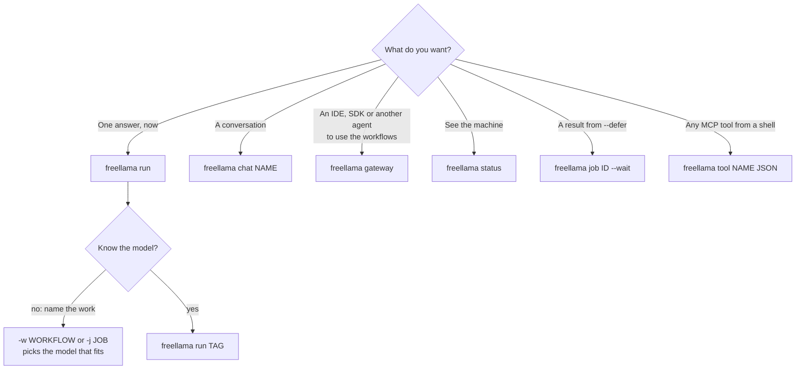
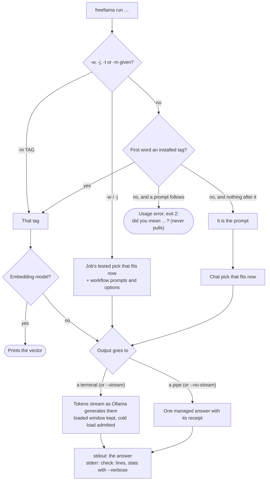
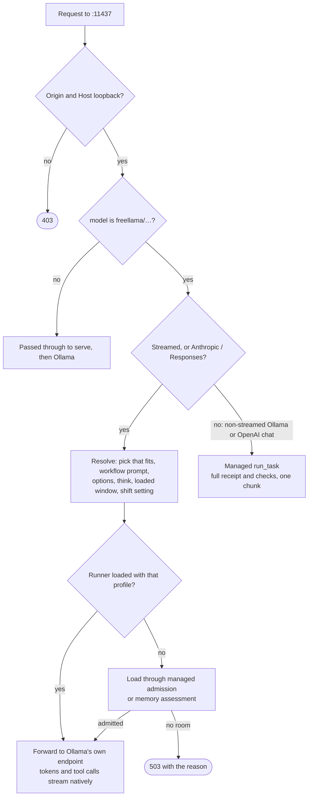

# Agent commands: `freellama run`, `chat`, `gateway`

`freellama run` works like `ollama run`, with FreeLlama on every request:
- the tested model for the job that fits in memory now
- the job's documented prompts and options
- the memory gate
- `check:` lines that say what to verify

`freellama gateway` serves the same workflows as models (`freellama/fix-bug`) to Ollama, OpenAI and
Anthropic clients. [Every API](API.md) shows every surface.

## Install

```bash
npm install -g @octocodeai/freellama     # one command: freellama
```

| Command | Runs in | Needs |
|---|---|---|
| `freellama serve`, `doctor`, `init`, `catalog`, `task`, `jobs`, `bench-all`… | The Rust binary | Nothing else |
| `freellama run`, `chat`, `gateway`, `workflows`, `job`, `tool`, `tools` | Node, from `@octocodeai/freellama-mcp-server` (installed as a dependency) | Node.js 22+ |
| `freellama status` | Human view on a terminal; JSON when piped or with `--json` | — |

The agent commands ship in npm 0.11.0 and later. From a checkout, run `yarn install && yarn build`,
then `node packages/cli/bin/freellama.js …`. A `cargo install freellama-cli` binary has the operator
commands only.

## Which command



## First five minutes

| Step | Command | You get |
|---|---|---|
| 1 | `freellama catalog` | Tested picks per job: installed, fits now |
| 2 | `freellama workflows` | Each workflow and what it expects |
| 3 | `git diff \| freellama run -w summarize-diff` | The summary on stdout |
| 4 | Read stderr | `check:` lines: what to verify before you rely on the answer |
| 5 | `freellama gateway`, then `OLLAMA_HOST=127.0.0.1:11437 ollama run freellama/explain-code` | The same workflow in the `ollama` chat |

## `freellama run`

```bash
git diff | freellama run -w summarize-diff
freellama run -w fix-bug -f path/to/parser.ts "The parser drops the last token"
freellama run -j find-code -f 'path/to/src/**/*.ts' --top 3 "where are CLI flags parsed"
freellama run --ask "Is a refund requested?" < ticket.txt
freellama run --ask "Which team?" --choice billing="Payments" --choice technical="Software" < ticket.txt
freellama run "Why is the sky blue?"                       # the chat pick that fits now
freellama run bonsai-2:9b "Why?" --think=false             # a tag you choose
echo "Invoice 2291, Acme, 1,240.50 EUR" | freellama run -w extract-json --schema "invoice_id, vendor, total float, currency"
freellama run -w review-code --each -f 'src/*.ts'          # one answer per file
```

### How a run resolves



| Rule | Behavior |
|---|---|
| stdin | Piped or redirected input is read: the `state` of a decision, one item per line for an embedding job, else after the prompt. An agent harness's open socket never hangs the call; a socket is read only if data arrives within 250 ms |
| Image path in the prompt | Attached as an image, as in `ollama run` |
| `--ask` with no model | Runs on the `classify` job's tested pick; answers are named after the question (`refund-requested: true (p 0.89)`) |
| Always managed | Decisions, embeddings, tools, batches (`--each`), `--defer`, `--preview`, `--save-as` |
| serve | Started once in the background if nothing answers (log `~/.octocode/freellama/serve.log`, PID on stderr); `FREELLAMA_MCP_AUTOSTART_SERVE=0` turns it off |

### Flags

| Group | Flags |
|---|---|
| Same as `ollama run` | `--format json\|SCHEMA`, `--think[=true\|false\|LEVEL]`, `--hidethinking`, `--keepalive`, `--verbose`, `--ask` / `--choice` / `--level`, `--dimensions N`, `--nowordwrap`, `--insecure` |
| Choose the work | `-w/--workflow`, `-j/--job`, `-m/--model`, `-t/--task`, `--objective`, `--prefer cpu\|gpu`, `--min-confidence` |
| Inputs | `-f/--file PATH\|GLOB` (repeatable), `--image`, `-s/--system TEXT\|@FILE`, `--tools JSON\|@FILE`, `--suffix TEXT\|@FILE` (fill in the middle) |
| Model controls | `-o/--option k=v`, `--ctx N`, `--top N` (embedding matches) |
| Output | `--schema 'name, age int, tags list'\|JSON\|@FILE`, `-x/--extract` (first code block), `--json` (full receipt), `-q/--quiet`, `--stream` / `--no-stream` |
| Scheduling | `--each`, `--defer`, `--preview`, `--save-as NAME`, `--session`, `--priority`, `--timeout`, `--max-wait`, `--endpoint URL` |

`freellama run --help` lists every flag. `--think=LEVEL` must be a level the model lists
(`ollama show MODEL`). `--suffix` needs a model with Ollama's `insert` capability. `-x` extracts
text; it is not a patch.

### Exit codes

| Code | Meaning | What to do |
|---|---|---|
| 0 | Answered | Read the `check:` lines |
| 75 | Busy, short of memory or Ollama down | Retry; stderr gives `retry after Ns` when known |
| 1 | Refused, failed, or an empty answer | Read stderr; an empty thinking answer says to use `--think=false` |
| 2 | Usage error | Fix the command |
| 130 | Interrupted (Ctrl-C cancels the running job) | — |

### Embeddings and code search

| Feature | How |
|---|---|
| Rank files by a question | `freellama run -j find-code -f GLOB --top N "question"` |
| Persistent index | Each chunk's vector is kept in `$FREELLAMA_HOME/embedding-index/`, so a repeated search embeds only new or changed chunks (89 chunks: 7.3 s first, 0.28 s next). `FREELLAMA_EMBED_INDEX=0` turns it off |
| Shorter vectors | `--dimensions N` on models trained for it (nomic v1.5, embeddinggemma) |

## `freellama chat`, `status`, `job`, `tool`

| Command | What it does |
|---|---|
| `freellama chat NAME` | The real `ollama` chat on a workflow (`review-code`), `freellama/auto` or a tag, through a gateway that lives as long as the chat; each answer ends with its `check:` lines |
| `freellama status [--endpoint URL]` | On a terminal: memory, queues, usage, each loaded model (size, GPU or CPU, window, time until it unloads) and active jobs |
| `freellama job ID [--wait\|--cancel] [--endpoint URL]` | A deferred task: `--wait` blocks until it ends and prints only the answer |
| `freellama tool NAME [JSON\|@FILE\|-]` | Any FreeLlama MCP tool, with its own schema; `freellama tools` lists them, `freellama tool NAME --help` shows one. `tool sweep` with `start` or `resume` stays until the sweep ends |

Approvals still apply: `freellama tool ollama_pull` needs the exact tag and its approved size, and
`ollama_delete` the exact installed tag ([agent invariants](../AGENTS.md#agent-facing-invariants)).
`freellama tool delegate_research` reads only workspaces under `FREELLAMA_MCP_ALLOWED_ROOTS`.

## The gateway: workflows as models

```bash
freellama gateway                                      # 127.0.0.1:11437
OLLAMA_HOST=127.0.0.1:11437 ollama run freellama/explain-code
curl http://127.0.0.1:11437/v1/chat/completions -d '{"model":"freellama/review-code",
  "messages":[{"role":"user","content":"def avg(xs): return sum(xs)/len(xs)"}]}'
curl http://127.0.0.1:11437/v1/messages -H 'anthropic-version: 2023-06-01' -d '{"model":"freellama/explain-code",
  "max_tokens":400,"thinking":{"type":"disabled"},"messages":[{"role":"user","content":"What does git rebase --onto do?"}]}'
```

| Model name | Runs |
|---|---|
| `freellama/<workflow>` | That workflow: `fix-bug`, `review-code`, `explain-code`, `summarize-log`, `extract-json`, `describe-screen`, … |
| `freellama/<job>` | A chat-shaped job: `coding`, `summarize`, `ocr`, `image-recognition` (`summarize` uses the coding picks: `freellama catalog --job coding`) |
| `freellama/auto` | The chat pick that fits now |
| Any other tag | Passed through to Ollama via `serve`, with admission and telemetry |

### How a request is handled



| Endpoint | Clients | Virtual model |
|---|---|---|
| `POST /api/chat`, `/api/generate` | `ollama` CLI, Continue, Roo, Aider, Goose, Zed, Open WebUI, LangChain `ChatOllama` | Streamed by Ollama; `stream:false` is managed |
| `POST /v1/chat/completions` | opencode, Cline, LangChain `ChatOpenAI`, Open WebUI, OpenAI SDKs | `stream:true` streamed by Ollama; otherwise managed |
| `POST /v1/responses` | Codex (`wire_api = "responses"`), opencode | Streamed or not, by Ollama |
| `POST /v1/messages` | Claude Code (`ANTHROPIC_BASE_URL`), Goose, Zed | Streamed or not, by Ollama |
| `GET /api/tags`, `/v1/models`, `POST /api/show` | Model lists | Virtual models first, then installed tags |

| Rule | Behavior |
|---|---|
| What the caller sends wins | A system message, think or reasoning setting, sampling and format stay; job mode fills only what is missing |
| Thinking off | `reasoning_effort: "none"` (OpenAI), `thinking: {type: "disabled"}` (Anthropic), `think: false` (Ollama, Responses) |
| Small `max_tokens` | A thinking model may spend it all: `finish_reason: "length"`, empty content |
| Model name | Every response for a virtual model, streamed or not, names the requested virtual model (`freellama/review-code`) in the protocol's `model` field; the real tag is `freellama.model`. Real tags pass through unchanged |
| Receipts | A `freellama` object (`model`, `checks`, `job`) that standard clients ignore. Ollama streams: on the `done` line, plus `num_ctx` and `context_source`; with `checks` in the content too for a person in a chat. OpenAI Chat streams: a top-level field on the last chunk before `data: [DONE]`. Responses streams: on the `response.completed` (or `response.incomplete`) event, beside `response`. Anthropic streams: on the `message_stop` event. Non-streamed responses: a top-level field (managed Ollama and OpenAI chats carry `job_profile` and `cached_prompt_tokens` instead of `job`). Checks cover the whole answer and its tool calls; on the OpenAI and Anthropic layers they never enter the content |
| Security | Loopback only; non-loopback Origin or Host refused; no files read and no URLs fetched over HTTP (images must be base64) |
| Errors | 503 when waiting can fix it (capacity, memory, Ollama, no pick that fits), else 500 |

Local models are 2–9B: they serve bounded tasks well and long agent loops poorly. Anthropic does
not support routing Claude Code to non-Claude models.
