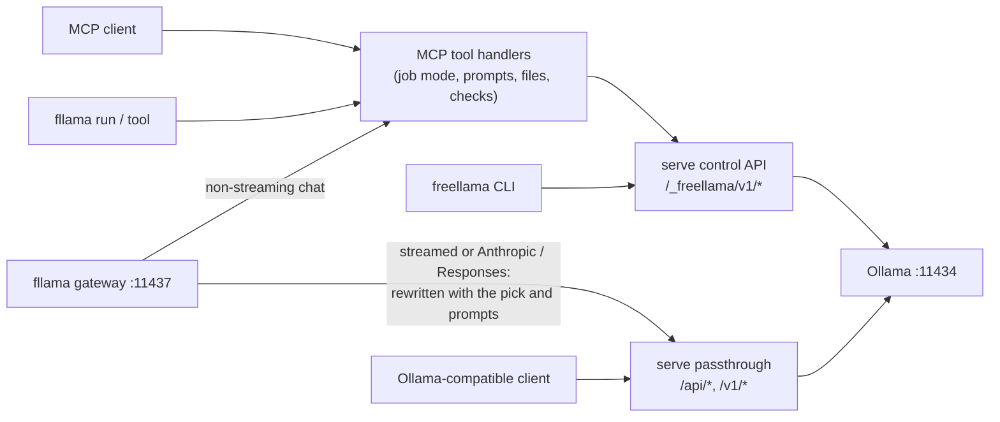

# Every FreeLlama API

FreeLlama exposes one engine through several doors. Pick the door that matches your client. Each
section below lists everything behind it and links to the guide that owns the details. Everything
here was checked against the code (2026-11-10).

## Which one to use

| You are | Use | Start with |
|---|---|---|
| An agent with MCP (Claude Code, Codex, Cursor…) | [MCP tools](#mcp-tools) | `models {view:"catalog", job}`, then `run_task {workflow}` |
| An agent or script with only a shell | [`fllama`](#fllama-commands) | `git diff \| fllama run -w summarize-diff` |
| An Ollama, OpenAI or Anthropic client (Continue, opencode, Open WebUI, LangChain, an SDK) | [Gateway](#gateway-endpoints) | base URL `http://127.0.0.1:11437`, model `freellama/review-code` |
| An operator | [`freellama` CLI](#freellama-commands) | `freellama init`, `freellama serve`, `freellama status` |
| A program that wants receipts and routing | [Control API](#control-api) | `POST /_freellama/v1/tasks` |
| An existing Ollama client that only needs admission and telemetry | [Passthrough](#ollama-compatible-passthrough) | `OLLAMA_HOST=127.0.0.1:11435` |

Ports: Ollama `11434`, `freellama serve` `11435`, the CPU backend that `serve --spawn-cpu-backend`
starts `11436`, and `fllama gateway` `11437`.

## `fllama` commands

`fllama` ships with `@octocodeai/freellama-mcp-server` from 0.11.0; before that, run it from a
checkout ([install](AGENT_CLI.md)). See the [reference](AGENT_CLI.md) for flags and output rules.

| Command | Does |
|---|---|
| `fllama run [MODEL] [PROMPT…]` | One managed task. Takes `ollama run` flags plus `-w/--workflow`, `-j/--job`, `-f/--file`, `--schema`, `-x`, `--json` and more |
| `fllama chat [NAME]` | The real `ollama` REPL on a virtual model or a tag |
| `fllama gateway [--port] [--endpoint]` | Serves the [gateway endpoints](#gateway-endpoints) |
| `fllama workflows` | Workflows and jobs, with what each expects |
| `fllama catalog [JOB]` | Tested picks per job: installed, fits now |
| `fllama job [ID] [--cancel]` | Lists deferred tasks, or gets or cancels one |
| `fllama tool NAME [JSON\|@FILE\|-]` | Calls any [MCP tool](#mcp-tools) with its own schema. `fllama tools` lists them; `--help` shows a schema |
| `fllama list\|ls\|ps\|show\|pull\|push\|rm\|cp\|create\|stop\|serve\|signin\|signout\|launch` | Passed to `ollama` unchanged. `fllama serve` is `ollama serve` |

## Gateway endpoints

The gateway serves these virtual models:

- `freellama/<workflow>`: fix-bug, review-code, explain-code, summarize-log, extract-json,
  describe-screen and the rest.
- `freellama/<job>`: coding, summarize, ocr, image-recognition.
- `freellama/auto`: routing picks the model.

Any other model name passes through to `serve`. The [reference](AGENT_CLI.md#virtual-models-and-the-gateway)
explains the mapping.

| Endpoint | Protocol | A virtual model… |
|---|---|---|
| `GET /api/tags`, `GET /v1/models` | Ollama, OpenAI | is listed first, before the installed tags |
| `POST /api/show` | Ollama | is described, with capabilities |
| `POST /api/chat`, `/api/generate` | Ollama | is streamed by Ollama (the default); with `stream:false` it runs as a managed task |
| `POST /v1/chat/completions` | OpenAI Chat | with `stream:true` is streamed by Ollama; otherwise it runs as a managed task |
| `POST /v1/responses` | OpenAI Responses (Codex) | is streamed or answered by Ollama |
| `POST /v1/messages` | Anthropic Messages (Claude Code) | is streamed or answered by Ollama |
| `GET`/`HEAD /` | Ollama heartbeat | |
| anything else | | is proxied to `serve` |

## MCP tools

There are 13 tools, registered from [`tools/registrations.ts`](https://github.com/bgauryy/FreeLlama/blob/main/packages/mcp/src/tools/registrations.ts).
`fllama tool NAME` reaches every one of them.

| Tool | Use it to |
|---|---|
| `doctor` | Check Ollama and FreeLlama health, live queues and limits (`view:"status"`), and token usage |
| `session` | Keep related `run_task` calls on one model: create, kill, delete |
| `models` | See catalog picks per job, installed and loaded models, one model's details, or search ollama.com and Hugging Face (`view:"library"`) |
| `scope` | Keep chat history on the server, with revisions: create, get, fork, delete |
| `run_task` | Run bounded work on a local model: `job` or `workflow`, `files`, decisions, embeddings with `nearest`, vision, tools, up to 64 batch items, `defer`, `preview` |
| `task_jobs` | List, get, cancel or remove deferred work |
| `ollama_pull` | Download one exact tag the user approved, at its reported size (`approvedSizeBytes`) |
| `ollama_manage` | Load or free a model |
| `ollama_delete` | Delete one exact tag the user names; it cannot be undone |
| `delegate_research` | Answer a read-only question about a workspace or GitHub with a local agent (bash, octocode or github adapters; `coder` is opt-in) |
| `audio` | Transcribe or translate a WAV, or speak text |
| `sweep` | Judge a code tree, logs or a docs site chunk by chunk in the background, reporting only flagged or changed chunks |
| `read_response` | Read a section or page of a saved `response_file` |

The server also has 22 **prompts**: the 15 workflows (read-text, read-table, read-fields,
answer-image, describe-screen, change-code, fix-bug, implement, write-tests, review-code,
explain-code, summarize-log, summarize-text, summarize-diff, extract-json), plus classify,
find-code, duplicates, research, github-research, sweep and `freellama`. **Resources** are
`freellama://docs/<path>` for every bundled doc, with the index at `freellama://docs/index`.

## `freellama` commands

These are the operator commands of the Rust binary. The [CLI reference](CLI.md) covers flags and
behavior.

| Group | Commands |
|---|---|
| First run and health | `init`, `doctor`, `ready`, `machine`, `status`, `usage`, `config [--reload]` |
| Run the service | `serve`, `proxy`, `auth-token` |
| Models | `models`, `catalog`, `warm`, `unload` |
| Work | `route`, `task`, `jobs`, `session`, `scope create\|get\|fork\|delete` |
| Measure and tune | `bench-all`, `policy from-eval` |

`init`, `doctor`, `catalog`, `auth-token`, `proxy`, `bench-all` and `policy` work without `serve`;
the rest are clients of it.

## Control API

The control API lives at `/_freellama/v1/*` on `serve`
([router](https://github.com/bgauryy/FreeLlama/blob/main/packages/rust-core/src/platform/mod.rs)).
Every route needs the bearer token when one is configured, except `GET /_freellama/ui`.

| Area | Routes |
|---|---|
| State | `GET health`, `GET ready`, `GET machine`, `GET models` |
| Decide and run | `POST routes` (no inference), `POST tasks`, `POST task-batches` |
| Affinity and history | `POST sessions`, `DELETE sessions/{id}`, `POST sessions/{id}/kill`; `POST scopes`, `GET scopes/{id}`, `DELETE scopes/{id}`, `POST scopes/{id}/fork` |
| Residency | `POST warm`, `POST unload` |
| Deferred jobs | `GET jobs`, `GET jobs/{id}`, `DELETE jobs/{id}`, `POST jobs/{id}/cancel` |
| Monitoring | `GET metrics`, `GET status`, `GET usage`, `GET config`, `POST config/reload`, and the `GET /_freellama/ui` page |

Request shapes are in [Architecture](ARCHITECTURE.md#request-shapes); monitoring fields are in
[Monitoring](MONITORING.md).

## Ollama-compatible passthrough

Every path outside `/_freellama/*` on `serve` is forwarded to the primary Ollama byte for byte,
with raw admission, host-pressure holds and usage telemetry
([sidecar](ARCHITECTURE.md#ollama-sidecar)). It covers Ollama's native `/api/*`, its
OpenAI-compatible `/v1/*`, and the Anthropic-compatible `/v1/messages`. A few paths get special
handling:

- `/v1/*` requests go by model to the engines listed in `upstreams.toml`, and `GET /v1/models` is
  merged across them.
- `POST /v1/systemone` has its `assets` translated to `images`.
- Pulls, pushes, copies, deletes and blob uploads skip the execution lock.
- A request with `keep_alive:0` is treated as an unload.

`freellama proxy` runs only this layer.
