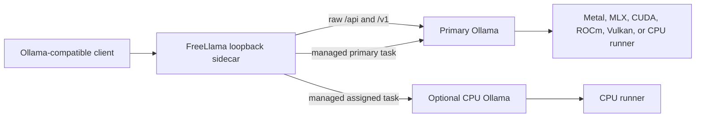
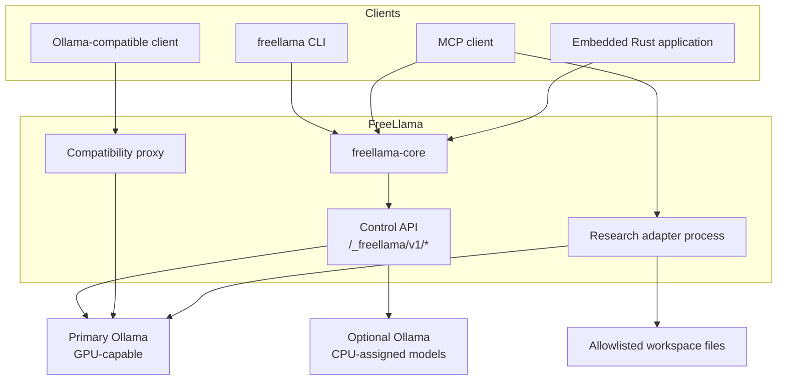
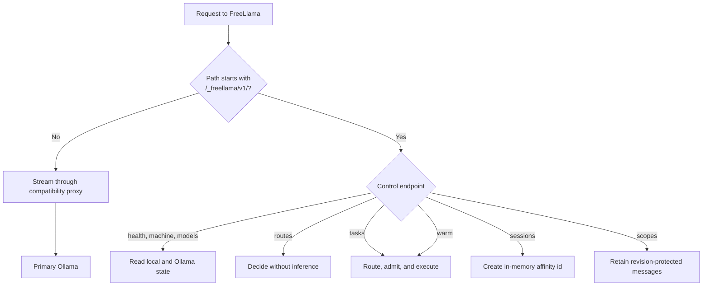
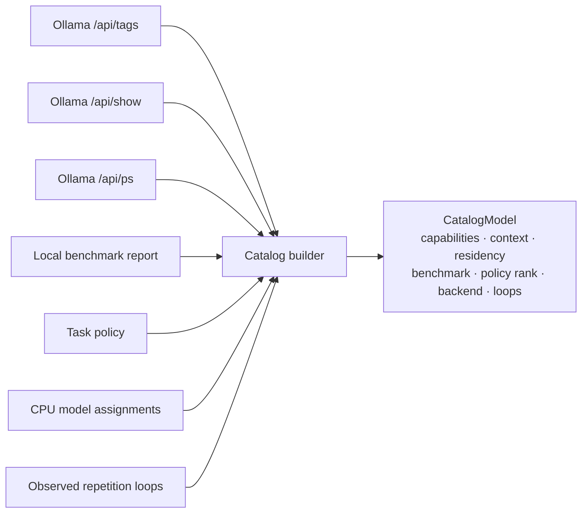
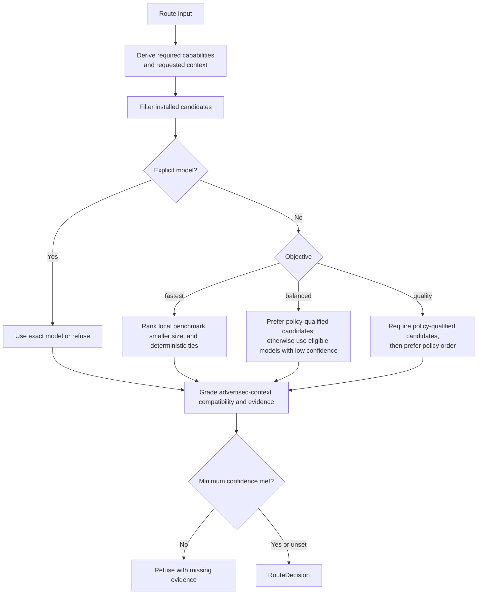
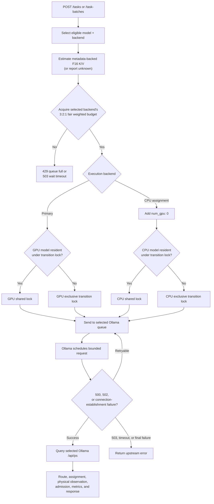
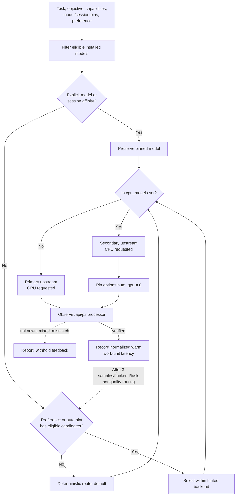
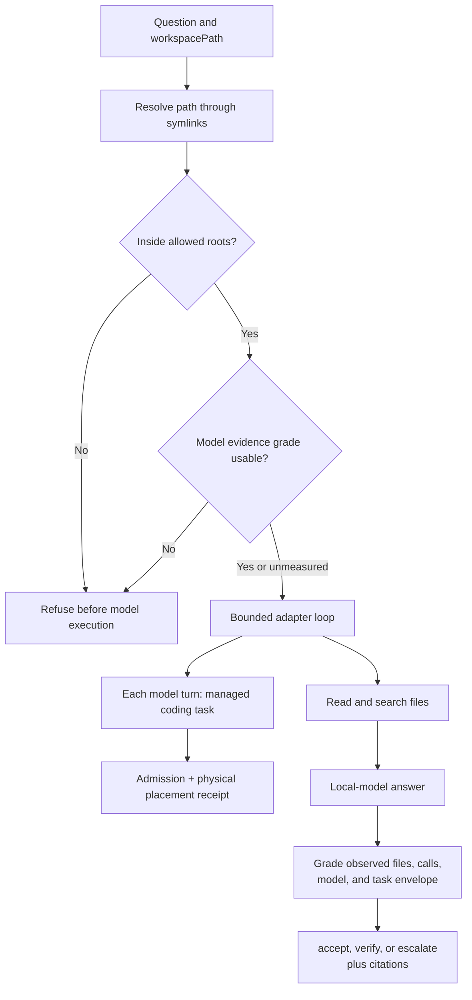
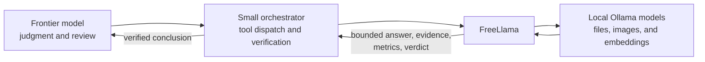

# FreeLlama architecture

FreeLlama is the management layer between an AI agent and local Ollama models. Agents offload
bounded tasks through MCP, the CLI, or the control API. FreeLlama selects eligible models,
coordinates resources, and returns results with execution evidence.

The calling agent owns task decomposition, prompts, and answer verification. FreeLlama owns managed
admission, memory checks, residency coordination, and routing within operator-configured CPU/GPU
backends. Ollama owns model storage, runner loading, inference engines, and token generation;
the operating system and drivers schedule physical work.

## Responsibility boundary

This is the canonical ownership rule; other guides link here.

| Responsibility | Owner |
|---|---|
| Goal decomposition, prompts, system messages, task dependencies, and answer verification | Calling agent |
| Ollama processes and endpoints, exact `--cpu-model` assignments, runtime settings, and approval of pulls, stops, and deletes | Operator |
| Prompt templates and model defaults | Ollama model metadata or a `Modelfile` |
| Physical CPU/GPU scheduling and memory | OS, drivers, and accelerator runtime |
| Model files, runners, Metal, MLX, llama.cpp, and token generation | Ollama |
| Native `/api/*` and OpenAI-compatible `/v1/*` semantics | Ollama |
| Installed-model discovery and capability normalization | FreeLlama |
| Task routing, advertised-context compatibility, advisory K/V estimates, evidence policy, and model rejection reasons | FreeLlama |
| Managed admission, session affinity, bounded scope history, and model-transition coordination | FreeLlama |
| Forecast memory reservations, host-pressure holds, and requests to unload idle unpinned models | FreeLlama managed execution |
| Explicit per-model CPU/GPU backend assignment | FreeLlama and separate Ollama processes |
| Grounded research adapters, citations, and verification verdicts | FreeLlama MCP server |
| Bearer authentication of every route except the static `/_freellama/ui` shell | FreeLlama; external ingress owns TLS and tenant authorization |

FreeLlama is a governed router, not an unrestricted hardware scheduler: a CPU preference cannot move
an arbitrary tag, and one managed call contains one task. Only the calling agent knows which tasks
are independent.

### Ollama sidecar

FreeLlama is a loopback sidecar, not an Ollama fork. It talks to Ollama over its documented HTTP
contract, which also makes a second, process-isolated CPU backend possible without changing client
payloads:



FreeLlama does not make an individual model decode faster. It can improve workload completion by
avoiding unsuitable routes, reducing avoidable transitions, refusing unsupported work early, and
overlapping independent CPU and GPU model requests when the machine benefits from that layout.
Sources: [Ollama API](https://docs.ollama.com/api/introduction),
[streaming](https://docs.ollama.com/api/streaming), [usage](https://docs.ollama.com/api/usage).

## System topology

Every public surface uses the Rust core or calls a narrow local dependency:



The CLI and MCP server do not reimplement routing. CLI commands other than `serve`, `doctor`,
`init`, and benchmarking are HTTP clients of a running `freellama serve`. The MCP server reaches the
same control API through the feature-gated NAPI boundary, and unless `FREELLAMA_MCP_AUTOSTART_SERVE=0`
it starts the bundled `serve` in the background at launch when nothing answers on the default endpoint.

## Request classification

The listener classifies requests by path before any model-aware work occurs:



The control API exposes these endpoints:

| Method and path | Purpose | Inference |
|---|---|---|
| `GET /_freellama/v1/health` | Health, admission capacity, and configured backends | No |
| `GET /_freellama/v1/machine` | Machine profile | No |
| `GET /_freellama/v1/models` | Normalized installed catalog, evidence, residency, and execution backend | No |
| `POST /_freellama/v1/routes` | Deterministic route decision | No |
| `POST /_freellama/v1/sessions` | New model-affinity session | No |
| `DELETE /_freellama/v1/sessions/:session_id` | Release model-affinity session | No |
| `POST /_freellama/v1/sessions/:session_id/kill` | Release a session and cancel its in-flight tasks; the runner stays loaded | No new inference |
| `POST /_freellama/v1/scopes` | Create bounded message history | No |
| `GET /_freellama/v1/scopes/:id` | Scope metadata; optional explicit history inclusion | No |
| `POST /_freellama/v1/scopes/:id/fork` | Fork history at an expected revision | No |
| `DELETE /_freellama/v1/scopes/:id` | Delete retained history | No |
| `POST /_freellama/v1/warm` | Admitted load of an exact installed runner profile | Load only |
| `POST /_freellama/v1/tasks` | Managed chat, vision, tools, or embedding task (body shape under [Request shapes](#request-shapes)) | Yes |
| `POST /_freellama/v1/task-batches` | Caller-declared independent tasks with ordered per-item receipts | Yes |
| `GET /_freellama/v1/jobs` | Deferred job metadata without prompts or results | No |
| `GET /_freellama/v1/jobs/:id` | One deferred receipt and retained result | No |
| `POST /_freellama/v1/jobs/:id/cancel` | Cancel one deferred task and release its local permits | No new inference |
| `DELETE /_freellama/v1/jobs/:id` | Cancel active work, release local permits, and remove its retained record | No new inference |

Status, usage, metrics, and runtime-config endpoints are listed in [monitoring](MONITORING.md).

### Request shapes

The control API uses snake_case JSON. A managed task body is the routing fields plus the payload:

```json
{
  "task": "vision", "objective": "fastest", "model": "my-vision-model",
  "session_id": "<uuid from POST /sessions>", "required_capabilities": ["vision"],
  "prompt": "Text Recognition:", "images": ["<base64, no data-URI prefix>"],
  "priority": "background", "keep_alive": "5m", "max_wait_seconds": 30, "timeout_seconds": 120,
  "stop_on_repetition": true,
  "request_options": { "options": { "temperature": 0, "num_predict": 600 }, "format": "json", "think": false }
}
```

`model` is read the way Ollama reads it: an exact installed tag, else `name:latest`, else the one
installed tag of that family; an unknown or ambiguous name is refused with the installed candidates.
`messages` (Ollama message objects, images included) replaces `prompt`; `input` serves embeddings;
`context_tokens` owns `num_ctx` and placement owns `num_gpu`, so neither is accepted inside
`request_options.options`. `stop_on_repetition: true` streams the chat from Ollama and stops as soon
as the output repeats its unit twice after the first copy over 96+ characters: the connection
closes, which cancels generation upstream, and everything generated is kept with
`done_reason: "repetition"`. An Ollama "token repeat limit" abort is kept the same way
(`done_reason: "repeat_limit"`). A stopped stream has no Ollama timing fields, so it trains no
throughput feedback. The receipt holds `route`, `admission` (`queue_wait_ms`,
`resource_wait_ms`, `transition_wait_ms`, `total_wait_ms`), `execution` (placement, observation,
`resource_admission`, `context_sizing`, `memory_reservation`), `metrics`, `feedback` and
`response`, which is Ollama's own answer (`message.content`, `eval_count`, durations).

A batch nests whole task bodies:

```json
{ "max_parallelism": 2, "tasks": [ { "id": "item-1", "independent": true, "task": { "task": "vision", "model": "my-vision-model", "prompt": "...", "images": ["..."] } } ] }
```

`POST /sessions` with an empty object returns `session_id`; `POST /warm` takes `{"model": "<tag>"}`.

The machine profile is host-derived rather than model-name-derived. It reports total physical
memory on macOS (`sysctl`), Linux (`/proc`), and Windows (CIM through PowerShell), along with CPU, OS,
architecture, and disk. `memory_bytes` is portable host RAM. `unified_memory_bytes` is populated
only when host and accelerator memory are known to share a pool; it must not be treated as discrete
GPU VRAM. Ollama's `/api/ps` remains the placement authority.

All other paths use the compatibility proxy. It buffers request bodies up to 64 MB so a retry can
resend identical bytes, then streams the upstream response. It removes hop-by-hop headers, adds
`x-freellama-proxy: 1`, always targets the primary upstream, and does not apply CPU model
assignment. Existing Ollama clients keep predictable compatibility; clients that opt into the
managed API receive routing and policy behavior.

## Model discovery

The catalog joins data from Ollama and FreeLlama's optional evidence files:



FreeLlama fetches tags and residency from each configured backend. Models assigned to CPU are
removed from the primary catalog view and included only from the secondary backend. Static catalog
metadata is cached for 30 seconds; residency and observed loops are refreshed before routing.

Every field comes from the model's own metadata and from what FreeLlama observed, never from its
name. `GET /_freellama/v1/models` adds, per model:

- `context_default`: the context Ollama gives a request that leaves `num_ctx` unset (`source` is
  `modelfile`, `config`, `ollama_context_length`, `vram_tier`, `resident_runner`, or `unknown`). A managed
  task that sends a different `num_ctx` reloads the runner.
- `resident_context`: the `context_length` of the loaded runner from `/api/ps`.
- `observed_loops`: per task kind, managed runs since start and how many ended in a repetition
  loop (`{runs, loops}`); process-local, not persisted.
- `kv_cache_bytes_per_token_f16`: estimated from the declared architecture's block count, KV head
  count and key/value lengths, for any architecture; `null` when the metadata declares recurrent,
  state-space, sliding-window, shared or cross-attention caches, which the dense formula misstates.

A failed `/api/show` response skips that model instead of failing the entire catalog. An unreachable
configured backend fails catalog discovery closed because FreeLlama cannot prove the assigned model's
state.

### Public model metadata

Public model enrichment belongs to the MCP layer's `model-knowledge.ts` and `model-search.ts`.
Installed/detail requests can opt into GET-only Ollama family and full tag-page lookups. The layer
matches exact tags and digest prefixes, preserves local supported features, and attaches family-scoped
source excerpts and usage notes. Its bounded in-memory cache expires successes after one hour and
failures after one minute. Failed or unmatched lookups leave local inventory and evidence intact.
Public claims do not enter the Rust catalog, task policy, quality confidence, or routing decisions.
See [Model metadata](MODEL_SELECTION.md#model-metadata) for the public contract and request bounds.

## Deterministic routing

Routing defaults to ordinary `completion`; explicit profiles refine selection. Supported task kinds are `completion`, `coding`,
`code_repair`, `tools`, `browser`, `vision`, `embedding`, and `long_context`.



Explicit model selection never substitutes another model. An explicit `model` is read the way
Ollama reads it: the exact tag, else `name:latest`, else the one installed tag of that family; an
unknown or ambiguous name is refused with the installed candidates. Every rejected candidate
includes a reason so callers can distinguish capability, context, policy, and installation failures.

Routing never ranks by a model's name or architecture. Automatic selection (fallback ranking and
session affinity) ranks a model last for a task kind when it has looped on that kind at least twice
in at most twice as many managed runs; the decision then carries
`repeats_on_this_task_last_resort`. An operator policy naming the model for the task, or an explicit
`model`, always wins. No request option is hard-coded for a model: apart from an operator policy's
per-model `model_options` (`think`, `num_predict`), stop sequences and decoding settings belong to
the caller.

`context_window_fit` means only that requested `num_ctx` fits the model's advertised context
window. It is not a live-memory, free-VRAM, K/V-cache, thermal, or runner-admission verdict.
Execution separately reports an advisory model-metadata K/V estimate and post-run
placement evidence; Ollama remains authoritative for actual runner allocation and admission.

### Confidence evidence

Confidence is a grade derived from independent evidence dimensions:

| Policy evidence | Benchmark evidence | Confidence | Meaning |
|---|---|---|---|
| Present | Present | `medium` | The task policy qualifies the model and the machine has measured it |
| Present | Missing | `low` | Quality evidence exists without local functional measurement |
| Missing | Present | `low` | Local throughput exists without a quality contract |
| Missing | Missing | `low` | Routing relies on capability metadata only |

`minConfidence: "medium"` refuses before generation when either input is missing. The gate lives in
`select_route`, so the HTTP API, CLI, MCP server, and embedded core share the same behavior.

## Managed task execution

The implementation separates [admission scheduling](https://github.com/bgauryy/FreeLlama/blob/main/packages/rust-core/src/platform/admission.rs),
[execution coordination](https://github.com/bgauryy/FreeLlama/blob/main/packages/rust-core/src/platform/execution/mod.rs),
[read-only readiness](https://github.com/bgauryy/FreeLlama/blob/main/packages/rust-core/src/platform/readiness.rs), and
[typed errors](https://github.com/bgauryy/FreeLlama/blob/main/packages/rust-core/src/platform/error.rs). The platform module wires HTTP endpoints,
configuration, discovery, and shared state; extracting these owners preserves the public routing API.

Managed tasks combine routing with admission and backend-aware transition coordination. With
`defer:true`, the server returns HTTP `202` and a process-local job handle, then runs the same task
path. The bounded registry owns receipts and cancellation, while the existing governor owns
admission. Batch items cannot defer. Per-task `timeout_seconds` bounds discovery, waiting, loading,
and inference together, capped by the server task timeout. See [CLI controls](CLI.md#execute-tasks)
for retention limits and [monitoring](MONITORING.md) for the observable lifecycle.



Admission is independent per backend and uses weighted fair round robin: interactive gets three
turns, normal two, and background one, preserving FIFO inside each class and preventing starvation.
The primary/GPU pool defaults to two weighted units per observed `OLLAMA_NUM_PARALLEL` slot,
falling back to two. The optional CPU pool defaults to one. A saturated GPU burst therefore cannot
consume the permit held for a small CPU helper. With one parallel slot, those values represent one
ordinary chat and one embedding. Operators can tune both budgets from queue-wait and resident-memory evidence.
After FreeLlama admission, each Ollama process applies its own `OLLAMA_MAX_QUEUE`, scheduler,
`OLLAMA_NUM_PARALLEL`, and loaded-model limit. Raw proxy generation requests bypass weighted
admission but still pass the raw concurrency cap, backend exclusion, and host-pressure gate.

| Task | Default cost |
|---|---:|
| Embedding | `ceil(input_items / 4)` |
| Chat, coding, tools, browser, or long context | 2 |
| Vision | 4 |

The runtime file's `[task_costs]` table overrides task-kind base costs. Embeddings multiply their
base by `ceil(input_items / 4)`; the acquired charge is capped to the backend's current capacity.
See [monitoring controls](MONITORING.md#adaptive-concurrency) for validation and reload behavior.

After six capacity bypasses, the scheduler reserves released capacity for the oldest blocked waiter,
so a stream of small requests cannot indefinitely starve a larger request. Cancellation releases
that reservation. Admission, resource waiting, and transition locking share one queue deadline.

A task waiting for host resources returns its execution slot after two seconds and continues
waiting within the same deadline. It remains counted against the backend's bounded queue, so
memory pressure cannot create an invisible backlog. Health reports slot and resource waiters
separately. Returning to slot admission transfers the existing queue registration atomically;
new arrivals and a smaller reloaded queue limit cannot displace accepted work. Expired deadlines
prevent admission even when an execution slot is free. Cancellation removes either waiter, and releasing a memory reservation wakes resource
waiters immediately; host telemetry still obeys the sampling and recovery policy below.

FreeLlama acquires the admission slot before a transition lock to avoid deadlock. A model marked
resident during discovery is checked again while the shared transition lock is held; stale or
unavailable residency falls back to the exclusive transition path. Session affinity is bound only
after successful upstream execution, so refused and failed tasks cannot change later routing.
An explicit `done:false` chat response or a reported upstream error is a failure, even with HTTP 200.
It cannot train runtime feedback or bind affinity. Completed failed exchanges retain the raw response
and honor a requested immediate unload. Transport failures also attempt that unload and return its
lifecycle receipt, but a disconnected inference response alone does not prove upstream cancellation.
Resource failures return a readable `error`, a stable `code`, and structured `resource_admission`
data, including per-item batch failures.

`POST /_freellama/v1/task-batches` is for caller-declared independent work only: every item has a
stable ID and `independent:true`; dependent workflow execution is rejected before any upstream call.
It bounds local dispatch and returns ordered per-item success/error receipts. Every child still
passes the same global admission and transition path above.

The K/V preflight derives single-sequence F16 K+V bytes-per-token for any architecture whose
metadata declares the block count and head counts. Explicit key/value dimensions take precedence
over embedding length divided by heads; sliding-window, shared-KV, recurrent, cross-attention, and
unknown layouts report unknown. F16 is advisory because quantized KV can
use less memory. The coarse model-file budget refuses files over 80% of local CPU/unified RAM only
for loopback backends. Forecasts use each backend's independently attributed parallelism and KV
cache settings where process inspection is available, with explicit fallback sources otherwise.
Process observations refresh on requests after five seconds; measurements made under different
settings cannot supply an exact-fit estimate. Ollama remains the live loader and final memory
authority. Configured settings alone do not prove physical processor placement.

The shared [resource governor](https://github.com/bgauryy/FreeLlama/blob/main/packages/rust-core/src/platform/resources/mod.rs) samples local
available-memory estimates, load per logical CPU, OS memory pressure, active swap-out growth, and
thermal throttling when reported. OS memory pressure holds every local demand; active swap-out
growth holds new loads; CPU-load and thermal holds apply to CPU-assigned work and to cold loads
(decoding weights is CPU work and a new heat source) but not to a bounded request on a runner
already resident on the GPU, which neither waits for the cores nor cools the package by waiting (`ResourceDemand::is_held_by`; the assessment's
`held_by` lists the holds that applied). Low available RAM (below the larger of 15% or 1 GiB, clearing after two
healthy samples above the larger of 20% or 2 GiB) depends on the platform (`ResourcePolicy::low_memory`).
A new load must leave that reserve free, but never more than its own size above the 1 GiB floor.
On macOS (`advisory`) the estimate undercounts what the OS can reclaim, so a load that does not cover
it first unloads idle runners and then dispatches with a `memory_advisory`. On Linux and other
platforms (`refuse`) a new load that does not fit first unloads idle runners and then waits
with `held_insufficient_capacity` until a permit release or a fresh sample frees capacity, or refuses
with 503 at its deadline: Linux `MemAvailable` already includes reclaimable cache and is the hard cap
in a container, so over-admitting invites the OOM killer. Already-resident runners add no memory and
are admitted in both modes, also during an active-swapping hold, so a large load never locks out
reuse of its own runner; swapping still holds new loads. Historical swap occupancy alone is not pressure. Samples are cached for two
seconds; unavailable signals stay unknown. Remote backends bypass this host gate.

Each pressure signal recovers independently after two fresh samples that meet its recovery
threshold. A recovered CPU-load signal therefore clears even while RAM remains low.

On Linux and macOS the default `require_memory` telemetry policy holds local inference when
available RAM is missing, even when a raw request has no model-footprint estimate. Windows and other
platforms have no host collector, so they default to `best_effort` and admit with
`admitted_telemetry_unknown`; elsewhere `best_effort` is an explicit opt-in;
`require_all` additionally requires the collector's applicable load, OS-pressure, and thermal signals.
Unsupported Linux collector signals remain explicitly unavailable rather than being fabricated.
The pure `ResourceSnapshot::assess_capacity` calculation is shared by admission and previews.
Previews use the same footprint lookup, subtract existing reservations, and expose both queue and
resource readiness. Insufficient model headroom reports `runnable_low_memory_estimate` and admits
no siblings on macOS; elsewhere it reports `held_insufficient_capacity`. Preview capacity is advisory and conservative, never a reservation.

Managed CPU/unified-memory tasks reserve estimated additional model-file and known F16 KV bytes
across both backends. Verified runner footprints replace that estimate only for the same backend,
immutable model digest, and equal-or-larger observed context. Exact resident digest/context matches
avoid double-counting existing allocations. The reservation is rechecked after transition locking
without waiting while holding the backend lock; an increased requirement that no longer fits the
estimate dispatches with a `memory_advisory`, and a pressure hold refuses with 503. Permits release on completion or cancellation. On discrete-GPU hosts, observed free
VRAM discounts the estimated host-memory requirement by the bytes the GPU can hold. Missing VRAM
telemetry reserves the full estimated footprint in host RAM. The governor cannot constrain external
allocations or preempt an already-running model.

Managed text tasks without explicit `context_tokens` select the smallest 2K/4K/8K/16K/32K bucket
that covers the UTF-8 prompt/schema estimate, output reserve, and 512-token template margin, bounded
by the selected model's advertised limit. Larger requests require explicit context or compaction.
Multimodal and embedding requests retain their profiles. The execution receipt exposes
`context_sizing`; previews contain routing fields only and therefore retain task defaults.
Managed chat sends `truncate:false` and `shift:false` so supporting Ollama backends refuse overflow
instead of silently losing earlier instructions. Managed embeddings send `truncate:false` too.
Only the dedicated CPU backend supplies a thread default: half the logical CPU count on other
platforms, while macOS leaves Ollama to select its performance cores. `FREELLAMA_CPU_NUM_THREAD`
overrides that default; explicit request options take precedence. The primary backend leaves thread
selection to Ollama to avoid changing the options of a shared runner. `runtime_options` reports
forwarded values; runner support is not assumed.

Resident tasks share a backend lock. Nonresident tasks take that backend's exclusive lock so a cold
load cannot race another managed task on the same server. CPU and GPU backends have separate locks
and admission pools, so they can progress independently.

In `serve`, raw generation requests also take the primary backend's exclusive transition lock,
returning 503 when it stays busy past the raw queue wait. The response body holds this guard through
EOF or disconnect. Metadata GET/HEAD, `/api/show`, model-store calls (pull, push, copy, delete, and
blob uploads), and empty `keep_alive:0` unload requests take no lock and bypass pressure. Raw
inference waits at most two seconds for host pressure to clear, then returns 503 with `Retry-After`. Raw request-body collection has the configured request deadline too; an incomplete upload
returns HTTP 408 and releases its guards without contacting Ollama. Admission receipts report
`queue_wait_ms`, `resource_wait_ms`, `transition_wait_ms`, and
their sum as `total_wait_ms`. Health and route receipts expose sampled pressure and reservations.

HTTP `500` and `502` status codes and connection-establishment failures use bounded retry with backoff.
HTTP `504`, transport timeouts and post-send disconnects are not replayed.
FreeLlama does not retry `503 Service Unavailable` because retrying while holding admission can
amplify overload. It does not retry a generation timeout because the first request might still run.

## CPU and GPU backend selection

CPU eligibility is an explicit operator assignment. Within that safe set, a caller may provide a
guarded preference and `auto` may learn from warm runtime receipts:



The hint never changes the operator's CPU assignment. If the preferred backend has no eligible
model, routing falls back and returns `preference_satisfied: false`. Feedback is task-specific,
bounded, versioned, and prompt-free. The CLI persists it with atomic file replacement by default;
restart-reset behavior is available only through the explicit `--ephemeral-feedback` mode. It
records normalized latency only for already-resident, physically verified tasks so prompt size and
cold-load cost do not poison the comparison. It requires more than a 10% advantage; capacity can
break a tie before the sample threshold. Quality routing, explicit model selection, and session
affinity do not follow the latency loop.

The same selection function supplies preview receipts and managed task execution. This keeps advertised placement and actual request routing aligned.

Raw proxy traffic always uses the primary upstream. For setup and runtime verification, see
[Run models on CPU and GPU](CPU_GPU_ROUTING.md).

## MCP tool flow

The MCP server keeps general model work (`run_task`), file-backed research (`delegate_research`, a
confined adapter subprocess), and destructive lifecycle operations (`ollama_manage`,
`ollama_delete`) in separate tools, so `run_task` never acquires file access and lifecycle
operations are not hidden inside a generic action. The canonical tool table, schemas, and security
annotations are in the [MCP server reference](https://github.com/bgauryy/FreeLlama/blob/main/packages/mcp/README.md#tools).

## Grounded research flow

Use `delegate_research` for narrow questions that require reading repository files:



The verdict does not ask the local model whether it researched the answer. It uses the adapter's
recorded calls, successful file evidence, the selected model's measured grade, and the question's
shape.

The adapter loop preserves its control contract through four mechanisms:

- Pagination keeps complete output in adapter memory and writes it into the final result file,
  while showing bounded pages. Oversized lines split losslessly; the final page ends pagination.
- Context fitting byte-preserves the system prompt and question by default, compacts older
  observations, and fails before Ollama if pinned content cannot fit. The first estimate is
  configurable; real `prompt_eval_count` values calibrate subsequent fits conservatively.
- JSON repair retains gathered evidence across a bounded format correction.
- Repeat suppression serves an identical earlier result without rerunning the subprocess command.

Overflow compaction targets 90% of the input budget using older observations, preserving head/tail
evidence and exact stored-page recovery actions. Already-fitting prefixes and existing breadcrumbs
remain unchanged. Compact observation ledgers preserve action, status, source, step, page recovery,
and untrusted-output provenance. Full observations and page offsets are stored in temporary files;
only the requested page enters the conversation. Final audit JSON streams the full results from disk
and is atomically replaced. Temporary files are cleaned on normal and exceptional exits.
Calibration keys include the endpoint, exact model tag and verified manifest digest, system-prompt
hash, estimator version, and settings. Unknown model identity disables persisted calibration while
retaining process-local calibration. Adapter retries cover explicit
503 overload and connection refusal, never uncertain timeouts or post-send disconnects.

Ollama's optional `prompt_eval_cached_count` is a subset of total `prompt_eval_count`. Prefill rate
uses uncached tokens only; unavailable cache counts produce null instead of invented zero hits.
Adapter cache totals remain null if any turn is unreported, with partial-report coverage in metadata.
See [Ollama usage](https://docs.ollama.com/api/usage) and
[the pinned prefix-cache implementation](https://github.com/ggml-org/llama.cpp/blob/74a7c897f049c17e7080423aa2111776eff6ebbf/tools/server/server-context.cpp#L3201).

Adapter implementations and defaults live in
[`packages/mcp/src/research/`](../packages/mcp/src/research/).

## Context and token boundary

The intended orchestration pattern keeps judgment in the strongest model and token-heavy operations
local:



Raw source, images, and embedding vectors do not need to enter the frontier model's context.
Embedding vectors are withheld by default because they are large and not human-readable. For the
measured accounting, see [Token economics](https://github.com/bgauryy/FreeLlama/blob/main/packages/mcp/README.md#token-economics).

## State and failure behavior

FreeLlama keeps these values in memory:

- Catalog metadata cache
- Current residency snapshots
- Session-to-model affinity
- Revision-protected scope message history and bounded adaptive residency measurements
- Independent GPU and CPU priority-fair weighted admission pools
- Per-task normalized warm latency and queue feedback for each backend, restored from an optional
  versioned atomic snapshot
- Separate CPU and GPU transition locks

Sessions are bounded (default 1024) and expire after idle time (default one hour); they store only
model affinity, never prompts or Ollama KV. Restarting `freellama serve` clears sessions and the catalog cache. Persisted placement feedback is
reloaded; `--ephemeral-feedback` intentionally resets it. Ollama owns model residency, so loaded
models survive a FreeLlama restart. Scope histories and their revisions do not survive restart.
They store messages independently from affinity and append only a successful generation at the
expected revision. Warming uses ordinary admission and fit checks; omitted residency controls use
a finite measured policy. See [Scope history and model warming](SCOPES_AND_WARMING.md) for the
public contract and configured limits.

In `serve`, raw generation traffic shares the primary transition lock and receives
host-pressure gating, while managed tasks also reserve forecast memory. Direct Ollama callers bypass
these controls. FreeLlama cannot preempt inference or constrain other processes. A configured but
unreachable CPU backend makes managed catalog discovery fail closed; raw primary passthrough remains
usable. Runtime feedback is task-specific, token-normalized, and warm-only: it can steer unpinned
`fastest` or `balanced` work after three samples per backend and a greater-than-10% advantage, but
cannot change CPU eligibility or steer quality routing.

The design fails closed when it cannot establish a required contract. Examples include an
unreachable configured backend, an unknown confidence grade, a policy without qualified models, an
explicit model that is not installed, or a task that exceeds the advertised context window.

## Product boundary

FreeLlama is not an inference engine, remote provider marketplace, billing layer, hosted model
registry, general agent runtime, or A2A coordinator. It can authenticate every route except the
static UI shell with one operator-managed bearer token and refuses unauthenticated nonloopback
listeners. An external layer
must still provide TLS, tenant authorization, tenant-specific limits, and isolation.

Use Ollama directly when a caller only needs raw speed from one exact model. Use FreeLlama when the
workload needs routing evidence, bounded admission, backend placement, compatibility proxying,
grounded research, or inspectable receipts.
