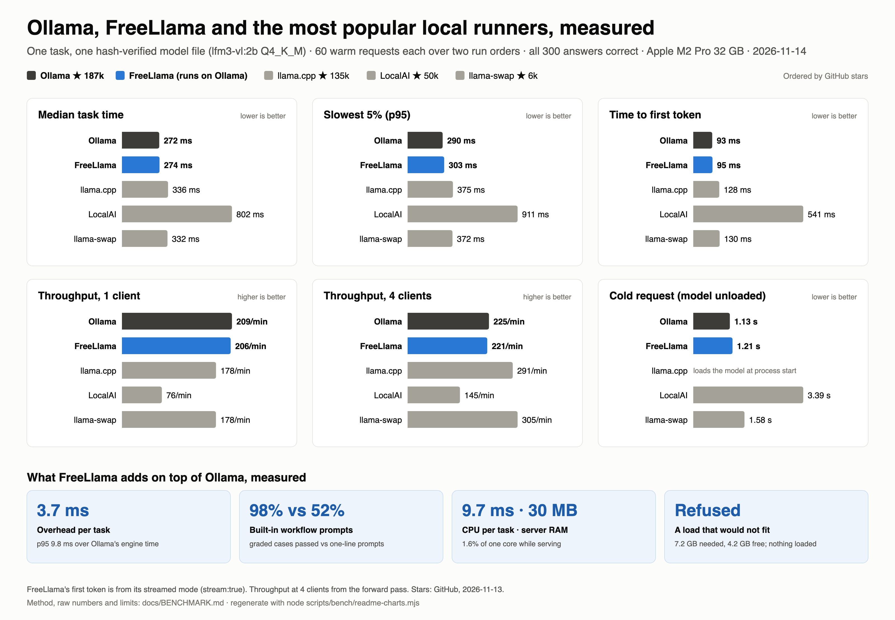
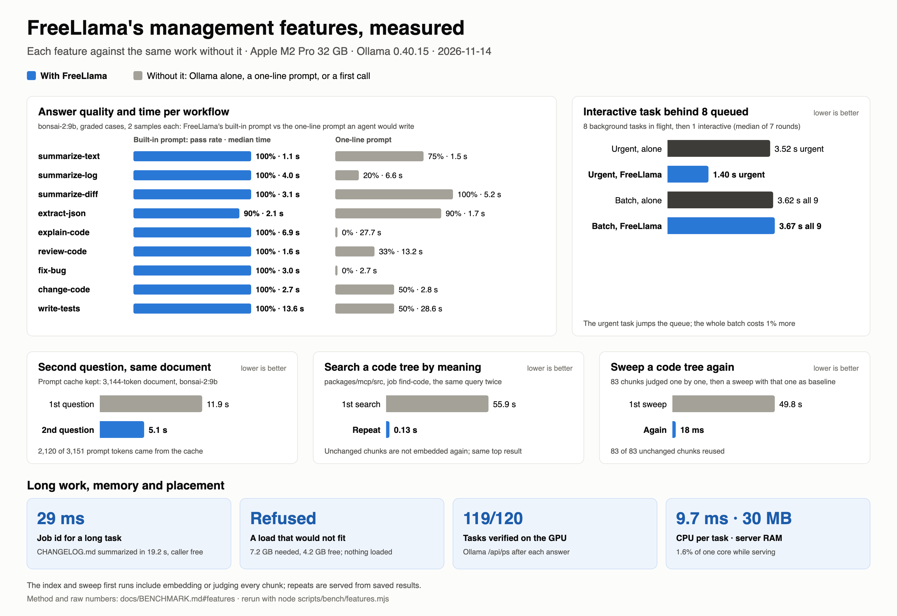

# Benchmark

One run, measured on 2026-11-14 on an Apple M2 Pro (32 GB): FreeLlama against Ollama alone,
llama.cpp, llama-swap and LocalAI, all loading the same hash-verified model file. Every one of the
360 measured answers was correct and byte-identical for that single extraction fixture.
This is separate from [result-check accuracy and local tool-calling evidence](RELIABILITY.md).
The current explicit [managed llama.cpp text path](LLAMACPP.md) is also separate from these
Ollama-backed FreeLlama measurements.



Then the [features](#features): what FreeLlama's management changes, each measured against the
same work without it.

## What the measured scenarios show

FreeLlama manages model selection, admission and receipts around external engines. The
FreeLlama rows below used Ollama. In this workload, its layer added a few milliseconds and
used about 30 MB of server RSS. These results describe the recorded configurations:

| Scenario | Setup measured here | Observations in this run |
|---|---|---|
| An agent (Claude Code, Cursor, scripts) that offloads bounded work to local models on a machine that also runs editors, browsers and builds | **FreeLlama on Ollama** | Same speed as Ollama (274 vs 272 ms median, first streamed token 95 vs 93 ms); its own work is 3.7 ms per task and its server uses 26–31 MB. Its built-in workflow prompts passed 45/46 completed graded cases versus 25/48 for one-line prompts (planned-denominator limits below), in less time and fewer tokens. An interactive task behind 8 queued ones answered in 1.40 s instead of 3.52 s; repeated code searches and sweeps reuse saved work (55.9 s → 0.13 s, 49.8 s → 18 ms); long tasks return a job id in 29 ms. It refuses a load that would not fit and names what holds the memory (live: needed 7.2 GB, 4.2 GB free, refused), selects eligible installed models with runtime admission, and returns a receipt with per-phase timing. 9.7 ms CPU per task. MCP server, CLI and an Ollama/OpenAI/Anthropic gateway. |
| One application, one model you chose, little else running | **Ollama alone** | Fastest here by 2 ms (272 ms), one-line install, the largest model library. You size models and watch memory yourself. |
| Many concurrent requests to one model | **llama.cpp `llama-server`** | Slower per request here (336 ms) but 291 tasks/min at 4 clients against 225 for Ollama, which serves one request at a time unless `OLLAMA_NUM_PARALLEL` is set (not measured). Model loads at process start. |
| Several models swapped on demand behind one OpenAI endpoint, on any engine | **llama-swap** | 332 ms, the best 4-client throughput (305 tasks/min), 1.58 s to load on first request. Limits are pools you declare, not measured memory. |
| One server for many modalities and backends (images, speech, video) | **LocalAI** | About 3× slower on this task (802 ms; 541 ms to first token) and 3.39 s cold, in exchange for breadth. |
| A desktop app for people | LM Studio, Jan | Not measured here. |

FreeLlama and Ollama are not either-or: FreeLlama runs on the Ollama you have, and Ollama's own
clients keep working through it.

## KPIs

Six setups, the same request, 60 measured requests each over two run orders (forward and
reversed), after 2 warm-ups per pass.

| KPI | What it measures | How | Ollama alone | FreeLlama | FreeLlama streamed | llama.cpp | LocalAI | llama-swap |
|---|---|---|---:|---:|---:|---:|---:|---:|
| Correct answers | The task's JSON, field by field | Exact match against the known answer | 60/60 | 60/60 | 60/60 | 60/60 | 60/60 | 60/60 |
| Median task time | What one request costs | Client wall clock, warm model, pooled over both orders | **272 ms** | **274 ms** | **273 ms** | 336 ms | 802 ms | 332 ms |
| p95 task time | The slow tail | Same samples | 290 ms | 303 ms | 299 ms | 375 ms | 911 ms | 372 ms |
| First token | When text starts to appear | Client clock to the first non-empty content | 93 ms | — | 95 ms | 128 ms | 541 ms | 130 ms |
| Throughput, 1 client | Tasks finished per minute in sequence | Verified tasks ÷ measured window, mean of both orders | 209 | 206 | 217 | 178 | 76 | 178 |
| Throughput, 4 clients | Tasks per minute under contention | 4 concurrent clients, 30 requests (forward pass) | 225 | 221 | 222 | 291 | 145 | 305 |
| Cold request | First answer when the model is not loaded | 3 samples after an unload (`keep_alive: 0`) or a process restart | 1.13 s | 1.21 s | 1.17 s | n/c¹ | 3.39 s | 1.58 s |
| Decode speed | Engine token rate | Ollama's own timing, median of each order, averaged | 124 tok/s | 125 tok/s | 124 tok/s | — | — | — |
| Layer overhead | Time added on top of the engine | Client time minus Ollama engine time, 40 requests | — | 3.7 ms (p90 5.6) | — | — | — | — |
| Layer memory | RAM the management process itself uses | Peak RSS of the FreeLlama server process | — | 26–31 MB | 26–31 MB | — | — | — |
| Swap growth | Whether the run pushed the host into swap | Swap used at block start versus peak | 0 | 0 | 0 | 0 | 0 | 0 |
| Layer CPU | CPU the management process uses per task | `ps` CPU time of FreeLlama's server over 100 warm tasks | — | 9.7 ms | — | — | — | — |
| GPU placement | Whether the model ran fully on the GPU | Ollama `/api/ps` after each answer, from the receipt | — | 59/60 | 60/60 | — | — | — |

¹ llama.cpp loads the model before it reports ready, so its first request after a restart is warm
(0.33 s); its load time is part of process start, not the request.

Bold marks the three setups within 2 ms of each other. Gaps under about 50 ms changed order
between earlier runs on a busier host; read them as ties.

## Results

[Full report](assets/benchmark-results-2026-11-14.html): pooled and per-order tables,
host samples. Between the two run orders LocalAI's median moved by 100 ms (851 → 751 ms) and
llama.cpp's by 34 ms (311 → 345 ms); Ollama, FreeLlama and FreeLlama streamed stayed within
268–275 ms in both.

**Concurrent clients** (forward pass, 30 requests per level):

| System | 2 clients: p50, tasks/min | 4 clients: p50, tasks/min |
|---|---:|---:|
| Ollama alone | 527 ms, 226 | 1,058 ms, 225 |
| FreeLlama | 534 ms, 221 | 1,068 ms, 221 |
| FreeLlama streamed | 535 ms, 220 | 1,074 ms, 222 |
| llama.cpp | 561 ms, 210 | 777 ms, 291 |
| llama-swap | 564 ms, 213 | 787 ms, 305 |
| LocalAI | 913 ms, 128 | 1,621 ms, 145 |

Ollama serves one request at a time by default, so its time per request doubles with two clients;
FreeLlama keeps its throughput within 2%. llama.cpp's parallel slots overlap requests.

### FreeLlama's overhead, profiled

Each receipt carries `timing`: milliseconds per phase inside `serve`. On 40 warm requests the old
build spent its time on three things every request paid for: reading Ollama's `/api/tags` for a
pinned model (21 ms median; Ollama reads every manifest from disk), waiting for a fresh host
sample every 2 s (55 ms at p90), and writing learned feedback to SQLite (5 ms median). The new
build caches each endpoint's tag list for 10 s, samples the host and probes Ollama's settings in
the background, and writes feedback after the response.

| Client time minus Ollama engine time | Old build | New build |
|---|---:|---:|
| Median | 22.9 ms | 3.7 ms |
| p90 | 60.3 ms | 5.6 ms |
| Max | 81.5 ms | 29.6 ms |

Both builds measured back to back on the same host at the same load (load average about 7).

### Memory gate, live

With the host under pressure (load average 16, swapping, 5.9 GB free of 32 GB), a FreeLlama
`summarize-text` task was held for its 20 s wait limit and then refused: "needs 7.2 GB incl. 3.6 GB reserve, 4.2 GB
free; largest memory users: Google Chrome Helper ×54 4.6 GB, Code Helper ×3 2.6 GB, node ×13
2.4 GB…". Nothing was loaded and nothing swapped. The suite has no matching row for the other
systems yet (`--hog-gb` exists but was not run).

## Features



Each feature measured against the same work without it, through the MCP server an agent uses,
with a fresh `serve` on the build above (`scripts/bench/features.mjs`). Same Mac, 2026-11-14. Raw
numbers: [`benchmark-features-raw-2026-11-14.json`](assets/benchmark-features-raw-2026-11-14.json).

| Feature | Measured against | Without it | With FreeLlama | How |
|---|---|---:|---:|---|
| Priority under load | One interactive task sent after 8 background tasks | 3.52 s (Ollama alone, arrival order) | **1.40 s** | Median of 7 rounds; `priority: "interactive"` vs `"background"`. The whole batch of 9 took 3.62 s and 3.67 s (+1%) |
| Built-in workflow prompts | The one-line prompt an agent would write | 52% of graded cases | **98%** | 24 cases × 2 samples on `bonsai-2:9b`; [per workflow](#built-in-prompts-measured) |
| Code search index | The first search of `packages/mcp/src` by meaning | 55.9 s | **0.13 s** (repeat) | Job `find-code` with `nearest`; the repeat embeds no unchanged chunk and returns the same top file |
| Sweep with a baseline | A first sweep: 83 chunks judged one by one by `strands-decider:2b` | 49.8 s | **18 ms** | `sweep {baseline}` reused all 83 unchanged chunks |
| Long task as a job | Waiting on one call | — | **29 ms** to a job id | `run_task {defer:true}` for `summarize-log` over `CHANGELOG.md`; done in 19.2 s while the caller polled `task_jobs` |
| Memory gate | Loading a model that does not fit | — | **Refused** | 7.2 GB needed with 4.2 GB free; nothing was loaded ([details](#memory-gate-live)) |
| GPU placement | — | — | **119/120** verified | Ollama `/api/ps` after each answer showed the whole model in VRAM |
| Layer cost | — | — | **9.7 ms CPU, 26–31 MB** per task and server | `ps` CPU time over 100 tasks; peak server RSS |

The first index and sweep runs include embedding or judging every chunk; their repeats read saved
results, so the size of the gain depends on how much changed.

Not a FreeLlama-only gain, so not in the table: a second question about the same 3,144-token
document took 5.1 s instead of 11.9 s (2,120 of 3,151 prompt tokens from cache). That is Ollama's
prompt cache; FreeLlama keeps the context size and settings stable between calls so the cache
stays usable, and Ollama alone gives the same when a client does the same. Ollama reuses it across
turns only for attention models such as `bonsai-2:9b`, not hybrid ones such as `lfm3`.

### Built-in prompts, measured

FreeLlama's workflows send model-specific prompts evaluated on the dated cases below. To measure what that adds, the
workflow evaluation (`scripts/local-test/workflows.mjs`) ran the 9 text workflows' graded cases on
`bonsai-2:9b`, 2 samples each, once with the shipped prompts and once with the one-line prompt an
agent would write itself ([`baseline-prompts.mjs`](../scripts/local-test/baseline-prompts.mjs),
naming the answer format where the workflow needs one). Everything else (model, options, grading)
was the same. On the 24 cases graded both ways:

| | Shipped workflow prompts | One-line prompts |
|---|---:|---:|
| Pass among completed graded samples | **45/46 (98%)** | 25/48 (52%) |
| Pass / nominal 48 planned trials | 45/48 (94%) | 25/48 (52%) |
| Median time per task | **2.54 s** | 3.29 s |
| Median output tokens | **46.5** | 72.5 |

Per workflow (pass rate, median time per task):

| Workflow | Built-in prompt | One-line prompt |
|---|---:|---:|
| `summarize-text` | 7/7, 1.1 s | 6/8, 1.5 s |
| `summarize-log` | 9/9, 4.0 s | 2/10, 6.6 s |
| `summarize-diff` | 4/4, 3.1 s | 4/4, 5.2 s |
| `extract-json` | 9/10, 2.1 s | 9/10, 1.7 s |
| `explain-code` | 2/2, 6.9 s | 0/2, 27.7 s |
| `review-code` | 6/6, 1.6 s | 2/6, 13.2 s |
| `fix-bug` | 4/4, 3.0 s | 0/4, 2.7 s |
| `change-code` | 2/2, 2.7 s | 1/2, 2.8 s |
| `write-tests` | 2/2, 13.6 s | 1/2, 28.6 s |

`extract-json` is a tie: a schema-shaped task the one-line prompt already states.

The one-line prompts failed by padding past length limits (a log summary of 170 words for a 90-word
bound), inventing causes ("database" in a log that never mentions one), missing the failed step,
and leaving out the edit block. The retained aggregates contain 46 shipped completions versus 48
baseline completions over a nominal 48 planned trials per arm. The 98% figure is 45/46 completed
samples; counting the two absent shipped completions as not passed gives 45/48 (93.75%). The
individual traces for those absent samples are not in the checked-in aggregates. Earlier notes
report six memory-held attempts, but the retained data does not reconstruct those attempts or
explain their relationship to these two missing completions. Treat this as
incomplete completion evidence, not a production reliability percentage. The newer
[tool-calling smoke suite](RELIABILITY.md#public-tool-calling-smoke-suite) tests a different scope.

## Scorecard

FreeLlama rated on measured numbers only: each target is parity with Ollama alone (which
FreeLlama runs on) or a fixed bar, and each value comes from this page.

| KPI | Target | Measured | How | Result |
|---|---|---|---|---|
| Quality: benchmark task | Same as Ollama (100%) | 60/60 correct, byte-identical to Ollama | [KPIs](#kpis) | Met |
| Quality: built-in prompts | Beat one-line prompts | 45/46 completed vs 25/48; nominal planned 45/48 vs 25/48 | [Denominators and limits](#built-in-prompts-measured) | Observed gain; incomplete shipped trials |
| Time: median task | Within 5% of Ollama | 274 vs 272 ms (+0.7%) | [KPIs](#kpis) | Met |
| Time: own overhead | p95 ≤ 15 ms | p95 9.8 ms, median 3.7 ms | [Overhead](#freellamas-overhead-profiled) | Met |
| Time: first token | Within 10% of Ollama | 95 vs 93 ms (+2%) | [KPIs](#kpis) | Met |
| Load: 4 clients | ≥ 95% of Ollama's throughput | 221 vs 225 tasks/min (98%) | [Results](#results) | Met |
| Switching: cold request | Within 5% of Ollama | 1.21 vs 1.13 s (+7%) | [KPIs](#kpis) | **Missed** |
| CPU | < 2% of one core while serving | 9.7 ms CPU per task, 1.6% of a core | below | Met |
| Memory: the layer | ≤ 50 MB | 26–31 MB server RSS | [KPIs](#kpis) | Met |
| Memory: under pressure | Refuse rather than swap | Refused 7.2 GB with 4.2 GB free; swap +0 in every block | [Memory gate](#memory-gate-live) | Met |
| GPU placement | Every receipt verified | 119/120 verified fully on the GPU | below | **Missed** |

The two misses: a cold request costs about 80 ms more through FreeLlama (admission, a host sample
and the residency watch around the load), and one receipt could not verify placement because the
model was no longer resident when FreeLlama looked after the answer.

**CPU** was measured as the `ps` CPU time (user + system) of FreeLlama's server process over 100
warm managed tasks, background host sampling included: 9.7 ms per task, against 10.8 ms for
Ollama's own server process over the same tasks, with tasks 0.6 s apart. **GPU placement** is the
receipt's `execution.observation`: Ollama's `/api/ps` after each answer showed the model's whole
size in VRAM (`processor: gpu`) for 119 of 120 FreeLlama tasks.

## Competitor landscape

Checked on 2026-11-13 using GitHub repository metadata (displayed stars and last push). Stars help
choose which tools to look at. They do not measure quality or speed.

**Runtimes and servers.** These load and run the model themselves.

| Project | Stars | Status here |
|---|---:|---|
| [Ollama](https://github.com/ollama/ollama) | 186.9k | Benchmarked (baseline; FreeLlama's upstream) |
| [llama.cpp](https://github.com/ggml-org/llama.cpp) | 134.9k | Benchmarked (`llama-server`) |
| [vLLM](https://github.com/vllm-project/vllm) | 96.9k | Not run: no Apple Metal backend |
| [GPT4All](https://github.com/nomic-ai/gpt4all) | 77.3k | Not run: desktop app, last push 2025-05 |
| [LocalAI](https://github.com/mudler/LocalAI) | 50.4k | Benchmarked |
| [exo](https://github.com/exo-explore/exo) | 48.4k | Not run: built for clusters of several machines |
| [textgen (oobabooga)](https://github.com/oobabooga/textgen) | 47.7k | Not run: desktop app |
| [Jan](https://github.com/janhq/jan) | 45.7k | Not run: desktop app |
| [SGLang](https://github.com/sgl-project/sglang) | 38.8k | Not run: GPU-server engine |
| [llamafile](https://github.com/mozilla-ai/llamafile) | 26.6k | Not run: same engine family as llama.cpp |
| [oMLX](https://github.com/jundot/omlx) | 23.6k | Not run: needs a separate MLX artifact and a third-party tap |

**Lifecycle, routing and agent layers.** These are FreeLlama's closest peers. They sit in front
of an engine.

| Project | Stars | Relation to FreeLlama | Status here |
|---|---:|---|---|
| [LiteLLM](https://github.com/BerriAI/litellm) | 63.2k | Gateway for many providers: budgets, retries | Not run: a different layer |
| [llama-swap](https://github.com/mostlygeek/llama-swap) | 6.2k | Starts engines on demand and swaps models | Benchmarked |
| [GPUStack](https://github.com/gpustack/gpustack) | 6.0k | Schedules models across GPU clusters | Not run: needs several machines |

Smaller runtimes, not run: [KoboldCpp](https://github.com/LostRuins/koboldcpp) (12.3k) and
[mlx-lm](https://github.com/ml-explore/mlx-lm) (7.7k) share an engine family or artifact format with
those above; [Lemonade](https://github.com/lemonade-sdk/lemonade) (6.2k),
[LM Studio's CLI](https://github.com/lmstudio-ai/lms) (5.4k), [RamaLama](https://github.com/containers/ramalama)
(3.1k) and [Docker Model Runner](https://github.com/docker/model-runner) (0.7k) were not installed.
Ollama-specific layers under 1k stars ([ollama-mcp-bridge](https://github.com/patruff/ollama-mcp-bridge),
[Olla](https://github.com/thushan/olla), [ollama-mcp](https://github.com/rawveg/ollama-mcp),
[herd](https://github.com/tom-swift-tech/herd), [ollama-queue-proxy](https://github.com/TadMSTR/ollama-queue-proxy))
cover one piece each: MCP pass-through, load balancing, GPU routing or a priority queue.

Tools at other layers (Open WebUI 158.6k, Fabric 44.6k, llm 12.8k, aichat 10.6k) are clients that
sit above FreeLlama, not peers. [TensorZero](https://github.com/tensorzero/tensorzero) is now archived,
and [RouteLLM](https://github.com/lm-sys/RouteLLM) was last pushed in 2024-08.

**How systems were chosen.** A system was benchmarked when it serves an HTTP API on this Mac and
can load the same GGUF bytes. llama-swap was added as the closest lifecycle manager. oMLX was left
out by the operator: it would need a third-party Homebrew tap plus a 1.71 GB MLX copy of the model
(`mlx-community/LFM3-VL-2B-OptiQ-4bit`), and that copy would be a separate cohort.

### Features beyond speed

Checked on 2026-11-14 against each project's README, docs and release notes, not by running
them. "Partial" means the feature exists with a limit named in the cell.

| System | Memory check before a load | Suggests a model that fits | MCP server for agents | OpenAI / Anthropic / Ollama API | Streaming | Prometheus metrics |
|---|---|---|---|---|---|---|
| FreeLlama 0.12.0 | Yes: refuses a cold load that would not fit live free memory and names what holds it | Yes: machine-local calibrated routing, then installed catalog fallback and runtime admission | Yes (13 tools), plus a CLI | Gateway: all three | Yes: managed tasks stream with their receipt (`stream: true`); gateway workflows stream through Ollama | Yes, plus a receipt per task |
| Ollama 0.40.16 | Partial: splits layers to fit VRAM; refuses only when total RAM is short | Partial: featured models, not fitted to the machine | No (`ollama launch` configures agents) | Yes / partial / native | Yes | No |
| llama.cpp 1.0.0 | Partial: `--fit` on by default; the router unloads to make room, then loads anyway | No | No (MCP client only) | Yes / yes / no | Yes | Yes (opt-in) |
| LM Studio 0.4.28 | Yes: resource guardrails, `lms load --estimate-only` | Partial: estimates | No (MCP client) | Yes / yes / no | Yes | No |
| LocalAI 4.12.1 | Yes: `--vram-budget` cap and context auto-fit | Yes: hardware-based recommendations | Unclear (client documented) | Yes / yes / yes | Yes | Yes |
| oMLX 0.8.0rc1 | Yes: process memory cap and eviction | Yes: first-run fit helper | No (MCP client) | Yes / yes / no | Yes | No |
| llama-swap v272 | Partial: evicts by declared pools, not measured memory | No | No | Yes / yes / no (passthrough) | Yes | Yes |
| vLLM 0.32.0 | Not found in docs | Partial: Metal recipes by Mac memory | No | Yes / yes / no | Yes | Yes |
| Jan 0.8.8 | Partial: fit check; auto-fit off by default since 0.8.1 | Partial | No (MCP client) | Chat completions / unknown / no | Unknown | Unknown |
| GPT4All 3.10.0 | No (static RAM labels) | Partial: static labels | No | Partial / no / no | Unknown | No |

FreeLlama inherits Ollama's engine, formats and modalities (vision, embeddings, speech) and adds
the gate, the pick and the receipts. Memory-aware loading is no longer rare: LocalAI, oMLX, LM
Studio and llama.cpp's router each have their own. FreeLlama's distinct parts are a gate driven
by live host signals, [machine-local calibrated picks with catalog fallback](MODEL_SELECTION.md#turn-measurements-into-routing-evidence),
job prompts, and an MCP server for bounded agent work. These current selection rules were not
measured by the pinned single-model comparison above.

The dated feature snapshot above lists llama.cpp 1.0.0 (2026-11-13) and Ollama 0.40.16; the measured
run used llama.cpp build 11960 and Ollama 0.40.15. Do not transfer the results to different versions.

## Setup

| Item | Value |
|---|---|
| Host | Apple M2 Pro, 12 CPUs, 32 GiB unified memory; other applications open; 1-minute load average 9.8 at the start, 5.3 at the end |
| Model | `lfm3-vl:2b-q4_K_M` (LFM3 1.7B, Q4_K_M), one GGUF file, SHA-256 `56dac2e192ff0d9ab8507f4f1aeb4aed0463449bbbefaac79497f041c95f21eb`, checked with `shasum -a 256` |
| Task | Extract `id`, `team` and `priority` from a support ticket as JSON; temperature 0, seed 42, 64 output tokens, 4,096 context, thinking off |
| Tokens per task | 75 prompt + 22 output (Ollama, FreeLlama, LocalAI); 74 + 24 (llama.cpp, llama-swap): each server applies the model's chat template its own way |
| Ollama | 0.40.15 (`/api/chat`) |
| FreeLlama | 0.12.0 plus the unreleased changes in the [changelog](../CHANGELOG.md): managed tasks (`/_freellama/v1/tasks`), streamed with `stream: true` |
| llama.cpp | `llama-server` 0.8.0, build 11960 (`8642541b2`), `-ngl 99 --jinja --reasoning-budget 0` |
| llama-swap | v272 (`802f1c4`) over the same `llama-server` |
| LocalAI | 4.12.1, `llama-cpp-development` backend, `gpu_layers: 99`, reasoning off |
| Procedure | One system at a time; 2 warm-ups, 30 measured requests per pass; forward and reversed order; then 2- and 4-client levels and 3 cold requests (forward only). After each Ollama-backed block the harness unloads the model it loaded |

llama.cpp 1.0.0 and Ollama 0.40.16 are outside this measured version cohort.

## Limits

- One machine, one small model, one short task. Larger models, long prompts and long outputs can
  order the systems differently.
- Ollama ran with its defaults (`OLLAMA_NUM_PARALLEL` unset); with parallel slots its concurrent
  throughput would change. Not measured.
- Whole-host CPU includes other applications, so it is recorded in the report, not compared.
- Process RSS undercounts GPU buffers on unified memory; only FreeLlama's own server RSS is quoted.
- The memory-pressure comparison (`--hog-gb`) and the agent-token meter are built but not run.
- Prompt quality was measured on one model (`bonsai-2:9b`), 2 samples per case, with deterministic
  graders; other models gain differently. The one-line baseline is one reasonable agent prompt, not
  the best an agent could write.
- The feature runs are one sample of each scenario on a busy workstation (load average 10–17),
  except priority (7 rounds). An earlier priority run gave the same interactive gain (3.80 s →
  1.57 s) but a 17% slower batch; the batch cost varies with load.
- CPU and the overhead before/after were measured outside the benchmark run, on the same host, with
  the same request, minutes apart.
- Targets in the scorecard were set by the FreeLlama team: parity with Ollama, or the RFC's bars.

## Reproduce

1. Install the engines: `bash scripts/bench/setup-macos.sh --install` (llama.cpp, LocalAI, oMLX).
   Get llama-swap from its [GitHub release](https://github.com/mostlygeek/llama-swap/releases) and
   check the archive's SHA-256. No model is downloaded automatically.
2. Set up LocalAI from
   [`localai-model.example.yaml`](../scripts/bench/localai-model.example.yaml). If the stable
   `llama-cpp` backend rejects your model's architecture (4.12.1 rejected `lfm3`), use
   `llama-cpp-development`. Keep
   `reasoning.disable`, or LocalAI spends the 64-token cap on reasoning and returns an empty answer.
   Set up llama-swap from [`llama-swap.example.yaml`](../scripts/bench/llama-swap.example.yaml).
3. Add `start` commands, or start each service yourself, then run preflight, a forward pass and a
   reversed pass:

```sh
node scripts/bench/preflight.mjs --config CONFIG.json --hash-model --out NEW_PREFLIGHT_DIR
node scripts/bench/run.mjs --config CONFIG.json --samples 30 --out NEW_FORWARD_DIR
node scripts/bench/run.mjs --config CONFIG.reversed.json --samples 30 --out NEW_REVERSED_DIR
node scripts/bench/report.mjs --report NEW_FORWARD_DIR/summary.json --report NEW_REVERSED_DIR/summary.json --out NEW_REPORT.html
```

With two or more `--report` files, the page shows a pooled table (p50/p95 from each run's raw
`trials.jsonl`) and one table per run order. Preflight reports vendors with `start` as
`owned_start` and checks only their start command.

After each Ollama-backed block, the runner unloads the benchmark model it warmed (`keep_alive: 0`
at `ollama_base_url`, confirmed by `/api/ps`); `--keep-loaded` skips this. Optional coverage flags,
described in the [bench README](../scripts/bench/README.md#run-options):

- `--max-load-per-cpu X [--strict-load]`: record load and top CPU processes at each block start;
  warn above X, or skip the block as `not_run`.
- `--concurrency 2,4,8`: C1, N concurrent clients per level on the warm model.
- `--cold [--cold-samples N]`: C3, unload or restart, then time the first request.
- `--hog-gb N [--force-hog]` with `--cold`: C2, hold N GiB during each block. Refused above
  estimated available minus 2 GiB unless forced.

Keep the background workload fixed and note it. Before claiming a difference, compare it with the
drift between passes. The runner stops every later vendor if an inference outcome is uncertain or
if it cannot stop a server it started.

The [features](#features) run against a fresh `serve` with its own home and the installed models
(`--chat-model`, `--decide-model`); it pulls nothing:

```sh
node scripts/bench/features.mjs --binary target/release/freellama --out FEATURES.json
```

Local evidence (Git-ignored): `.octocode/bench/live-2026-11-14-v2/` holds the configs, both
passes (`run-forward/`, `run-reversed/`), raw `trials.jsonl`, cold and concurrency samples, server
logs, host samples and `background-load.txt`. The charts are drawn from it by
`node scripts/bench/readme-charts.mjs --run DIR --run DIR --facts docs/assets/benchmark-facts-2026-11-14.json --out docs/assets`.

## Verification

Historical verification recorded on 2026-11-14 after the benchmark build (before the later
calibration, engine and refactor changes): `yarn test:js` **1,280 pass** (1 skipped), `yarn
test:bench` **112 pass**, MCP integration against live Ollama **160 pass**, and the Rust suite
all unit tests pass (427) with **3 integration-contract failures** (293 pass), all in tests the
earlier staged branch work did not update (digest-verified
placement and no inference retry after a 500); none touches the changes measured here. `cargo
clippy -D warnings` is clean. The production gate (`yarn verify:production`) was not run for that snapshot. These counts and
failures are preserved as historical context; they are not the current checkout's verification
status. Use [Testing](TESTING.md) for the current gate commands.
