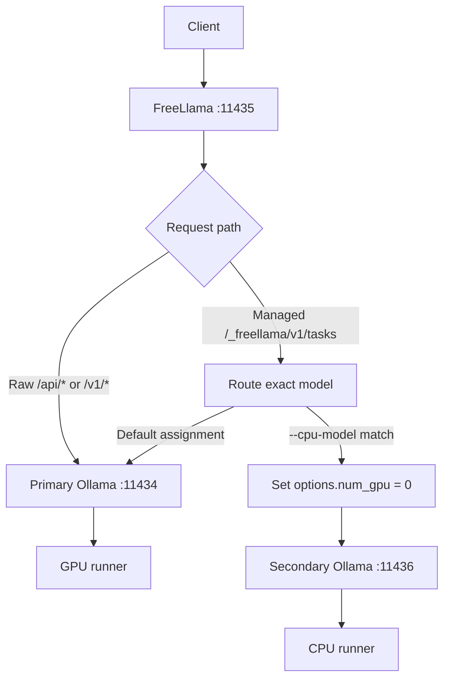
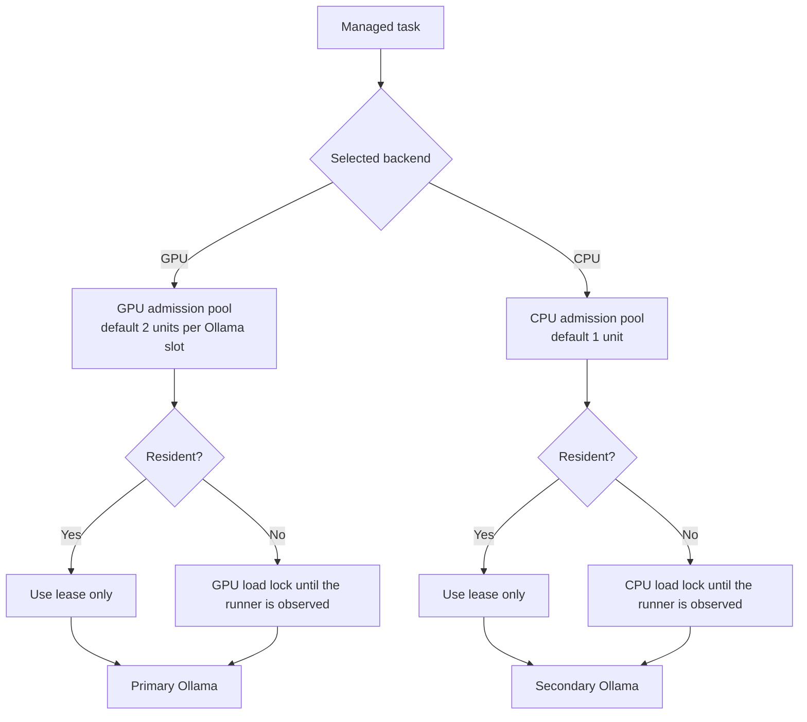
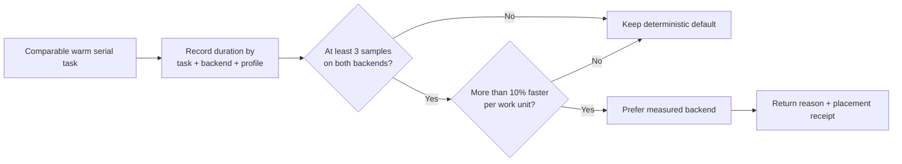

# Run models on CPU and GPU

To separate GPU work from CPU helpers, configure two Ollama processes and assign exact helper-model
tags to the secondary process. FreeLlama routes managed tasks within those assignments, applies
`num_gpu: 0` to CPU requests, and reports both the selected backend and observed processor placement.

The calling agent submits tasks and placement preferences. FreeLlama coordinates admission,
memory checks, and model transitions for each backend; the operator configures the processes and
eligible tags. A configured CPU backend is intent: inspect the placement observation before
treating it as proof of CPU execution.

This configuration is useful for embeddings, short classification, and other small helper models.
Benchmark large CPU workloads before adopting them. Apple silicon shares memory bandwidth; systems
with discrete GPUs have different contention and transfer costs, so neither result transfers
without measurement.

## Adapt the design to your hardware

The two-process contract is portable; the device-control mechanism and useful workload are
machine-specific:

| Host | Primary process | CPU process defense in depth | Capacity evidence |
|---|---|---|---|
| Apple silicon | Metal auto-detection | Managed `num_gpu: 0`; `OLLAMA_LLM_LIBRARY=cpu` is only a hint | Total unified memory plus `/api/ps` |
| Linux or Windows with NVIDIA | CUDA auto-detection | `CUDA_VISIBLE_DEVICES=-1` plus managed `num_gpu: 0` | Host RAM, `nvidia-smi`, and `/api/ps` |
| Linux or Windows with AMD | ROCm or Vulkan auto-detection | `ROCR_VISIBLE_DEVICES=-1` or `GGML_VK_VISIBLE_DEVICES=-1`, plus managed `num_gpu: 0` | Host RAM, vendor tools, and `/api/ps` |
| CPU-only | CPU | A second process can isolate helpers, but it does not create a second accelerator | Host RAM and measured overlap |

`doctor` reports `machine.memory_bytes` on macOS, Linux, and Windows. It reports
`machine.memory_kind` as `unified` only when host and accelerator share one memory pool; host RAM
is not a VRAM estimate on discrete-GPU hosts. `machine.gpu` names the accelerator when the OS reports it
(Apple model and core count, or NVIDIA name and memory on Linux), and `performance_cpus` /
`efficiency_cpus` split hybrid CPUs on macOS. These are identity facts, not placement proof. Model-library fit is therefore a host-memory preflight, and
actual accelerator placement must come from Ollama's resident-runner report.

An agent can choose `auto`, `prefer_cpu`, or `prefer_gpu`, but it cannot invent topology. The
operator owns the backend endpoints and exact CPU-eligible tags. This split lets the same schema
work on a laptop, a CPU-only server, or a multi-GPU workstation without silently moving arbitrary
client requests.

## Understand the boundary

The primary upstream owns the compatibility API and GPU-default managed tasks. The secondary
upstream owns only exact tags configured with `--cpu-model`:



FreeLlama does not rewrite raw passthrough request bodies or route them by model. A direct Ollama client that
needs model-aware CPU placement must use the managed task endpoint instead.

## Start the backends

Start the primary Ollama process with a conservative local-only baseline:

```bash
OLLAMA_HOST=127.0.0.1:11434 OLLAMA_NO_CLOUD=1 \
    OLLAMA_MAX_LOADED_MODELS=1 OLLAMA_NUM_PARALLEL=1 ollama serve
```

Or let `serve` start and own the CPU process: `--spawn-cpu-backend` runs `ollama serve` on
`127.0.0.1:11436` (`--cpu-backend-port`, `--ollama-binary`) with `OLLAMA_NO_CLOUD=1`,
`OLLAMA_LLM_LIBRARY=cpu`, `OLLAMA_NUM_PARALLEL=1` and every GPU runtime hidden
(`CUDA_VISIBLE_DEVICES`, `ROCR_VISIBLE_DEVICES`, `HIP_VISIBLE_DEVICES`, `GGML_VK_VISIBLE_DEVICES` set
to `-1`), waits until it answers, logs it to `cpu-ollama.log` in the FreeLlama home, and stops it
when `serve` exits. A port that already answers is refused rather than adopted:

```bash
npx @octocodeai/freellama serve --spawn-cpu-backend --cpu-model nomic-embed-text:v1.5
```

To run the second process yourself, start it on another loopback port:

```bash
OLLAMA_HOST=127.0.0.1:11436 OLLAMA_NO_CLOUD=1 \
    OLLAMA_MAX_LOADED_MODELS=1 OLLAMA_NUM_PARALLEL=1 \
    OLLAMA_LLM_LIBRARY=cpu ollama serve
```

The library override is experimental and varies by Ollama build. On the measured Apple Metal 0.33.2
server, Ollama accepted `OLLAMA_LLM_LIBRARY=cpu` but still selected Metal until the request included
`num_gpu: 0`. FreeLlama adds that option to CPU-assigned managed requests.

On other GPU backends, Ollama also documents process-level device controls:

- NVIDIA: `CUDA_VISIBLE_DEVICES=-1`
- ROCm: `ROCR_VISIBLE_DEVICES=-1`
- Vulkan: `GGML_VK_VISIBLE_DEVICES=-1`

Use a device control appropriate for the Ollama build in addition to FreeLlama's request option when
you need defense in depth.

## Assign models

Start FreeLlama with the two upstreams and at least one exact CPU model tag:

```bash
./target/release/freellama serve \
    --upstream http://127.0.0.1:11434 \
    --cpu-upstream http://127.0.0.1:11436 \
    --cpu-model nomic-embed-text:latest
```

Repeat `--cpu-model` to assign more tags:

```bash
./target/release/freellama serve \
    --upstream http://127.0.0.1:11434 \
    --cpu-upstream http://127.0.0.1:11436 \
    --cpu-model nomic-embed-text:latest \
    --cpu-model qwen2.5:0.5b
```

Use the exact name returned by Ollama, including `:latest` when present. FreeLlama rejects these
unsafe or ambiguous configurations:

- A CPU upstream without a CPU model assignment
- A CPU model assignment without `--cpu-upstream`
- Empty model names
- The same socket expressed through aliases such as `localhost:11434` and `127.0.0.1:11434`
- An upstream that points back to the FreeLlama listener, or an unspecified host such as `0.0.0.0`

A nonloopback FreeLlama listener requires `--allow-remote` and bearer-token authentication.
See the [production runbook](PRODUCTION.md) for remote ingress requirements.

Set independent admission budgets when the defaults do not fit the workload:

```bash
./target/release/freellama serve \
    --upstream http://127.0.0.1:11434 \
    --cpu-upstream http://127.0.0.1:11436 \
    --cpu-model nomic-embed-text:latest \
    --max-concurrent-tasks 2 \
    --cpu-max-concurrent-tasks 1 \
    --max-queued-tasks 16 \
    --cpu-max-queued-tasks 8
```

The defaults above admit one ordinary primary-backend chat (cost 2) and one CPU embedding (cost 1)
at the same time. They are conservative workload units for the common `OLLAMA_NUM_PARALLEL=1`
layout, not a profile of the development Mac. Increase them only after measuring queue wait,
resident memory, and Ollama's own parallel setting on the target host.
Queue cardinality and wait time are separate bounds: excess waiters are refused immediately, while
an admitted waiter may remain until `--max-queue-wait-seconds`. Automatic backend selection checks
that the actual task cost fits the current slot snapshot before following historical speed.

## Let an agent express placement intent

MCP `run_task` and the managed HTTP route accept `executionPreference`: `auto`, `prefer_cpu`, or
`prefer_gpu` (HTTP: `execution_preference`). `minPlacementEvidence` accepts `configured` or
`observed` (HTTP: `min_placement_evidence`). Always preview consequential work:

```json
{
  "task": "embedding",
  "objective": "fastest",
  "executionPreference": "prefer_cpu",
  "minPlacementEvidence": "observed",
  "preview": true
}
```

A preview accepts routing constraints only. Add the embedding input when submitting the execution
request after accepting the route.

The agent does not gain authority to assign models. FreeLlama first applies model installation,
capability, policy, context, explicit-model, and session-affinity constraints. It only honors the
preference if an eligible model is already assigned to that backend. Inspect
`execution.preference_satisfied`, `execution.backend`, `execution.observation`, and
`execution.reason`. `observed` fails closed for cold models: warm once with `configured`, inspect
the receipt, then retry with observed evidence.

## Verify placement

Inspect FreeLlama's declared backend contract:

```bash
curl --silent http://127.0.0.1:11435/_freellama/v1/health | jq '.backends'
```

The output is similar to the following:

```json
{
  "gpu": {
    "upstream": "http://127.0.0.1:11434"
  },
  "cpu": {
    "upstream": "http://127.0.0.1:11436",
    "models": ["nomic-embed-text:latest"]
  }
}
```

Run a managed embedding task:

```bash
curl --silent http://127.0.0.1:11435/_freellama/v1/tasks \
    --header 'content-type: application/json' \
    --data '{
      "task": "embedding",
      "objective": "fastest",
      "model": "nomic-embed-text:latest",
      "input": "placement check",
      "keep_alive": "-1"
    }' | jq '{execution, admission, route}'
```

The `execution` object separates the configured `backend`, the `requested_processor`, and
post-run `observation`. The source is Ollama `/api/ps`; direct inspection remains useful:

```bash
curl --silent http://127.0.0.1:11434/api/ps | jq '.models[] | {name, size, size_vram}'
curl --silent http://127.0.0.1:11436/api/ps | jq '.models[] | {name, size, size_vram}'
```

A fully CPU-loaded model reports `size_vram:0`; a fully GPU-loaded model reports positive VRAM
covering its resident `size`. Compare both values from the same `/api/ps` entry. Installed `/api/tags`
file bytes can differ from resident memory and cannot prove a mixed placement. Positive VRAM without
total resident size stays unknown. `observation.status` is `verified`, `mismatch`, `not_resident`, or `unavailable`. Unknown, mixed, and mismatched
samples are reported but excluded from adaptive feedback.

## Understand concurrency

Each backend has its own weighted admission pool and its own load lock (see
[Load lock and use lease](#load-lock-and-use-lease)). CPU and GPU model loads therefore do not block
each other, and a GPU burst cannot spend the CPU helper's permit:

Within a priority class, each pool prefers a waiter whose model is already running on its backend
(or was admitted there last), within bounded skips; see [the admission design](ARCHITECTURE.md#managed-task-execution).

Both pools also share local host-pressure sampling and forecast-memory reservations. Independent
queues do not imply independent RAM on a unified-memory machine. A request can wait for available
headroom even when its backend has a free weighted permit. Inspect `admission.resources` in health
and `execution.resource_admission` in task receipts. Unknown thermal or GPU measurements are not
reported as healthy readings. See [the execution architecture](ARCHITECTURE.md) for the complete gate.



FreeLlama can overlap requests across the two servers even when each Ollama process uses
`OLLAMA_NUM_PARALLEL=1`. Raising `OLLAMA_NUM_PARALLEL` affects parallel requests within one server
and multiplies K/V-cache memory; it is a separate tuning decision. `OLLAMA_MAX_QUEUE` likewise
bounds each Ollama process after FreeLlama admission. It does not replace either backend's weighted
FreeLlama budget, bounded waiter count, or queue-wait deadline. Raw generation passthrough uses a
separate one-stream default cap in `serve`; its permit is held until the streamed response ends or is dropped.

The runtime file's `[task_costs]` table can tune individual task-kind weights without increasing
the entire pool's ceiling. Default vision weight four can serialize two vision requests under a
four-unit budget even when Ollama has two slots. A lower weight requires a qualified workload;
it does not add engine slots or relax memory checks. See
[monitoring controls](MONITORING.md#adaptive-concurrency).
Raw generation requests follow the same rules on the primary backend. A raw request for a runner
Ollama already holds at a matching digest and context takes no lock. A raw load takes the load lock
and receives 503 (`proxy busy: another model load is active`) if it stays busy past the raw queue
wait. Metadata GET/HEAD, `/api/show`, model-store calls (pull, push, copy, delete), and empty
`keep_alive:0` unloads remain available. Raw and managed work share the lock, the use leases and the
memory forecast, so a raw load and a managed load on one backend never overlap.

### Load lock and use lease

Two different things protect a model. Its use lease lasts through generation; the backend load
lock ends as soon as a compatible runner is observed, including before a nonstream response returns
its headers.

| | Held by | Held for | Blocks |
|---|---|---|---|
| **Use lease** (per model, per backend) | every managed task and raw generation for that model | the whole request, until the response ends or the caller disconnects | eviction and unload of that model. Tasks arriving for a model being unloaded wait for the unload |
| **Load lock** (per backend) | a request that loads or reloads a runner, and a managed explicit unload | only until `/api/ps` shows the runner (or the request ends or is cancelled); managed unloads retain it through bounded confirmation | other loads and managed explicit unloads on the same backend |

The rules that follow:

- A request whose runner is already resident at the expected digest and context (`resident_shared`)
  takes no load lock. It waits for no other model's load, and its lease keeps its runner from being
  evicted while it decodes.
- A request for a model that is not resident (`nonresident_transition_exclusive`) takes the load
  lock, reads `/api/ps` again, and shares the runner if a same-model load just finished. Otherwise
  it holds the lock until the runner appears, then releases it and keeps decoding under its lease.
  Same-model arrivals queue behind that load and then share the loaded runner instead of loading
  it again. A cancelled loader releases the lock at once.
- A load that needs memory held by a busy model waits. Eviction only ever takes models with no
  lease, and each time any model's use ends the waiting load plans its eviction again, so it
  proceeds as soon as that model is idle and never earlier.
- Managed explicit unloads take the model's lease first and then the load lock. Raw explicit
  unloads and automatic idle eviction use the per-model lifecycle claim without the backend load
  lock, so they can free an idle runner while another model is preparing a load. They still wait
  for that model's users and retain ownership through bounded unload observation.
- Observing runner readiness wakes resource waiters to re-size their demand. A same-model follower
  waiting for a cold-load forecast can then share the runner while its first request still decodes.

A cold task reads `/api/ps` six times in all: discovery, the receipt's capacity preview, the
dispatch-time forecast, the observation before the lock, the observation after winning it, and the
placement observation after the run. A resident task skips the post-lock read.

### Degraded runner identity

Reusing a runner without the load lock requires an observed identity. `/api/ps` must report the
runner's digest and it must equal the catalog digest. The reported `context_length` must equal the
requested `num_ctx`; when `/api/ps` omits it, the runner is shared only if the request sends no
`num_ctx` (Ollama's default applies, so nothing explicit can contradict it). A missing digest is never
compatible: the runner could be any build of the tag, so the task takes the load lock instead.

The reason is in the task receipt at `admission.reason` (copied from `execution.runner_reuse.reason`):
`resident_identity_unobserved`, `resident_digest_changed`, `resident_context_mismatch`,
`resident_context_unobserved`, `unverified_load_options`, `resident_placement_mismatch`,
`resident_context_unobserved_default_context_assumed` (shared, with the context assumed), or `null`
for a plain match or when no runner is resident. `execution.runner_reuse.status` is `compatible`, `incompatible_or_unverified`,
`absent` or `unavailable`.

### GPU placement rule

One rule decides whether a resident runner satisfies a request's placement, for managed and raw work
alike (`PlacementRule`). Placement is judged from the same `/api/ps` entry's `size_vram`:

| Rule | When | A runner satisfies it when |
|---|---|---|
| `any` | no placement evidence required (the default, and all raw passthrough) | always |
| `cpu_only` | the request sets `num_gpu:0` | `size_vram` is `0` |
| `gpu_resident` | `minPlacementEvidence: "observed"` on a GPU-assigned task | `size_vram` is above `0` |

`execution.runner_reuse.placement_rule` reports the rule applied. A runner that fails it is
`resident_placement_mismatch` and the task takes the load lock and reloads.

### Raw generation whose allocation cannot be forecast

A raw generation is admitted only with a memory forecast. When the model's metadata cannot be read
in time, or the request body names a model the proxy cannot resolve (a multipart body, say) and
could still load one, nothing could size or serialize that load. It is refused with HTTP 503,
`Retry-After: 1` and `code: "model_forecast_unavailable"` instead of being admitted with a zero-byte
reservation. A well-formed JSON body that names no usable model, or a model that is not installed,
reaches Ollama's own validation and gets its 4xx.

## Understand automatic feedback

With `executionPreference: "auto"`, unpinned `fastest` and `balanced` work can select a backend from
comparable observed warm execution profiles. Learned hints require two eligible backends, a verified
effective context and known execution controls. Automatic context preparation is shared with execution,
including Ollama's known default where suitable. A decision-only preview cannot supply
that payload projection and uses capacity and policy signals. The loop is bounded:



When both candidates have qualified phase history and idle compatible runners, routing compares
estimated setup + prefill + decode time. It requires more than a 10% predicted advantage and takes
no speculative prefix-cache credit. Cached-token counters are required to learn generation prefill
rates; older Ollama responses without those counters retain the existing normalized-rate fallback.
Busy queues and cold-load costs remain unknown rather than becoming zero.

The fallback compares generation decode nanoseconds per output token or embedding nanoseconds per
input token. Each task/backend retains up to 32 exact profiles with 32 observations each; switching
models does not erase another model's history. Identity includes installed/resident digest, rate
metric kind, observed effective context, effective controls,
endpoint-attributed process settings, and serial admission class. Unknown or changed evidence,
cold transitions, and overlapping managed work supply no speed sample. A difference
of 10% or less is treated as noise. Feedback never overrides an explicit model, session affinity,
capability or policy guards, or the `quality` objective. A measured advantage also never forces a
cold load: when the faster backend's model is not loaded but the other backend's eligible model is,
the loaded one runs (`resident_backend_avoids_cold_load`); warm the faster model to switch. The CLI
keeps the bounded, versioned, prompt-free snapshot in the shared database by default; `--ephemeral`
opts into reset-on-restart behavior. Aggregate duration counters are diagnostic only and do not
qualify learned hints; a snapshot of another schema version is refused. Health's
`decision_ready` describes the stored profile window; the current request must independently
match it before routing can use its speed. `GET /_freellama/v1/health` exposes profile identity,
profile sample counts, persistence status, and per-backend admission capacity. Task receipts include
`execution.completion_planning` with candidate estimates and fallback explanations. These are snapshots,
not capacity reservations or measurements of saved time. Physically verified
warm completions still contribute aggregate duration diagnostics even when their interval cannot
qualify a speed-learning sample.

Configured processor intent, verified placement, and speed-learning eligibility remain separate
receipt fields. Missing endpoint-attributed process inspection disables learned hints and recovery,
including remote backends; ordinary routing, admission, and pressure/error safeguards still work.
Fresh process probes run for candidate serial learning or an eligible learned-route lookup, not
for pinned, quality-only, preview-only, or single-backend route selection.

## Interpret the measured Mac result

The local benchmark warmed both models, then ran three matched sequential and parallel trials using
a 100-line Qwen completion and a 256-item Nomic embedding batch:

| Trial | Sequential | Parallel |
|---|---:|---:|
| 1 | 34.586 s | 27.499 s |
| 2 | 38.988 s | 28.233 s |
| 3 | 37.997 s | 38.167 s |
| Median | 37.997 s | 28.233 s |

The median parallel result was 1.346 times faster, a 25.70% wall-time reduction. The third trial
shows why this feature is workload-dependent: CPU work can slow Metal work through host and unified-
memory contention.

The placement and compatibility guardrails also passed:

| Guardrail | Observed result |
|---|---|
| GPU placement | `qwen3.8:27b-mlx`, `size_vram: 19,175,677,668` |
| CPU placement | `nomic-embed-text:latest`, `size_vram: 0` |
| Managed execution | Every recorded request returned HTTP 200 with the correct upstream receipt |
| Admission | `queue_wait_ms: 0` for every request |
| GPU output | Identical output length in every sequential and parallel trial |
| Raw compatibility | `/api/version` through FreeLlama returned primary Ollama 0.33.2 |

An earlier, lighter overlap check paired a small CPU embedding with a cold GPU completion. The CPU
request completed in 60 ms while the GPU request continued and completed in 7.391 seconds. This is
the intended sweet spot: a small helper can finish without waiting for unrelated GPU generation.

A fresh post-build smoke check repeated the concurrent path through the persistent services. Both
requests returned HTTP 200 in 8.303 seconds wall time, both reported zero queue wait, Qwen returned
`OK` from the primary backend, and Nomic returned one embedding from the CPU backend. That runner
snapshot reported 18,486,900,456 GPU bytes for Qwen and zero for Nomic. The positive GPU byte count
is the placement invariant; its absolute value can change with the request profile and runner state.

A production-gate adversarial trial assigned `qwen3.8:27b-mlx` to the CPU endpoint with
`num_gpu:0`. Ollama still reported all 18,490,183,380 resident bytes in VRAM. FreeLlama returned
`observation.status:"mismatch"`, `feedback.accepted:false`, kept CPU samples at zero, and refused a
subsequent `min_placement_evidence:"observed"` preview with HTTP 422. This is why assignment and
physical processor are distinct fields.

Immediate unload is a managed transaction. For `keep_alive:0`, FreeLlama temporarily retains the
runner, observes `/api/ps`, records feedback only when placement is verified, requests an explicit
unload, and verifies that the runner is no longer resident. Inspect both `execution.observation`
and `execution.lifecycle`; a failed unload is reported without discarding the completed task output.

Prefer the following assignments:

- Small embedding models
- Short extraction or classification helpers with measured CPU behavior

Benchmark these assignments before adopting them:

- Large generative models on CPU
- Large embedding batches that saturate memory bandwidth
- Two workloads whose combined resident memory approaches system capacity

The local measurement receipt is written to
`.octocode/evals/cpu-gpu-concurrency-benchmark.md`. Git intentionally ignores that path, so the
trial table in ["Interpret the measured Mac result"](#interpret-the-measured-mac-result) carries the durable result while the local artifact
retains the full run detail.

## Troubleshoot the secondary backend

If an assigned model does not appear, check the following conditions:

1. Confirm that the exact tag appears in `GET http://127.0.0.1:11436/api/tags`.
2. Confirm that the secondary server is listening on the configured port.
3. Run a managed task, then confirm `size_vram: 0` on the secondary `/api/ps` response.
4. Inspect the secondary Ollama log for a runner command containing `-ngl 0` or equivalent CPU
   placement evidence.
5. Confirm that the request used `/_freellama/v1/tasks`, not raw `/api/chat` passthrough.

A configured but unreachable CPU backend causes model discovery to fail closed. GPU-managed tasks
can also be unavailable until the secondary server returns. Raw passthrough to the primary server
continues to work because it does not depend on catalog discovery.

For the surrounding Ollama settings, see [Production](PRODUCTION.md#configure-ollama-explicitly). For
all `serve` flags, see the [CLI reference](CLI.md).

## Upstream sources

- [Ollama hardware support](https://docs.ollama.com/gpu) documents GPU visibility controls and
  Apple Metal support.
- [Ollama FAQ](https://docs.ollama.com/faq) documents concurrency, residency, `/api/ps` processor
  reporting, and K/V-cache behavior.
- [Ollama troubleshooting](https://github.com/ollama/ollama/blob/main/docs/troubleshooting.mdx)
  documents the experimental `OLLAMA_LLM_LIBRARY` override.
- [Ollama API types](https://github.com/ollama/ollama/blob/main/api/types.go) defines `num_gpu` as a
  runner-load option.
