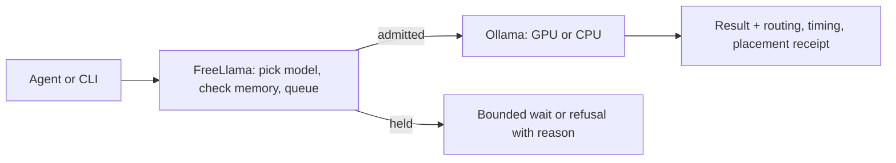
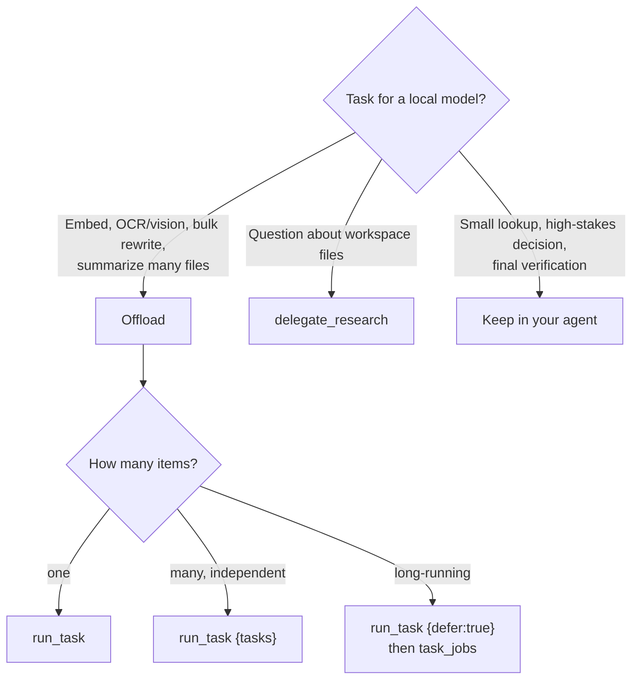
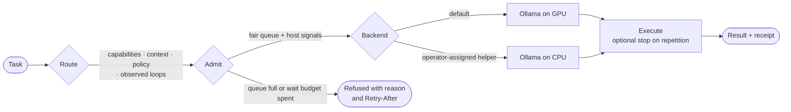
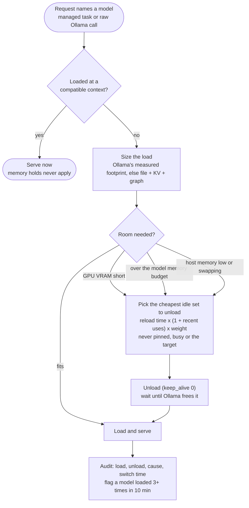

# FreeLlama features and how it works

Moved from the root README. For install and a first task, start with the [README](../README.md).


**Run your agent's bulk work on local models without overloading your machine.**

FreeLlama sits between an AI agent and [Ollama](https://ollama.com). For each task it picks an
installed model that fits, admits the task against live memory, CPU and heat signals, runs it on the
GPU or a CPU-only Ollama, and returns the result with a receipt of where and how it ran. Any Ollama
model works.



## Why FreeLlama

Coding agents spend paid tokens and context on work a local model can do: embedding files, reading
screenshots and scans, rewriting or summarizing many files. Calling Ollama directly, an agent cannot
tell:

- **Which model:** tag names do not show capabilities, context window or memory footprint.
- **Whether there is room:** a new load can push the machine into swap, several agents can pile onto
  one GPU, and a busy or hot machine slows everything.
- **Whether it worked:** a model can repeat itself until the token cap, and nothing says whether the
  task ran on the GPU or fell back to the CPU.

FreeLlama routes from installed metadata and observed behavior, admits against host signals, stops
runaway repetition, and returns a checkable receipt. The agent still decides what to offload and
verifies the answer. The name refers to less metered inference, not only Meta's Llama models.

## How it works

### What to offload

Offload bounded work whose result your agent can check; keep judgment in the agent.



### The smart flow

Every managed task passes the same gates, each deciding from installed metadata, live host signals
and observed behavior, never from a model's name.



An explicit `model` always wins over routing.

## Features

Each feature is reachable from MCP, the CLI and the HTTP control API under `/_freellama/v1` unless a
cell says otherwise. Every MCP tool is also reachable from a shell with `freellama tool <name> JSON`, and
`run_task` with `freellama run` ([agent CLI](AGENT_CLI.md)).

| Feature | What you get | MCP tool | CLI | HTTP |
|---|---|---|---|---|
| [Model selection](#model-selection) | The right installed model for the task, with a confidence level | `run_task {preview:true}`, `models` | `route`, `models` | `POST /routes`, `GET /models` |
| [Fallback chains](#fallback-chains) | An ordered list of models to try when the one before is refused before it runs (no room, input too long, not installed); never after a model started | `run_task {fallbackModels}` | `task --fallback-model`, `freellama run --fallback` | `fallback_models` on `POST /tasks` |
| [Resource admission](#resource-admission) | Tasks run, wait or are refused with a reason | every `run_task` receipt, `doctor {view:"status"}` | `status`, `ready` | `GET /health` (liveness), `GET /ready` (can serve now), `GET /status` |
| [CPU and GPU backends](#cpu-and-gpu-backends) | Helper models on CPU next to GPU work, with proof of where each ran | `run_task {executionPreference}` | `serve --cpu-upstream --cpu-model` | `POST /tasks` |
| Decisions | Label, triage or yes/no-check items with a decision model: one forward pass, one line per answer | `run_task {task:"decision", state, questions}` | `task --task decision --questions` | `POST /tasks` |
| Ranked search and duplicates | Embed files or texts and get the closest items to a query, or the most similar pairs, as labels with scores instead of vectors; files are chunked by lines and labelled `path:Lstart-Lend` | `run_task {task:"embedding", files, nearest}` | `task --task embedding --input-file F --nearest QUERY` | — |
| Speech | Transcribe or translate a WAV, or speak text to a WAV file, on a local audio model | `audio` | `freellama tool audio` | Ollama `/v1/audio/*` through serve |
| Inputs by path | The server reads the files an agent names, so logs, screenshots and source files are never pasted into its output | `run_task {files}` | `task --input-file`, `--image` | — |
| [Loop control](#loop-control) | A repeating answer stops early with every token kept | `run_task {stopOnRepetition}` | `task --stop-on-repetition` | `stop_on_repetition` |
| [Machine awareness](#machine-awareness) | GPU, cores, memory, GPU load and heat read from the OS | `doctor` | `machine`, `doctor` | `GET /machine` |
| [Batches, jobs and history](#batches-jobs-and-history) | Fan-out, submit now and collect later, multi-turn chat without resending history | `run_task {tasks}` / `{defer}`, `task_jobs`, `scope`, `session` | `task --defer`, `jobs`, `scope`, `session` | `/task-batches`, `/jobs`, `/scopes`, `/sessions` |
| Warm-up and unload | Load a model ahead of use through the same memory checks; unload a resident one once its tasks finish (never loads first) | `ollama_manage {action:"warm"}`, `ollama_manage {action:"unload"}` | `warm`, `unload` | `POST /warm`, `POST /unload` |
| Model catalog and cookbooks | Tested picks per job with their evidence, what is installed and fits now, and a recipe for each | `models {view:"catalog"}`, `freellama://docs/cookbooks/<job>` | `catalog [--job JOB]`, [docs/cookbooks](cookbooks/README.md) | — |
| Find and install models | ollama.com and Hugging Face GGUF search, every tag with its size and memory fit, pulls only on approval | `models {view:"library"}`, `ollama_pull`, `ollama_delete` | `freellama tool models\|ollama_pull\|ollama_delete` (same approvals) | — |
| Job mode and prompts | Name a job and FreeLlama runs its first catalog pick that is installed and fits, with its documented prompt, options and embedding prefixes; your fields win. MCP prompts give each job's call, and `saveAs` hands an answer to the next task as a file | `run_task {job, saveAs}`, MCP prompts, [cookbook](cookbooks/jobs.md) | `freellama run -j JOB\|-w WORKFLOW --save-as NAME`, `freellama workflows` | — |
| [Your own workflows](PROMPTS.md#your-own-workflows) | A Markdown file per workflow in `~/.octocode/freellama/workflows/`: a job, a title and the instructions. It runs like a built-in, replaces a built-in of the same name, and the receipt names the file and its digest | `run_task {workflow}` | `freellama run -w NAME`, `freellama workflows` | gateway `freellama/NAME` |
| Chunked sweeps | A local model checks a code tree, log or docs site chunk by chunk in the background, saves every result, re-checks flags with a stronger model and, against a baseline, reports only what changed | `sweep`, [cookbook](cookbooks/sweep.md) | `freellama tool sweep` | — |
| [Grounded research](#grounded-research) | Read-only repository answers with file and line citations | `delegate_research` | `freellama tool delegate_research` | — |
| [Small agent context](FEATURES.md#small-agent-context) | Compact results and paged details instead of raw dumps | every tool, `read_response` | JSON on stdout | JSON |
| [Observe and evaluate](#observe-and-evaluate) | Live status, usage, metrics, benchmarks, routing policy from evaluations | `doctor {view:"usage"}` | `status`, `usage`, `config`, `bench-all`, `policy from-eval` | `/status`, `/usage`, `/metrics`, `/config`, `/_freellama/ui` |
| Ollama passthrough | Any Ollama `/api/*` or `/v1/*` call, byte-preserving, with retries and a stream cap; `freellama gateway` also serves `freellama/<workflow\|job\|auto>` virtual models over Ollama, OpenAI `/v1/chat/completions` and `/v1/responses`, and Anthropic `/v1/messages` | — | `serve`, `proxy`, `freellama gateway` | Ollama's own paths |

### Model selection

Routing filters installed models by task, capabilities (`tools`, `vision`, `embedding`, ...), context
window, routing policy and memory fit, and reports a confidence level. `minConfidence:"medium"`
refuses weakly evidenced routes, `objective:"quality"` requires a policy-backed model, and `model`
pins one. A bare name resolves as in Ollama: `name:latest`, or the only installed tag of that family.

Routing never ranks by a model's name or architecture and adds no model-specific request options. A
model that loops on a task kind (at least two loops in at most twice as many runs) ranks last for that
kind; `models` lists the evidence as `observed_loops`. See [model selection](MODEL_SELECTION.md).

### Fallback chains

`fallbackModels` (HTTP `fallback_models`, CLI `--fallback-model`, agent CLI `--fallback`) is an
explicit, ordered list of up to 4 models. The next one runs only when the one before it was refused
before anything executed:

| Refusal | Code |
|---|---|
| No room in memory by the wait deadline | `resource_admission_unavailable` |
| The input exceeds the model's context window | `context_window_exceeded`, `embedding_item_exceeds_context` |
| The model file alone exceeds the host budget | `model_exceeds_host_budget` |
| Not installed, or lacks the task's capability | `model_not_installed`, `model_not_eligible` |
| The backend's circuit is open | `upstream_circuit_open` |

Anything else stops the chain: a timeout, a cancellation, a busy queue or an error after the model
started never moves to another model, so no work is replayed after an uncertain outcome. The receipt's
`fallback` lists every attempt with its code, and the answer gets a `check:` line naming the model
that answered. Each attempt waits as a single task would, so set a short `maxWaitSeconds` to move on
sooner; `timeoutSeconds` bounds the whole chain. While one model is tried, the models after it count
as busy, so making room for an attempt that is then refused never unloads the model that would run
next. An entry equal to the first model (which may be a scope default or a job's pick) is skipped; a
model listed twice is refused. When an embedding task runs in slices and a later slice is refused,
part of the work already ran, so the chain stops there. A chain cannot be combined with a pinned
digest or backend, and MCP refuses one over separately sliced embeddings so one answer comes from one
model. Batch items and `task_jobs` results carry the receipt's `fallback` too.

```jsonc
{ "tool": "run_task", "arguments": { "model": "lfm3:1.7b", "fallbackModels": ["bonsai-2:9b"], "files": ["big.log"], "prompt": "summarize", "maxWaitSeconds": 20 } }
```

### Resource admission

A task queues fairly, waits for budget units on its backend and for the host signals that apply to
it, then runs or is refused with `Retry-After`.

- **Budget.** Each Ollama decoding slot (`OLLAMA_NUM_PARALLEL`) is worth two units: a chat costs 2, a
  vision task 4 (capped to the budget), an embedding 1 per four inputs. The GPU queue holds 16 tasks,
  the CPU queue 8. A task waits at most 120 s, or `maxWaitSeconds`.
- **Fairness.** Priority classes get 3, 2 and 1 turns per round, FIFO within a class. After six
  bypasses the oldest blocked task reserves capacity, so nothing starves. In a live run, 4
  interactive tasks submitted last finished before the normal and background tasks queued ahead.
- **Fast refusals.** A full queue answers 429 at once, an expired wait 503. Both carry `Retry-After`
  from the tasks ahead, how many of that cost run at once, and recent service time.

Each host signal holds only the work it affects:

| Signal | Holds |
|---|---|
| OS memory pressure (macOS `kern.memorystatus_vm_pressure_level`, Linux PSI) at warning | new model loads; at critical, everything |
| Low available RAM | judged per load: a new load runs if it leaves its own reserve, else waits; a loaded model keeps serving |
| Active swapping | new loads of 1 GiB or more, or of unknown size; a loaded model keeps serving, raw passthrough included |

A load that waits for memory is told who holds it: the 503, the progress message and the route
preview name the largest programs (`node: tsserver.js ×3 3.8 GB, rust-analyzer ×2 2.3 GB`).
| CPU load | CPU-bound work only, never a GPU load or GPU inference |
| Thermal throttling (macOS) | CPU-bound work and new loads |

A new load must leave a reserve free: 15% of RAM, at least 1 GiB, capped at the load's own size. If
it does not fit, idle models are unloaded first; if it still does not fit, it waits and is refused at
its deadline, on every OS. On macOS the available figure already includes reclaimable pages
(inactive, speculative, purgeable), so loading past it means compression and swap.
`serve --low-memory advisory` (or `FREELLAMA_LOW_MEMORY=advisory`) restores admit-with-warning.
While any model is loaded, `serve` also samples the host itself: under low memory, OS pressure or
swapping it unloads the cheapest idle models (audit trigger `pressure_sweep`), never pinned,
`keep_alive: -1` or busy ones. Because of the reserve, a load can wait while the OS still shows free
memory ([admission controls](CLI.md#bound-admission)). Total deadlines (`timeoutSeconds`) and
per-backend circuit breakers complete admission; see [monitoring and tuning](MONITORING.md).

### Model memory and switching

A loaded model answers at once, a cold one first pays its load time, and loading past what the
machine holds swaps and stalls everything. FreeLlama decides what stays loaded:



- **Model memory budget.** Loaded models on one backend may hold at most `model_memory_budget`
  together: 75% of RAM by default, `"24GiB"`, or `"off"`. Ollama checks only what is free at that
  moment, so without a budget loads keep landing until macOS swaps. It applies where models share
  host memory (Apple silicon, or a CPU backend).
- **What to unload.** The cheapest idle set that frees enough: measured reload time, scaled by recent
  use and an optional per-model weight. Pinned models, models with queued or running work (raw
  passthrough included) and the model being loaded are never chosen. Warms and preloads teach load
  time but do not count as uses, so they cannot keep themselves resident.
- **No ping-pong between backends.** A measured speed advantage never forces a cold load while the
  other backend has an eligible model loaded.
- **Audit.** `status` shows the budget in use, loads, unloads and evictions by cause, switch time per
  model, and models swapped back and forth. Every MCP result carries `timing` (wall time, plus queue,
  load, prompt and output time for a task).
- **Learned per model.** Each model revision's output needs (reasoning included), load time, memory
  footprint and loops are measured from its runs and saved. FreeLlama sends no output cap of its own;
  a model that ran out of room gets twice as much next time.
- **Preload.** `preload.startup` loads listed models at startup; with `messages` (such as a long
  system prompt) it also evaluates them into the runner's prompt cache. Predictive preload counts
  model-to-model switches and, once a successor is clear, loads it in the background, only when it
  fits without unloading anything and the host is calm. Agents warm a prefix with
  `ollama_manage {action:"warm", model, systemPrompt}`.
- **Shared state.** Measured sizes, load times, placement feedback, usage and the audit live in one
  `SQLite` file, `~/.octocode/freellama/freellama.sqlite`, shared by every FreeLlama process on the
  machine.

Measured switch times on an Apple M2 Pro (32 GB) through `serve`, model files in the OS file cache:

| Model | Loaded size | Load (switch) | Request when loaded |
|---|---:|---:|---:|
| `gpt-oss:20b` | 11.9 GiB | 5.1–9.7 s | 0.9 s (short answer) |
| `glm-ocr:latest` | 2.7 GiB | 1.5–2.0 s | 0.45 s (one image strip) |
| `strands-decider:2b-nvfp4` | 1.4 GiB | first call 1.2–1.4 s, load included | 3–60 ms (one question) |
| `nomic-embed-text:v1.5` | 0.3 GiB | 0.27–0.5 s | 70 ms (one input) |

Unloading takes milliseconds on Apple silicon. With a 14 GiB budget and all four in rotation, loading
glm-ocr unloaded gpt-oss for the budget, loading gpt-oss unloaded the helpers (for the budget, then
for low host memory), and the audit flagged all four as thrashing: raise the budget, pin the big
model, or give helpers their own backend.

### Keys, budgets and other engines

- **Client keys.** `clients.toml` in the home (or `--client-keys`) names one bearer token per agent
  or tool, each with an optional `daily_tokens` budget and `admin` right. Usage counts output plus
  prompt tokens not reused from a cache, per UTC day, for managed tasks and raw Ollama or OpenAI calls
  (`task: "raw"`, from the counts each response reports). A spent budget refuses generation with 429
  and `Retry-After` until the next UTC day; reads still work. Only admin keys may pull, push, copy,
  create or delete models or reload the runtime file. The operator token is unmetered.
- **Other engines.** `upstreams.toml` (or `--upstreams`) adds OpenAI-compatible engines. A `/v1/...`
  request for `lmstudio/qwen3-8b` goes to upstream `lmstudio` as `qwen3-8b`; a bare name goes to
  Ollama when Ollama has it, else to the engine that lists it. `GET /v1/models` lists all. A local
  engine waits out host holds as a loaded model would. The caller's FreeLlama token never leaves;
  each engine gets its own key, sent only over HTTPS or to this machine.

```toml
# ~/.octocode/freellama/clients.toml
[[client]]
name = "octocode"
token_file = "keys/octocode.token"   # freellama auth-token --out keys/octocode.token
daily_tokens = 2000000

# ~/.octocode/freellama/upstreams.toml
[[upstream]]
name = "lmstudio"
url = "http://127.0.0.1:1234/v1"
```

### CPU and GPU backends

An optional second, CPU-only Ollama runs exact helper models, such as an embedder, so they never
compete with GPU work: `serve --spawn-cpu-backend --cpu-model TAG` starts it on loopback, waits for it
and stops it with `serve`, or point `--cpu-upstream` at one you run. Each backend has its own budget, queue and model-transition lock. The operator
assigns models; agents can only state an `executionPreference`. Ask for
`minPlacementEvidence:"observed"` when placement matters, and trust the receipt's observed placement
over the configuration. See [CPU/GPU routing](CPU_GPU_ROUTING.md).

### Loop control

Some models answer correctly, then repeat the answer until their output limit (a `num_predict` cap or
the end of their context). With the repetition stop, FreeLlama streams the answer, checks it every 16
tokens, and stops once the text has repeated twice over at least 96 characters; closing the
connection cancels generation in Ollama. It is on by default for free text with no output cap (JSON
and tool calls are left whole); `stopOnRepetition:false` (CLI `--stop-on-repetition false`) turns it
off, `true` turns it on for a capped task. Nothing is trimmed: `response` holds the full text and
`output_check` says where the first copy ends. A loop that ran to the limit without the stop is
flagged the same way, and routing records it either way.

### Machine awareness

`freellama machine`, `freellama status` and MCP `doctor` report what the OS says, without elevated
privileges:

- **Machine:** chip, logical CPUs, Apple silicon's performance/efficiency split, total memory and
  whether it is unified, and the GPU (Apple model and cores; NVIDIA name and memory via `nvidia-smi`).
- **Live:** available memory, OS memory pressure, CPU load, GPU busy percent (Apple, NVIDIA) and Apple
  GPU-driver memory. macOS heat is the thermal pressure level (`nominal` to `sleeping`, throttled from
  `heavy`) plus the `pmset` CPU speed limit on Intel Macs; Linux and Windows report it as unknown.
- **Placement:** fully GPU, fully CPU or split, as Ollama reports each loaded model.

### Batches, jobs and history

| Need | Use |
|---|---|
| Many independent items | `run_task {tasks, maxParallelism}` with up to 64 `{id, independent:true, task}` items |
| Submit now, collect later | `run_task {defer:true}` returns `job.id`, then `task_jobs {action:"get", jobId}` |
| Multi-turn chat without resending history | `scope {action:"create"}`, then `run_task {scopeId, scopeRevision, prompt}` |
| Keep related calls on one model | `session {action:"create"}`, then `run_task {sessionId}` |
| Hot model before latency-sensitive work | `ollama_manage {action:"warm", model, contextTokens}` |

Scopes and sessions live in memory and are lost when the service restarts. Deferred jobs are
process-local by default; with `FREELLAMA_DURABLE_JOBS=1` their finished receipts survive a restart,
an unfinished one reads back as an unknown outcome (never replayed), and `idempotencyKey` makes a
resubmission return the original job ([deferred jobs](DEFERRED_JOBS.md)). See
[scopes and warming](SCOPES_AND_WARMING.md).

### Grounded research

`delegate_research {question, workspacePath}` gives a local model bounded, read-only search and read
tools over an allowed workspace and returns an answer, file and line citations, and an independently
computed verdict. Discard `escalate` results and verify the citations on the rest.

### Small agent context

`run_task` and `delegate_research` return a compact view unless `receipt:"full"`; every tool saves its
whole result to a `response_file`, which `read_response` pages by section. Embedding vectors are
omitted unless `returnEmbeddings:true`. The optional `telemetry.externalEquivalent` estimates avoided
API cost from a rate card you configure with the `FREELLAMA_EXTERNAL_COST_*` variables in
[MCP configuration](../packages/mcp/CONFIGURATION.md#environment-variables).

### Observe and evaluate

- **Live status:** queues, memory holds, loaded models, circuit breakers and usage per day and model,
  from `doctor {view:"status"}`, `freellama status` or `/_freellama/ui`.
- **Evaluation:** `bench-all` benchmarks installed models; `policy from-eval` writes a routing policy
  from quality-evaluation results. See [model selection](MODEL_SELECTION.md).
- **Ollama compatible:** `/api/*` and `/v1/*` reach Ollama byte-for-byte, streaming included;
  FreeLlama never rewrites raw bodies. See [Ollama sidecar](ARCHITECTURE.md#ollama-sidecar).
