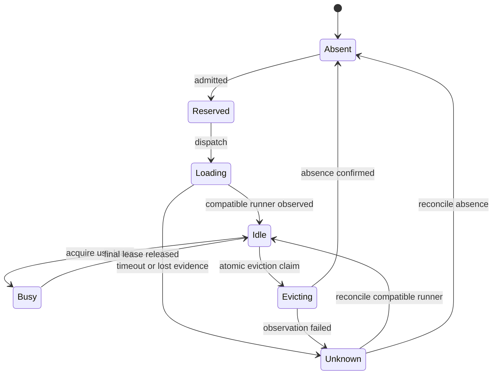

# FreeLlama: making the most of Ollama

Research and code audit, 1 November 2026.

Implementation follow-up: [current plan and completed scope](OLLAMA_IMPLEMENTATION_PLAN.md).
Findings below describe the pre-implementation working tree; the follow-up records repairs and remaining work.

FreeLlama should become a more precise, measurable coordinator above Ollama. Its best opportunity is to improve which eligible task runs next, which compatible runner stays resident, and when the machine can safely accept another load. Ollama should continue to own model loading implementation, inference, token batching, tensor allocation, and device execution.

This audit used six parallel research tracks: Rust resource coordination; routing and caching; MCP workflows; Ollama internals; inference-engine techniques; and local model orchestration projects. The repository baseline was HEAD `e718d8ad7af6af6e2a05ee6d3fc075dec9e8216f`, version 0.8.0, with substantial pre-existing staged and unstaged work. Findings refer to the inspected working tree, not a clean published release. Production source was not edited. This document is the audit deliverable.

The external comparison is a representative survey of relevant systems, not an exhaustive inventory of every competitor. Current upstream source and documentation were inspected; implementations on moving `main`/`master` branches are not assumed to match an installed binary. Ollama's release page resolved to v0.40.13; pinned release source could not be retrieved, so source-level upstream findings below are explicitly about retrieved `main`. Live model state and fresh hardware performance could not be established from this restricted execution environment.

## 1. Is this real virtual memory?

**No. The accurate term is model residency management, or a demand-loaded model cache.** FreeLlama decides which complete model runners should be resident and asks Ollama to load or unload them. Its reservations are bookkeeping that prevents competing admissions; they do not allocate physical memory.

Operating-system virtual memory maps virtual addresses to physical pages and supports protection, sharing, demand paging and reclamation. FreeLlama does not implement those mechanisms, GPU page migration, or transparent tensor spilling. “Virtual memory for models” can be a clearly explained analogy, but would be misleading as a literal feature claim. [O8]

| Layer | What is retained | Owner | Effect of a FreeLlama unload |
|---|---|---|---|
| Installed weights | Model blobs on storage | Ollama | Remain installed; no new download is needed |
| File page cache | Recently accessed file contents in RAM | OS | May remain cached and reclaimable, making a subsequent restart faster |
| Virtual mappings | Address-space mappings, possibly file-backed | OS and engine | Runner mappings can disappear; this is not a FreeLlama paging service |
| Runner residency | Weights, execution buffers and runtime state | Ollama and selected engine | Ollama releases the runner's allocations; completion and recovered capacity need observation |
| Prompt/KV cache | Computed attention state for compatible inputs | Engine | Do not promise preservation across unload without a supported persistence API |
| Scope history | Caller messages | FreeLlama | Can be replayed, but text history is not saved KV tensors |
| Catalog and evidence | Metadata, measurements, policies | FreeLlama | Can survive runner unload; some records persist in SQLite |

Unloading is also different from moving a model from GPU to CPU. FreeLlama currently selects among operator-assigned backends. Loading another instance on the CPU does not migrate the GPU runner's live session or KV cache. On Apple silicon, CPU and GPU use the same physical memory pool; assigning a helper to CPU can change execution contention without creating additional RAM. [O10]

Linux `MemAvailable` includes estimates of reclaimable memory. A released model therefore need not increase `MemFree` by its reported size. File cache remaining after unload can be beneficial. Routine cache purging would undermine reload efficiency; kernel documentation warns that rebuilding dropped caches consumes I/O and CPU. [O9]

Recommended product wording: **“FreeLlama manages the resident model working set above Ollama: it admits safe loads, retains useful runners, evicts eligible idle runners, and explains the resulting waits and transitions.”**

## 2. What the implementation actually builds

The workspace builds a Rust core and CLI with Cargo, a feature-gated NAPI addon, and TypeScript MCP packages with Yarn. The Rust library produces `rlib` and `cdylib` artifacts; NAPI is optional so the standalone CLI does not require Node symbols. Published native packages target separate OS/architecture/libc combinations. Release settings include fat LTO and one codegen unit. Unsafe code is denied outside the explicitly isolated FFI boundary.

The critical architectural advantage is that routing and resource policy live in Rust. MCP and CLI mostly express requests to that authority. FreeLlama does not own model tensor buffers merely because it is written in Rust. Improving its allocator or adding unsafe memory mapping would not, by itself, accelerate Ollama's token generation.

Local evidence: root `Cargo.toml`, `package.json`, `packages/rust-core/Cargo.toml`, `packages/rust-core/src/lib.rs`, and `docs/ARCHITECTURE.md`.

| Decision or mechanism | Correct owner | FreeLlama's useful role |
|---|---|---|
| Prompts, dependencies, acceptable answer quality | Calling agent | Enforce supplied constraints and preserve evidence |
| Exact CPU assignments and process configuration | Operator | Validate configuration and report effective observations |
| Queue order, admission, deadlines, residency policy | FreeLlama | Make decisions before work enters Ollama |
| Runner reuse, launch, unload, inference scheduling | Ollama | Supply compatible requests; observe results |
| KV layout, kernels, continuous batching, tensor offload | Selected engine inside Ollama | Detect capabilities; avoid unsupported promises |
| RAM, page cache, compression, swap, physical GPU execution | OS and drivers | Measure pressure and leave headroom |

## 3. Ollama internals that should shape FreeLlama

The following upstream observations are bounded to retrieved source; they are not a permanent ABI contract. In `server/sched.go`, compatible resident requests can take a reuse path; cold/reload work goes through the pending-load loop. Reuse checks normalize automatic settings and compare runner options, adapters and projectors, with an MLX-specific exception. Expiration is reference-aware. Victim selection prefers idle runners after duration/name ordering, so describing it as strict LRU is inaccurate. Discrete-GPU recovery has a separate wait. Some architectures clamp parallelism to one. [O1]

The llama-server integration translates explicit zero GPU layers into CPU execution on that engine path and constructs context/parallelism, cache, batch and thread arguments. MLX follows another path. Therefore generic acceptance of `num_gpu:0` is insufficient evidence that every Ollama model runs on CPU. The repository already documents observed MLX placement mismatches. [O2]

Ollama exposes distinct controls for loaded-model count, per-model request parallelism, pending queue size and retention. Current FAQ values include a 512-request queue, parallelism of one, and a loaded-model default based on GPU count. Context and parallelism multiply memory demand. These are version-dependent defaults, not recommended universal tuning values. [O3]

The environment implementation defines retention, load timeouts, KV type, Flash Attention and scheduling settings. Settings must belong to the actual Ollama process; changing the sidecar's environment does not establish the backend's configuration. [O4]

There is an upstream documentation inconsistency: the FAQ mentions a fixed 4K context while the context guide describes VRAM-dependent defaults. Prefer explicit workload profiles and observed runner context over a guessed default. A large available context should not automatically become every request's context. [O3, O5]

`/api/ps` supplies model identity, residency, total size, VRAM size, expiry and context. These are observations, not atomic reservations, GPU-utilization measurements, or proof of a complete compatible runtime profile. A sidecar should preserve unknown fields as unknown and attach observation age. [O6]

**Implemented.** FreeLlama's reuse path mirrors the `sched.go` split above. A runner whose digest and context `/api/ps` reports as matching takes no backend lock; only a load or reload queues on the per-backend load lock, until `/api/ps` shows the runner. A missing digest is never compatible, and a missing `context_length` is compatible only for a request that sends no `num_ctx`; the receipt's `admission.reason` names the degraded case. One `PlacementRule` (`any`, `cpu_only`, `gpu_resident`) judges placement from `size_vram` for managed and raw work. See [Load lock and use lease](CPU_GPU_ROUTING.md#load-lock-and-use-lease).

### The practical control surface

| Control | How to use it above Ollama | Important boundary |
|---|---|---|
| Exact model identity | Resolve installed tags; attach digest to evidence | Tags can change contents |
| Context | Use stable, sufficient context buckets; reuse a compatible larger automatic runner | Explicit profile changes may require reload |
| `keep_alive` | Retain frequently reused runners; shorten retention under pressure | An idle policy is not exclusive ownership of engine memory |
| Warm request | Prepare the exact profile; optionally evaluate a stable prefix | Warming itself consumes resources and can displace other runners |
| Unload request | Drain owned/eligible idle work and request release | Accepted HTTP response is weaker than confirmed absence and recovered capacity |
| Parallelism | Match sidecar capacity to effective engine capacity | More queued calls do not necessarily produce more simultaneous decoding |
| KV precision / Flash Attention | Offer measured, operator-approved profiles | Engine support and task quality must be checked |
| CPU backend | Place suitable exact helper models on a separate configured Ollama process | Verify physical placement and shared-memory contention |
| Cancellation | Close work streams and track local resource release | Do not claim physical inference stopped merely because a Rust future ended |

### Avoid several schedulers fighting each other

FreeLlama has managed primary and CPU admission pools, raw-proxy admission, resource waits/readmission, and transition-lock waits. Ollama then has its own queue and runner scheduling. Independent raw and managed primary limits are additive. Several FreeLlama processes can share SQLite histories while still having independent in-memory permits, activity counts and transition locks.

The deployment target should be **one coordinating FreeLlama authority per Ollama topology**, with clients sharing it. Keep pending work in FreeLlama until it is plausibly executable. Make downstream waiting visible instead of treating a successful send as productive execution. Record direct-Ollama traffic as an observation gap when clients bypass coordination.

FreeLlama's current backend-wide shared transition guards survive decoding. Consequently, a cold model can wait for unrelated resident generations, even when there is enough memory. A better design separates a model's use lease from a backend loading semaphore. Ollama remains responsible for its own safe load serialization.

This is an integration improvement, not a recommendation to replace Ollama or reproduce its token scheduler.

## 4. Memory and cache arithmetic

Plan a load from observed or conservatively estimated **weights + KV/state + compute/graph buffers + staging/runtime overhead**, then account for other residents and host headroom. File size alone is incomplete. Concurrent sequences, vision projectors, speculative components and temporary load peaks matter. Some architectures do not follow a uniform dense-attention KV formula; retain uncertainty instead of forcing an inaccurate estimate.

For a conventional attention model with equal K/V head dimensions, an illustrative estimate is:

`KV bytes = 2 × layers × KV heads × head dimension × bytes/element × context tokens × concurrent sequences`

For an explicitly hypothetical 32-layer, 8-KV-head, 128-dimension model, F16 KV at 8,192 tokens is 1 GiB per sequence; four sequences require approximately 4 GiB before allocator overhead. This is arithmetic, not a measurement of any installed model. Quantization, sliding-window/hybrid state, padding and implementation details change the result. Weight quantization and KV quantization are separate decisions.

The current code appropriately caches empirical footprints by model revision and profile, preserves conservative maxima, and treats unsupported KV architectures as unknown: `platform/footprint.rs:104`, `platform/catalog.rs:247`.

The next accounting model should name physical pools: host RAM/unified memory, each discrete GPU UUID, backend device visibility, and loading concurrency. Never sum two GPUs and assume the total can serve a placement that needs one device; never add unified GPU allocations to the same physical RAM twice. CPU and GPU helper overlap also needs a contention measurement, because both can saturate shared bandwidth.

| Cache | Current opportunity | Proposed optimization |
|---|---|---|
| Resident runner | Already warmed/retained by FreeLlama | Stable profile, cost-aware retention, truthful lifecycle state |
| Prompt-prefix cache | Engine-owned; cached-token counters already parsed | Preserve stable prefix ordering and affinity; measure actual saved prefill |
| OS file cache | OS-owned; helps some restarts | Distinguish runner-cold from disk-cold; avoid routine purging |
| Static metadata | 30-second full catalog cache | Digest-indexed `/show` metadata with separate tag/residency refresh |
| Runtime learning | Facts/footprints persist | Bounded records for multiple model/profile combinations |
| Scope transcript | Revision-protected text | Keep its semantics separate from tensors and runner residency |
| Exact task result | No general routing-layer cache found | Optional deterministic-task cache only with full identity/input/control keys |

A semantic answer cache should not be a default correctness shortcut. Similar prompts can require different code answers, and tool-bearing or state-dependent requests may not be reusable.

Also inspect the engine's displaced-prompt RAM cache. Current llama.cpp documentation exposes `--cache-ram` / `LLAMA_ARG_CACHE_RAM`, with an 8,192 MiB default and a decision-model exception. This is a cache ceiling, not an allocation made immediately at startup. FreeLlama's operating skill already mentions it. Verify the shipped Ollama runner version and inherited setting before treating it as effective, and include observed cache growth in the host budget. Active KV and saved prompt caches can be different memory consumers. [C2]

## 5. Current lifecycle: what already works

There is real implementation behind the resource-management claims:

- Bounded admission gives interactive, normal and background work 3:2:1 turns, with bounded bypass of large jobs. Memory waiters release execution capacity while remaining bounded in the queue.
- Rust guards release admission units, forecast reservations and activity counts on drop.
- Host pressure uses hysteresis and distinguishes memory, swapping, CPU and thermal signals. Resident work can continue under conditions that should hold a new load.
- Cost-aware eviction protects targets, pins, indefinite-retention models and observed active demand. It considers reload cost, decayed reuse and freed capacity.
- Automatic retention is finite: the documented default computes `60 + 30 × recent uses + 2 × load seconds`, applies a pressure factor, and clamps to 15–900 seconds. Explicit values take precedence.
- A background sweep checks while models are resident. With default two-second sampling and five samples per check, its nominal resident check interval is ten seconds, plus operation time. Low-memory-only reclamation waits for the configured idle threshold; distress permits earlier eligible eviction.
- Startup/predicted preloads, observed placement, context reuse, process-local jobs, session affinity and bounded scopes are implemented.

Evidence: `platform/admission.rs:198`, `resources/governor.rs:34`, `residency.rs:259`, `warming.rs:209`, `sweep.rs:12`, `sweep.rs:26`, `execution/pipeline.rs:268`, and `docs/SCOPES_AND_WARMING.md:233`. Paths in this section are under `packages/rust-core/src/` unless otherwise stated.

Keeping many models **installed** is cheap relative to keeping their runners resident. Efficient operation means keeping the useful working set resident and scheduling transitions deliberately; it does not mean maximizing the number of simultaneous loaded models.

## 6. Code findings to fix before tuning heuristics

These are static findings in the inspected tree. The cited paths establish implementation behavior; concurrent failure scenarios remain hypotheses until exercised with controlled fixtures. Priority means implementation order, not a demonstrated incident severity. Rust paths below are under `packages/rust-core/src/`.

| ID | Priority | Finding and consequence | Source anchor |
|---|---|---|---|
| F01 | High | Unified-memory forecast permits are released after name-only residency is seen, without committing a newer host sample. Another admission can see pre-load free memory after its protection was removed. | `platform/execution/pipeline.rs:475`; `platform/resources/governor.rs:163` |
| F02 | High | **Fixed.** Reuse requires digest, effective context and the shared `PlacementRule`; a mismatch takes the load lock and reloads. Original finding: managed shared-transition checks tested model presence rather than profile compatibility. Changed explicit context can need a reload while the old name still appears resident. | `platform/execution/pipeline.rs:357`; `platform/execution/observe.rs:118`; compare `proxy/mod.rs:309` |
| F03 | High | Eviction checks active count and then awaits unload without an atomic eviction claim. Its `unloaded_ok` list also retains HTTP-successful victims after absence polling times out. | `platform/execution/memory.rs:388`; `:397`; `:405`; `:420` |
| F04 | High | **Fixed.** A raw generation whose allocation cannot be forecast is refused with 503 `model_forecast_unavailable` instead of getting a zero-byte permit, and a raw load holds the load lock only until its runner is observed. Original finding: healthy raw cold work could get a zero-byte forecast permit; raw cold streams retained an exclusive transition guard through the response. | `proxy/mod.rs:216`; `:493`; `:577`; `proxy/admission.rs:204` |
| F05 | High | Speculative preload checks idle/fit before ordinary warm admission. That warm can later invoke eviction, so the non-displacement guarantee is not enforced transactionally. | `platform/preload.rs:185`; `platform/raw_models.rs:128`; `platform/execution/pipeline.rs:210` |
| F06 | High | Quality policy and functional benchmark evidence attach to mutable model tags, unlike digest-qualified runtime facts. Replacing a tag can inherit an earlier model's qualification. | `platform/discovery.rs:57`; `:94`; `platform/catalog.rs:182` |
| F07 | High | MCP progress recovery can submit inference again after result overflow or a missing job record. Completed or uncertain work can execute twice. | `packages/mcp/src/job-progress.ts:217`; `:234`; unit test `job-progress.test.ts:77` |
| F08 | High | Embedding slices concatenate vectors but retain only the last receipt and do not pin the first auto-selected model/digest. Metrics are incomplete; changes can mix incompatible embedding spaces. | `packages/mcp/src/tools/run-task.ts:136`; `packages/mcp/src/nearest.ts:18` |
| F09 | High | Research subprocess nonzero status becomes normal returned text, then an `ok` tool call and potential grounding evidence. Command failure can inflate trust. | `packages/mcp/src/research/sandbox.ts:153`; `agent-loop.ts:284`; `tools/delegate-research.ts:219` |
| F10 | Medium | Payload-aware context sizing follows selection of a single model. An unpinned long prompt can fail even when another eligible installed model would fit. | `platform/execution/pipeline.rs:51`; `:77`; `platform/context.rs:159` |
| F11 | Medium | Adaptive feedback retains one current profile per task/backend. Switching models/profiles resets learning; persistence favoring larger completion counts can restore older profiles. | `platform/feedback.rs:28`; `:51`; `:187`; `:234` |
| F12 | Medium | Readmission wait is added to queue time while remaining inside resource elapsed time; summed total wait counts it twice. Batch eviction duration is also copied into every victim's audit row. | `platform/execution/pipeline.rs:210`; `:315`; `:342`; `platform/execution/forward.rs:366`; `memory.rs:429` |
| F13 | Medium | A 200 ms `load_duration` threshold labels a cold load. Upstream ready time includes scheduler/setup waits, so this can pollute reload-cost learning. | `platform/residency.rs:18`; Ollama `server/routes.go` [O7] |
| F14 | Medium | Discovery requires both backends to succeed, refreshes all `/show` metadata every 30 seconds, and propagates malformed successful `/show` JSON as a catalog failure. | `platform/catalog.rs:50`; `:72`; `:294`; `:337`; `:354` |
| F15 | Medium | Cancellation plumbing differs with progress subscription, batch shape and embedding slicing. Progress UI should not determine whether work is cancellable. | `packages/mcp/src/tools/run-task.ts:186`; `:513`; `packages/mcp/src/batch-progress.ts:16`; `packages/rust-core/src/napi.rs:334` |
| F16 | Medium | Memory-holder diagnostics run synchronous bounded `ps` calls while holding a global standard mutex, and the async execution path calls them directly. A slow diagnostic can block a Tokio worker and contending callers. | `platform/resources/holders.rs:35`; `:61`; `platform/execution/pipeline.rs:230` |

Additional limits matter for planning: VRAM is not reserved atomically per physical device; model-budget ceilings are backend-scoped even on shared RAM; multiple coordinators do not share live leases; adaptive concurrency primarily learns serial comparable samples; and raw telemetry can record accepted headers/body-drop as success without a verified successful terminal response. These constrain claims of complete machine-wide control.

For F09, preserve `rg`'s legitimate no-match status separately from execution errors. Grounding should depend on successfully observed evidence, not simply on whether a promise resolved. For F07, synchronous fallback is reasonable only after a positively known pre-execution rejection. A missing result is not permission to replay.

No speculative lost-wakeup finding is included: checking the actual Tokio behavior showed that the existing `notify_waiters` pattern was valid. This illustrates why source review should distinguish suspicious code from established defects.

## 7. A better Rust implementation above Ollama

### Make model lifecycle transitions explicit

Use one profile identity throughout routing, warming, observation, eviction and evidence. It should include endpoint identity, model digest, effective context, reload-relevant controls, engine/build and known backend settings. The public API may not expose everything: attach observed/configured/unknown evidence instead of inventing a complete runner fingerprint.

The proposed lifecycle is:

**Implemented in part.** Busy is reference-counted: every managed task and raw generation holds a per-model use lease (`ActiveModel`) for its whole request, and eviction takes an idle claim (`try_evict`) atomically against arrivals, so a model in use is never unloaded. The per-backend load lock now covers only loads and unloads, and is released as soon as the runner is observed in `/api/ps`. A load that needs a busy model's memory waits and plans its eviction again each time any model's use ends. Still a proposal: explicit `Reserved`/`Unknown` states and a reconcile step (a lost observation is currently a refused or retried request, not a tracked state), and queue preference for already-compatible work. Ollama can still change residency outside this state machine, so reconciliation remains mandatory.

Convert forecast memory to observed occupancy only when a matching load and a sufficiently recent resource-sample epoch are reconciled. Releasing a forecast and refreshing telemetry must not expose a window of fictional free capacity. An unload receipt should separately report requested, accepted, absence confirmed, memory recovery observed, timed out and unknown.

Use a short critical section to claim a transition, perform network I/O outside it, then reconcile using its generation/lease token. An owned Rust guard can clean up abandoned state. Avoid asynchronous work in `Drop`; queue bounded cleanup to an owned supervisor and expose unresolved cleanup.

### Separate concerns in the queue

Keep the existing fairness and bounded backfill. Add a bounded preference for already-compatible model/profile work, with an aging/deadline escape so cold models cannot starve. Measure whether the saved switching cost is worth any added wait.

Use a per-model use lease, a backend load limit consistent with Ollama, and a shared physical-memory reservation. Long decoding should not require holding a backend-wide exclusive transition guard. *Implemented:* the use lease and the load-lock split above, with raw and managed work sharing both and the memory forecast. A backend load limit consistent with `OLLAMA_MAX_LOADED_MODELS` is not implemented; the load lock admits one load at a time. Raw and managed requests can retain their payload semantics while sharing these accounting primitives.

A speculative warm should have internal policy `allow_eviction=false`, `allow_queue=false`, a known target profile and a try-reservation. Recheck all constraints at dispatch, including Ollama's loaded-model limit. A precheck alone cannot prevent a later engine eviction. When foreground work arrives, cancel pending speculation; cancellation of an already-started physical load remains best effort.

### Optimize expected completion, within quality constraints

First reject unsuitable capabilities, insufficient context, disallowed placement and inadequate quality evidence. Then estimate:

`completion = queue wait + transition cost + uncached prefill time + decode time + contention cost`

The prediction should distinguish expected output length, stable-prefix reuse, context/profile reloads, CPU/GPU overlap and uncertainty. Prefer calibrated p50/p95 values over one throughput number. Keep operator assignments and explicit model requests authoritative.

Illustrative calculation, not a measured result: if a warm CPU helper takes 0.30 seconds, while the eligible GPU path waits 2.0 seconds and executes in 0.05 seconds, CPU completes sooner despite slower inference. Conversely, if CPU helper work slows a GPU generation enough through shared bandwidth, overlap may lose overall. The router needs workload completion evidence to choose.

Replace single-profile feedback with bounded per-profile records. Invalidate or downgrade evidence on digest/build/profile changes; persist samples or mergeable statistics with freshness, not a winner selected only by historical sample count. Keep prompt contents out of performance keys where hashes or control projections suffice.

### Use Rust for reliable coordination

Preserve RAII permits, checked reservation arithmetic, bounded queues and the isolated FFI boundary. Add typed lifecycle outcomes and phase timestamps to reduce loosely coupled JSON assumptions. A coordinator task with bounded messages and `watch` snapshots is one option; the current locks can also work if transition ownership and observation epochs are explicit.

Keep blocking process probes, SQLite work and expensive parsing off Tokio workers, with bounded blocking concurrency and subprocess deadlines. The main governor already offloads sampling, but the newly added memory-holder diagnostic does not: its cold cache can run two sequential probes with one-second bounds while holding a global mutex. Sample that diagnostic through a bounded background worker, publish a timestamped snapshot, and let the request path read the latest snapshot. `spawn_blocking` work cannot generally be aborted after it starts; this needs its own limits and shutdown policy. [R1]

Track background sweeps, preload jobs and cleanup tasks with cancellation and join ownership. Use deterministic concurrency tests and fault-injected upstream fixtures for lease acquisition, cancellation, stale observations and unexpected unload delays. Consider model checking a small extracted accounting state machine; do not add complexity to production merely to use a concurrency framework.

Do not prioritize custom allocators, unsafe tensor access, CPU affinity or kernel tuning without profiling evidence. CPU affinity and inference threading primarily affect Ollama/its runner. The higher-value Rust work is correct ownership, low control-plane latency, predictable backpressure and coherent telemetry.

## 8. MCP workflows that use Ollama efficiently

The existing split is useful: discovery, decision-only preview, execution, retained response, and explicit session/scope handles. Keep resource decisions in Rust and task dependency planning in the calling agent.

| Workflow | Recommended behavior |
|---|---|
| First use | Discover exact installed models and backend health; use a preview only when a routing decision needs inspection |
| Repeated short work | Reuse a stable profile and prefix; avoid paying discovery/preview/warm overhead on every tiny call |
| Independent bulk work | Submit bounded batches with explicit independence; let Rust admit each item |
| Large embeddings | Pin model digest and options for the whole operation; aggregate receipts and validate vectors |
| Long request | Give it a stable job identity; show progress without changing execution/cancellation semantics |
| Response exceeds inline budget | Spool the original result and return a paged opaque reference; never regenerate it to recover storage |
| Cancellation | Stop dispatching additional work; report local permit release separately from upstream stop evidence |
| Session ends | Release the caller's lease; allow shared demand and idle policy to determine residency |

Add request idempotency scoped to caller identity and normalized input. It should protect ambiguous retries without pretending nondeterministic generation is an exact response cache. For research, carry structured tool status and citations to actual successful observations; keep the full audit even when model-visible context is compacted.

Current official MCP documentation resolves to the 2026-07-28 specification and a Tasks extension. The extension's durable handles and negotiated behavior differ from the historical experimental Tasks API. FreeLlama's current jobs are process-local; adding protocol support requires an adapter plus durable metadata/results before promising restart resilience. Retain existing tools for compatible clients. [M1]

Opaque MCP resource links can complement local response-file paths for clients without a shared filesystem. Keep compact structured receipts and paged reads. Pull progress should use a monotonic counter: the current bytes-versus-small-step switching can move backwards between layers or at completion. [M2]

## 9. Feature and flow ratings

These are engineering judgments of the inspected implementation, not measured performance, market share or formal reliability scores. Scale: 1 missing/fragile; 2 partial; 3 useful with significant gaps; 4 strong foundation; 5 broadly validated and operationally mature. No overall average is appropriate because correctness gaps are not compensated by extra features.

| Area | Rating / 5 | Assessment |
|---|---:|---|
| Rust ownership and central policy | 4 | Good boundaries, guards and bounded state; lifecycle atomicity needs strengthening |
| Managed queue and fairness | 4 | Weighted priorities, anti-starvation and resource handoff already exist |
| Memory admission correctness | 3 | Strong pressure logic; stale-sample release and raw accounting gaps matter |
| Idle retention and eviction | 3.5 | Useful cost/reuse policy; claims and confirmed completion need alignment |
| CPU/GPU routing efficiency | 3 | Safe explicit topology and observed placement; limited completion-cost and contention learning |
| Many-model learning and metadata scale | 2.5 | Single-profile feedback and full metadata refresh limit scaling |
| Prompt/cache-aware flows | 3.5 | Prefix warming, context reuse and hit counters; no general persistent KV service |
| MCP discovery and context economy | 4 | Preview, bounded batches, scopes, lazy docs and paged receipts |
| Job/result/cancellation semantics | 2.5 | Useful handles, but replay and inconsistent cancellation are significant |
| Research evidence correctness | 2.5 | Full audit and confinement are strengths; success propagation needs repair |
| Timing and resource observability | 3 | Rich data, but overlapping timers and ambiguous load/unload classification |
| Proven speed advantage over alternatives | Unrated | No controlled comparative benchmark was run in this audit |

FreeLlama's credible differentiation is the combination of task suitability, operator-controlled placement, workstation pressure protection, fair admission and agent-readable execution evidence around Ollama. Generic loading, unloading, Rust implementation or MCP support alone do not establish uniqueness.

## 10. What to learn from other projects

These systems are design references. The primary implementation plan remains an Ollama sidecar. An engine's internal cache feature is not automatically available through Ollama's HTTP interface.

| Project | Relevant verified capability | Lesson for FreeLlama |
|---|---|---|
| Ollama | Runner reuse, bounded pending work, retention and internal resource/placement decisions [O1–O4] | Cooperate with its actual version and avoid redundant inner queueing |
| llama-swap | Current main documents groups, matrix compatibility, operator-declared capacity pools and eviction costs [C1] | Explicit compatibility/capacity policy is useful; automatic live measurements are a separate concern |
| llama.cpp server | Current master documents multi-model routing, device-memory eviction and idle sleep; host memory/projector limitations remain [C2] | Borrow explicit state and estimate provenance; do not assume these APIs are exposed by Ollama |
| LM Studio | JIT loading, TTL and auto-eviction for JIT models [C3] | Make the basic lifecycle easy to understand and inspect |
| LocalAI | Busy-aware eviction, groups, idle watchdogs and absolute/percentage VRAM budgets; cross-backend estimates remain imperfect [C4] | Distinguish eligibility, limits and estimate uncertainty |
| oMLX | Apple-focused LRU/pins/TTL, batching, persistent KV caching and dynamic host-memory protection [C5] | Useful pressure-policy and cache-value reference; persistent tensors require engine integration |
| vLLM | PagedAttention, prefix caching, and sleep modes separating weight retention from KV state [C6] | Separate weight, KV and scheduler economics; do not label runner unloading as paging |
| SGLang | Radix/prefix reuse, hierarchical caching, and a Rust gateway combining cache affinity with load balancing [C7] | Cache locality should yield when queue delay outweighs saved prefill |
| MLX-LM | Apple-native generation and caching; current Apple material describes continuous batching [C8] | Benchmark actual engine/profile combinations; support varies by operation |
| LMCache | KV storage/reuse integrations and compatibility requirements [C9] | An external cache needs a tensor-compatible engine interface, not just a proxy |
| GPUStack | Multi-node/device orchestration and benchmarking-oriented deployment; 2.3 documents elastic/shared-cache workflows [C10] | Borrow resource-domain and SLO validation concepts where local scope warrants them |
| LiteLLM | Routing, fallback, health, priority and budget mechanisms [C11] | Borrow request-level reliability patterns while retaining local hardware awareness |

README comparisons should be date/version bounded. In particular, “llama-swap has no memory reserve” is too broad given declared capacity pools; a fixed llama.cpp memory-margin claim is stale relative to current configurable documentation; and universal claims that no other project predicts or protects host memory are not established. Correcting these comparisons supports a stronger explanation of why the Ollama layer is valuable.

Do not copy an engine paper's throughput multiplier into FreeLlama's performance claims. Different hardware, datasets, concurrency and implementation ownership make that transfer invalid.

## 11. Timing and efficiency: evidence versus next measurements

Ollama exposes `load_duration`, prompt evaluation, cached prompt tokens and decode metrics. FreeLlama already reads cached-token fields. Source inspection shows `load_duration` spans request-start to runner-ready, including scheduling/setup work; it is not a disk-I/O stopwatch. [O7]

Always distinguish these states:

1. Compatible resident runner with a reusable prefix.
2. Compatible resident runner with an uncached prompt.
3. Runner restart with OS file-cache state unknown or warm.
4. Controlled cold-storage load, established through experiment rather than inferred from duration.
5. Profile-changing reload or placement change.

### Existing repository measurements

The following are historical, single-machine observations from `LOCAL_LIFECYCLE.md`, recorded 31 October 2026 on an M2 Pro with 32 GB unified memory and Ollama 0.40.13. They were not rerun here.

| Observation | Recorded value | What it supports |
|---|---:|---|
| Idle unload | 9 ms | Unload can be quick for this runner and host |
| Already absent unload | 5 ms | No-op lifecycle calls need not load anything first |
| Busy-model unload | 21,113 ms, versus 21,257 ms task duration | User-visible unload delay includes draining active work |
| First embedding request in switch sequence | 319 ms wall, 262 ms reported load | Startup dominated this example |
| Later embedding request | 197 ms wall, 1 ms reported load | Reuse removed most runner-ready overhead |
| Stable OCR/text prefix | 1,251–1,257 cached tokens; 17–38 ms prompt evaluation | Prefix reuse was observable in that workload |
| Changed prefix | 7 cached tokens; 544 ms prompt evaluation | Losing the shared prefix increased prefill cost |
| CPU/GPU helper examples | 2,184 ms CPU, 2,485 ms GPU for 200 inputs | A reason to investigate CPU helpers, not a matched speedup conclusion |

The file has an empty cold-load section, a null TTL observation and a queued 400 response. Those are gaps to investigate, not clean benchmark evidence. README switch timings explicitly describe model files already in the OS cache. Do not call those disk-cold results. Existing correctness trials include coarse substring checks and held workloads; those do not qualify universal quality or performance.

### Controlled benchmark plan

Use exact installed model digests, engine version, settings, power state and hardware. Preserve other users' model ownership; use isolated authorized runners where unload/reload experiments are needed. Start with deterministic upstream fixtures to repair F01–F16, then use the actual backend for physical claims.

| Workload | Compare | Measure |
|---|---|---|
| One model, short tasks | Direct Ollama versus raw and managed FreeLlama | Control overhead, TTFT, total latency, correctness |
| Fixed long prefix | Stable versus changed prefix | Cached tokens, actual prefill work, TTFT |
| Mixed contexts | Stable buckets versus frequent explicit changes | Reloads, cache loss, resident footprint, completion latency |
| Large model plus small helper | Sequential versus CPU/GPU overlap | Total makespan, GPU slowdown, host responsiveness |
| Alternating A/B/A/C | Ollama baseline versus FreeLlama eviction/retention | Reloads per completed task, queue tails, GiB-seconds |
| Mixed priority burst | Current fairness versus bounded model locality | Interactive p95, starvation bound, completion throughput |
| External memory pressure | Compatible resident work plus new loads | Refusals, pressure duration, swap-out growth, recovery |
| Raw and managed mix | Current versus shared accounting | Reservation consistency and unexpected serialization |
| Cancellation and unload | Queue, load and decode phases | Local release, upstream outcome, observed memory recovery |
| Many installed models | 10/50/100 metadata entries in fixtures | Discovery p50/p95, `/show` count, degraded-backend behavior |

Use randomized paired order and repeated warmed trials; at least 30 samples can characterize common latency but does not establish a stable p99. Use much larger samples for tails. Keep output lengths and correctness gates matched. Record failed/held work in throughput denominators and report distributions rather than only the fastest run.

Track disjoint phase spans with a monotonic clock: outer queue, resource wait, eviction request/confirmation, transition wait, runner-ready, first token, prefill, decode and finish. Some upstream spans overlap; preserve raw values without summing them blindly. Add prediction error, useful/wasted preloads, cache-hit tokens, repeated reloads, time under pressure and occupancy over time.

A change wins when it improves completed acceptable work and/or interactive latency while meeting host-pressure, fairness and correctness constraints. Maximizing utilization or loaded-model count alone is not the objective.

## 12. Prioritized implementation plan

| Stage | Concrete work | Acceptance criterion |
|---|---|---|
| 1 — trustworthy control | Fix profile matching, sample-epoch accounting, eviction claims/receipts, phase timing, result replay and embedding identity | Adversarial fixture interleavings preserve capacity and return truthful outcomes; one logical job never silently re-executes |
| 2 — Ollama cooperation | Shared raw/managed physical accounting; per-model leases and bounded loading; backend-isolated discovery; digest metadata/evidence | Healthy resident work continues safely; unavailable CPU backend does not block unrelated primary work; no fake free capacity |
| 3 — useful learning | Per-profile latency/footprint history, context feasibility before ranking, completion-cost estimates, measured contention | Prediction error is reported and improves on held-out traces; quality constraints remain intact |
| 4 — locality and retention | Bounded model-aware queue bursts, calibrated retention and strictly opportunistic preloads | Lower switching cost without interactive-tail or starvation regressions |
| 5 — MCP reliability | Uniform cancellation identity, original-result spooling, structured research evidence, capability-aware Tasks adapter | Progress changes presentation only; results and evidence remain retrievable without regeneration |

Persistent KV export/import, transparent CPU/GPU tensor migration and engine-level paging belong on a separate capability-dependent research track. They require supported Ollama/engine interfaces or upstream contributions. They should not delay the sidecar improvements above.

## 13. Verification performed

| Check | Result in this audit |
|---|---|
| `yarn typecheck` | Passed |
| `yarn test` | JS stage: 841 passed, 12 failed/timed out across four files, with 11 `listen EPERM` errors; Rust stage was not reached |
| `yarn test:rust` | Initially blocked by `sccache` permission error |
| `RUSTC_WRAPPER= cargo test --offline --workspace` | Compiled successfully; 13 CLI unit tests passed, then CLI integration had 2 passes and 3 permission failures at local listener setup; suite stopped |
| `RUSTC_WRAPPER= cargo test --offline -p freellama-core --lib` | 226 passed, 1 failed, 1 ignored; failure was host-memory discovery in an environment where `sysctl` was denied |
| Focused five-file MCP unit run | 181 passed; overlaps the broad JS suite and is not an additional independent total |
| Live Ollama/FreeLlama reads | Default loopback endpoints were unreachable from this environment; current residency/version/placement were not established |
| Live load/unload, pulls, runtime configuration | Not performed |

The full suite is not green in this environment. The permission failures do not prove product regressions, and the passing tests do not disprove the statically identified paths. No new physical CPU/GPU timing claim is made. Tests and source audits validate different things.

## 14. Primary-source articles and code

All links below were retrieved during this audit. Read the Ollama group first. External articles are linked and summarized, not reproduced.

### Ollama, memory and Rust

- **[O1] [Ollama scheduler](https://raw.githubusercontent.com/ollama/ollama/main/server/sched.go)** — inspect `getRunner`, `processPending`, `processCompleted`, `needsReload`, `findRunnerToUnload` and `waitForVRAMRecovery`. Moving main; use a version-specific compatibility test before relying on internal behavior.
- **[O2] [Ollama llama-server integration](https://github.com/ollama/ollama/blob/main/llm/llama_server.go)** — how runner settings become actual engine launch parameters.
- **[O3] [Ollama FAQ](https://docs.ollama.com/faq)** — queue, parallelism, retention and KV settings. Verify defaults against the installed version.
- **[O4] [Ollama environment configuration](https://raw.githubusercontent.com/ollama/ollama/main/envconfig/config.go)** — exact process-level setting definitions.
- **[O5] [Ollama context length](https://docs.ollama.com/context-length)** — context and memory behavior; compare with observed runner context.
- **[O6] [Ollama running-model API](https://docs.ollama.com/api/ps)** — available residency/placement fields and their limits.
- **[O7] [Generation metrics](https://docs.ollama.com/api/generate) and [route timer implementation](https://raw.githubusercontent.com/ollama/ollama/main/server/routes.go)** — distinguish documented timing labels from the intervals the implementation actually measures.
- **[O8] [Linux memory concepts](https://docs.kernel.org/admin-guide/mm/concepts.html)** — virtual memory, page cache and reclaim terminology.
- **[O9] [Linux `/proc` memory fields](https://www.kernel.org/doc/html/latest/filesystems/proc.html), [VM/cache controls](https://docs.kernel.org/admin-guide/sysctl/vm.html), and [PSI](https://www.kernel.org/doc/html/latest/accounting/psi.html)** — available memory and pressure are more informative than free-memory counters alone.
- **[O10] [Apple unified memory](https://developer.apple.com/documentation/metal/mtldevice/hasunifiedmemory) and [recommended working set](https://developer.apple.com/documentation/metal/mtldevice/recommendedmaxworkingsetsize)** — distinguish physical capacity from a performance-oriented working-set recommendation.
- **[R1] [Tokio blocking work](https://docs.rs/tokio/latest/tokio/task/fn.spawn_blocking.html) and [notification semantics](https://docs.rs/tokio/latest/tokio/sync/struct.Notify.html)** — bounded blocking execution and correct cancellation/wakeup reasoning.

### Design references and research papers

- **[C1] [llama-swap configuration](https://github.com/mostlygeek/llama-swap/blob/main/docs/config.example.yaml)** — declared resource pools, compatibility and cost-based eviction.
- **[C2] [llama.cpp server](https://github.com/ggml-org/llama.cpp/blob/master/tools/server/README.md)** — runner/router lifecycle, caching and documented memory-estimation limits.
- **[C3] [LM Studio TTL and auto-eviction](https://lmstudio.ai/docs/developer/core/ttl-and-auto-evict)** — clear user-facing idle semantics.
- **[C4] [LocalAI memory management](https://localai.io/docs/advanced/vram-management/)** — budgets, active-request protection and uncertainty across backends.
- **[C5] [oMLX](https://github.com/jundot/omlx) and [memory enforcer source](https://raw.githubusercontent.com/jundot/omlx/main/omlx/process_memory_enforcer.py)** — Apple workstation working-set and persistent-cache reference.
- **[C6] [PagedAttention paper](https://arxiv.org/abs/2309.06180), [vLLM prefix caching](https://docs.vllm.ai/en/latest/features/automatic_prefix_caching/), and [sleep modes](https://docs.vllm.ai/en/latest/features/sleep_mode/)** — distinguish KV block management, prefill reuse and weight retention. Sleep can discard KV even while weights are retained in CPU memory.
- **[C7] [SGLang paper](https://arxiv.org/abs/2312.07104), [HiCache design](https://docs.sglang.io/docs/advanced_features/hicache_design), and [Rust model gateway](https://docs.sglang.io/docs/advanced_features/sgl_model_gateway)** — prefix reuse, cache tiers and locality versus queue balancing.
- **[C8] [MLX-LM](https://github.com/ml-explore/mlx-lm) and [Apple: local agentic AI on Mac](https://developer.apple.com/videos/play/wwdc2026/232/)** — current Apple inference capabilities. Validate supported feature combinations instead of assuming every option composes.
- **[C9] [LMCache documentation](https://docs.lmcache.ai/)** — explicit engine/cache compatibility and secondary KV storage.
- **[C10] [GPUStack 2.3](https://gpustack.ai/blog/introducing-gpustack-v2-3/)** — published deployment and resource-orchestration features, not a FreeLlama benchmark.
- **[C11] [LiteLLM routing](https://docs.litellm.ai/docs/routing)** — request-level routing/reliability patterns.
- **[M1] [Current MCP specification](https://modelcontextprotocol.io/specification/2026-07-28) and [Tasks extension](https://modelcontextprotocol.io/extensions/tasks/overview)** — negotiate actual client support and align durability promises.
- **[M2] [MCP tools and resource links](https://modelcontextprotocol.io/specification/2026-07-28/server/tools) and [2025 progress semantics](https://modelcontextprotocol.io/specification/2025-11-25/basic/utilities/progress)** — interoperable receipts and monotonic progress for supported protocol versions.

The implementation goal is an Ollama-aware control layer whose decisions are both useful and verifiable: preserve compatible runners and prefixes, keep queues bounded and visible, retain only a justified working set, and measure the full cost of each transition.

## 15. Focused adoption plan: combine what FreeLlama already knows

Follow-up review, 1 November 2026. The practical strategy is to join existing signals into one decision before dispatch: task suitability, queued demand, compatible residency, likely prefix reuse, memory cost and expected completion time. Competitor techniques guide the policy; Ollama remains the execution engine. The following entries are proposed extensions, not implemented capabilities or measured speedups.

| Technique to adopt | Reference | Existing FreeLlama foundation | Concrete extension | Success measure |
|---|---|---|---|---|
| Balance cache locality against waiting | SGLang gateway [C7] | Sessions, scopes, prefix warming, cached-token receipts | Estimate prefix benefit per exact model/profile, and retain affinity while its expected completion remains competitive | Lower uncached prefill and TTFT without excessive queue delay |
| Plan a useful resident working set | llama-swap capacity/cost policy [C1] | Cost-aware eviction, pins, empirical footprints, queued activity | Include actual pending demand, reuse likelihood and lost-prefix recomputation cost when choosing eligible idle victims | Fewer reloads and lower workload completion time within the same memory budget |
| Adapt to other applications | oMLX memory enforcement [C5] | Host-pressure sampling, hysteresis and sweep | One coherent physical-pool ledger across CPU, GPU, raw and managed work; observation epochs prevent premature credit | Stable host responsiveness and no double-spending of forecast capacity |
| Preserve compatible runner profiles | Ollama reuse path [O1] | Context buckets, resident-context reuse and `ContextMode::OllamaDefault` | Shared profile compatibility checks across route, warm, transition and release | Fewer context-triggered reloads |
| Use bounded model locality in the queue | General batching/locality principle; application-level proposal | Weighted priority queue and caller-declared independent batches | Prefer a short compatible-model burst when it saves a transition; preserve FIFO rules where promised, add explicit aging and deadline limits | Lower switch cost while meeting fairness and interactive-tail targets |
| Prepare work from actual demand | FreeLlama's queue plus existing preloader | Queued tasks, startup warming, successor counts | Use pending tasks before statistical successor guesses; reserve and prepare only when useful without displacement | More useful preloads, less wasted load time |
| Retain learning across many models | Evidence-driven scheduling principle | SQLite facts, footprint history and placement feedback | Bounded per-profile performance records and digest-indexed metadata instead of replacing one current profile | Better prediction coverage and fewer whole-library metadata reads |

### What the new decision should compute

For every eligible candidate, construct an internal `CandidatePlan` before selecting it. Suggested fields are identity/profile, payload-fit result, physical-pool demands, compatible-resident evidence and its age, estimated queue/load/prefill/decode times, uncertainty, and rejection reasons. This is a design sketch, not a proposed public request schema.

Hard constraints come first: explicit model and operator placement, required capabilities, quality floor, context fit and safe resource admission. Within those constraints, rank expected finish time. Include the opportunity cost imposed on other queued work when a choice requires eviction or bandwidth-heavy overlap.

Prefix affinity is an estimate. Ollama does not give this sidecar a complete live map of cached tensors or slot assignments. A history of matching prefixes is a hint; returned cached-token counts are retrospective evidence. Scope any fingerprint by exact model digest/profile and caller boundary, invalidate it when residency becomes uncertain, and never interpret a cache hit for one model as reusable KV for another.

Existing source anchors: `platform/context.rs:199` reuses a sufficient same-digest resident context; `platform/runtime/mod.rs` defines `ContextMode::OllamaDefault`; `platform/feedback.rs:187` currently stores a single stats record per task/backend; `platform/routing/candidates.rs:42` contains the current ordering; `platform/residency.rs:259` already solves a bounded eviction selection problem. Paths are under `packages/rust-core/src/`.

### Concrete workload behavior

Suppose several agents submit independent coding requests for model A, embedding requests for an operator-assigned CPU model E, and OCR requests for model V. The calling agents retain task dependencies and prompts.

The proposed coordinator would retain A's compatible context and prefix, run E alongside A only where a measured concurrency profile supports it, and group a bounded number of ready V requests when loading V is necessary. It would respect an interactive deadline rather than waiting indefinitely to form a batch. If A and V cannot coexist, a bounded service interval lets one group complete before switching, with aging to protect the other. Co-residency remains preferable when it fits and performs well.

This proposal does not merge independent prompts into one generation. It controls request order and residency. Ollama performs any token-level batching it supports.

For CPU helpers, compare the entire alternatives: CPU queue plus CPU execution and its interference, versus GPU queue plus transition and GPU execution. Only operator-eligible models participate. The present topology does not support silently moving any requested tag between devices or automatically creating a second copy.

### Improve retention with a common economic signal

Retention and eviction currently use related but separate heuristics. Give them a shared estimate of the future cost of losing a runner:

`expected lost work = probability of reuse within horizon × (qualified reload time + likely prefix recomputation time)`

Use this as an input to the existing covering-set eviction planner, subject to actual pending demand, pins, active leases and physical-pool shortfalls. A value-per-byte ratio is a useful fallback, not a universally optimal replacement for the current set selection. Uncertain observations should not outweigh hard capacity requirements.

Preloading needs a stricter break-even test: expected latency saved must exceed expected foreground interference and displacement costs. For the first implementation, disallow displacement entirely. A task already in the queue is stronger demand evidence than a global model succession inferred from interleaved completions.

### A small, reviewable implementation sequence

1. **Repair the decision inputs.** Fix profile-insensitive residency checks, stale-sample forecast release, overlapping timers, ambiguous unload receipts and automatic inference replay. Performance policy cannot safely learn from incorrect accounting.
2. **Unify planning without changing selection.** Extract `CandidatePlan` and versioned profile records. In observation-only mode, compute proposed decisions and retain the current routing behavior. Measure prediction accuracy for the route actually executed; unchosen alternatives remain estimates until controlled trials test them.
3. **Enable completion-aware choice for unpinned work.** Apply hard quality/context/resource gates first, preserve operator constraints, and attach the reason and confidence to the receipt. Keep a simple conservative fallback where evidence is sparse.
4. **Add bounded queue locality and calibrated CPU-helper overlap.** Compare matched workload traces. Guard interactive latency and starvation, and reduce concurrency when overlap harms total completion time.
5. **Connect retention and preparation to the same planner.** Prefer actual pending demand, use atomic no-eviction speculative admission, and track wasted preloads. Expand only after measured benefit.

Rust should own the candidate plan, physical resource reservations, model leases and state transitions. MCP should expose caller intent through existing task kinds, constraints, priorities, sessions and independent batches, then return concise reasons. Keep prompts, workflow dependencies and answer verification with the calling agent. Additional tools are warranted only if an existing flow cannot express a useful intent.

A useful receipt would explain that a compatible runner was reused, a CPU helper avoided an estimated GPU wait, or a model switch was deferred to preserve an interactive deadline. Estimated savings must be labeled as estimates; avoided cost cannot be claimed as directly measured from one executed route.

### Ollama API boundary

All near-term changes above are sidecar policies using existing requests, observations and operator configuration. A durable KV export/import service, transparent tensor migration, and direct control of token batching require additional supported Ollama/engine interfaces. Version-aware detection of effective context, parallelism and cache settings is a necessary prerequisite even for ordinary sidecar optimization.

The recommended first feature is **profile-aware completion planning**, built on corrected lifecycle accounting. It supplies a common foundation for routing, queue locality, CPU-helper decisions, retention and preloading, while keeping the implementation centered on Ollama.
