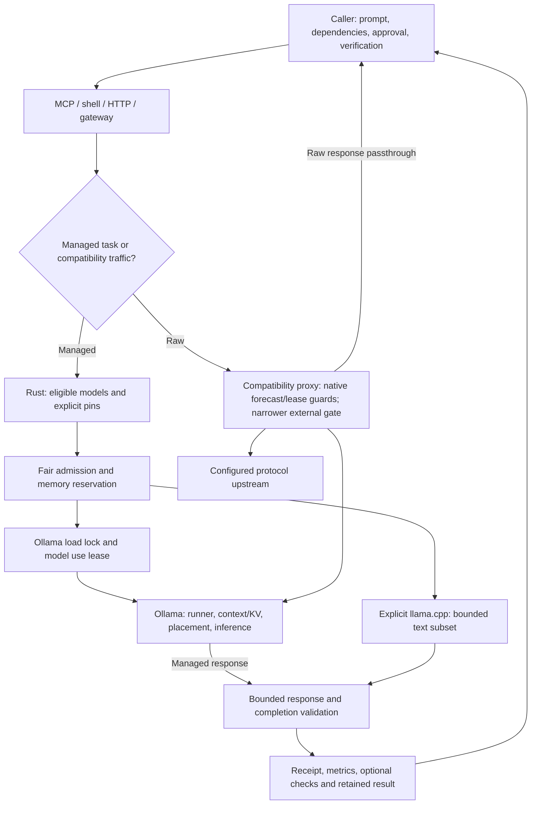

# End-to-end Ollama review

Reviewed **2026-11-15**, including unreleased changes. The strongest product direction is a
resource-conscious, inspectable coordinator for bounded work on a shared workstation. FreeLlama
should make admission, model choice, completion and failure easier to trust while leaving inference
to Ollama and judgment to the caller. The [overall assessment remains 7/10](ASSESSMENT.md): the
repairs below strengthen contracts but do not supply representative model or hardware qualification.

Astra reviewed the Rust execution and resource paths. Two Sol reviews covered agent protocols,
installation, checks, evaluation and research/coder boundaries. The orchestrator reviewed their
changes, durable identity, instruction ownership, feature coverage and primary upstream sources.
This is a source and contract review with retained historical live evidence, not a fresh execution
of every feature on every supported machine.

## Product decision and alternatives

| Direction | Best use | Decision for FreeLlama |
|---|---|---|
| Direct Ollama | One application, one explicit model, a dedicated machine | A strong baseline. Every extra layer must justify its overhead with coordination or evidence. |
| Shared-workstation coordinator | Several callers competing for finite memory and model residency | Prioritize bounded queues, accurate resource receipts, cancellation, measured selection and clear failures. |
| General engine/process switcher | Many inference servers and protocols | Keep the explicit llama.cpp text adapter; broaden capabilities only for a concrete client need and with failure tests. |
| General agent platform | Autonomous research, editing and tool execution | Keep adapters optional and bounded. Their maintenance and authority are separate from the core scheduling problem. |
| Automatic cloud escalation | Local output fails a check | Defer until check quality, data-transfer authorization and cost policy are established. A clean check currently cannot certify correctness. |

Ollama already provides model loading, residency controls, native queuing and parallel inference.
Parallelism increases context-memory demand, and per-request residency controls can override server
defaults. FreeLlama's opportunity is coordinating callers around those mechanisms, not assuming the
engine has none. [Ollama FAQ](https://docs.ollama.com/faq).

The nearby alternative [llama-swap](https://github.com/mostlygeek/llama-swap#features) advertises a
single-binary process switcher, multiple OpenAI/Anthropic-compatible engines, concurrency rules,
timeouts, logs and metrics. That makes breadth of proxy endpoints a weak sole differentiator. Our
inference from this comparison is to prioritize explainable admission and retained correctness
evidence. This review did not benchmark the competing projects or establish a competitive winner.

## Ownership from request to result

These doors have different contracts. Native local raw Ollama loads share forecast reservations,
transition locks and model leases, but not managed selection and context controls. External raw
upstreams have a narrower pressure gate; local telemetry cannot reserve remote memory. Direct
engine clients bypass FreeLlama entirely. Budgets, locks and leases are
process-local. Sharing a database does not create a host-wide scheduler. The operator should use one
coordinating authority per inference topology. See [architecture](ARCHITECTURE.md),
[every API](API.md) and [production boundaries](PRODUCTION.md).

The important ownership points are deliberately narrow:

- [Rust routing](../packages/rust-core/src/platform/routing/mod.rs),
  [admission](../packages/rust-core/src/platform/admission.rs) and
  [resources](../packages/rust-core/src/platform/resources/mod.rs) own selection and execution limits.
- [MCP registrations](../packages/mcp/src/tools/registrations.ts) own public tools;
  [virtual-model resolution](../packages/mcp/src/agent-cli/virtual.ts) owns gateway aliases.
- [Local prompts](../packages/mcp/src/local-prompts.ts) own opt-in job instructions. Caller fields
  win. The caller evaluates results and decides whether another model or tool should run.
- [Research adapters](../packages/mcp/src/research/) own bounded observations and their audit trail.
  They do not acquire the caller's mutation authority.

## Repairs implemented in this review

| Observed gap | Implemented repair | Evidence and practical limit |
|---|---|---|
| Managed Ollama JSON, error bodies and streamed output could accumulate without a response limit | Count wire bytes before parsing, including malformed records without a newline; reject oversized output without replay | Real HTTP tests cover text, errors, embeddings, decisions, exact limits and streams. The cap is per response, not a process-wide heap guarantee. |
| Slow managed-stream readers could accumulate unbounded events | Bounded event/frame channels, awaited token/route delivery, and an independently timed execution worker; admission progress is best effort | Slow-reader deadline and disconnect contracts verify local permits are released. Closing a connection is not proof that a GPU has physically stopped. |
| Internal catalog/residency/version reads could collect large bodies | One 4 MiB metadata reader checks HTTP status, declared size and incremental bytes | Known-length, chunked and exact-limit tests; raw generation refuses unknown forecasts and recovers when metadata becomes valid. Raw metadata passthrough remains byte-preserving. |
| Agent CLI/gateway calls omitted configured auth, ignored some controls, or accepted incomplete terminal output | Shared auth headers, redirect refusal, same-origin forwarding, managed routing for managed controls, required terminal completion, and verified HTTPS transport | Authenticated mock-server and TLS tests. A partial response remains failed; it is not retried as new inference. |
| Rewritten gateway and terminal responses could retain unlimited text | One JavaScript byte-budget helper bounds collected JSON/errors and transformed NDJSON/SSE before decoding | Exact-boundary, malformed-stream and cancellation fixtures. Raw real-model streaming is still a separate pull-driven path. |
| A retained deferred key could refer to changed managed-engine execution settings | Fingerprint the managed mapping in input identity while preserving the durable lookup namespace | Configuration changes conflict rather than rerun; original receipts remain readable. Credentials and declaration order do not change identity. [Migration rules](DEFERRED_JOBS.md#idempotency). |
| Numeric substring checks accepted a value contained inside a different number; malformed tool calls could escape warnings | Match numeric tokens with consistent comma normalization; validate container/name shapes and ambiguous tool definitions | Versioned 30-case regression report keeps misses and false positives. This remains a lexical/structural check, not semantic verification. |
| Evaluation records could misstate acquisition or accept a successful first turn followed by transport failure | Verify captured request provenance and continuations, reject duplicate acquisitions, version graders, and clear success on later failure | Offline tamper and transport fixtures; original raw model trials and strict results are unchanged. |
| Coder command capture discarded the middle of long logs and earlier-run output | Retain command bytes in private audit files, expose every run's reference, and terminate with an explicit incomplete result when the disk budget or write fails | Large-output, cap, write-error, timeout and cleanup tests; bounded model previews remain separate from retained logs. [Coder contract](cookbooks/research-agent.md). |
| Compact Octocode instructions existed as drifting duplicate strings | Bundle the canonical Markdown sheets through raw imports | The two baseline equality failures now have a single owner; existing equality, tool and line-count checks remain. |

The response limit reuses `FREELLAMA_MAX_REQUEST_BYTES` (64 MiB default). Bytes are counted before
UTF-8 decoding; JavaScript fetch may already have decompressed the HTTP body. The internal metadata
limit is 4 MiB. Incoming aggregate buffered bodies, deferred input retention and coder disk logs
have separate accounting. None is a substitute for a global response-memory budget. Configuration,
limits and failure behavior are detailed in [monitoring](MONITORING.md),
[agent CLI](AGENT_CLI.md) and [MCP configuration](../packages/mcp/CONFIGURATION.md).

Before-fix copies made from the staged implementation reproduced four managed-response regression
groups, both raw-proxy metadata regressions, the catalog byte-limit regression and all three managed
job-identity regressions. Current contracts pass those cases. The copies were isolated; the shared
index and retained model measurements were not rewritten to manufacture a passing baseline.
Independent cross-review also caught an explicit system prompt dropped by fill-in-the-middle
requests and custom coder logs placed inside the container scheduled for cleanup. Both are fixed;
all three new container-path cases failed before the confinement repair and pass afterward.
Using the corrected canonical Octocode sheet deliberately changes that adapter's prompt identity
and invalidates its old prompt-bound calibration. The frozen identity vector was recomputed
independently with Python's JSON/SHA-256 reference rules; the Bash prompt and other vectors are
unchanged. Historical Octocode outcomes do not qualify the repaired prompt without another evaluation.

## Feature coverage and remaining evidence

The rows below cover the public feature families. “Contract” means deterministic unit/integration
evidence; it does not mean a fresh live workload or a quality measurement. Detailed numerical ratings
and their scale remain in the [assessment](ASSESSMENT.md).

| Area | Coverage reviewed | What remains uncertain |
|---|---|---|
| Discovery, catalog, model selection and preview | Rust eligibility/pins, capabilities, bounded metadata, no-execution previews; machine-local calibration | Catalog picks are fallbacks; runtime/settings changes require recalibration; cross-machine selection benefit is unmeasured. |
| Text, coding, long context and structured output | Managed execution, request ownership, context fit, output checks, completion/error paths | Correctness across representative prompts and models. |
| Tool calls and thinking controls | Structural checks, per-model request controls, captured multi-turn smoke requests | Only seven public cases per measured model; parallel and long tool loops lack equivalent live qualification. |
| Vision/OCR and file input | Capability selection, payload/schema and file contracts, historical workflows | New image sets, languages and hardware; no fresh OCR accuracy claim. |
| Embeddings, nearest matches, deduplication and decisions | Specialized handlers, bounded upstream reads and retained historical cases | Dataset relevance/calibration and application-level decision accuracy. |
| Speech input/output | Explicit supported protocols and recipes, package contracts | Voice quality, transcription quality and platform/model coverage. |
| Workflows, custom prompts and job defaults | Caller-field precedence, sole prompt owner, recipe schemas, local calibration fallback | Generalization beyond exposed benchmark cases. |
| Batches, deferred jobs and idempotency | Ordered receipts, cancellation, bounded retention, recovery and managed identity changes | Crash/power-loss and sustained multi-client operational qualification. |
| Sessions, scopes, warming and sweeps | Revision/affinity boundaries, finite policies, leases and external-use protection | Other engine clients and physical driver behavior remain outside local authority. |
| Model search, pull, unload and delete | Explicit lifecycle tools and exact-tag approval/ownership rules | No new download, deletion or resident-model disturbance was required for this review. |
| Admission, CPU/GPU routing and memory | Weighted queues, reservations, context estimates, slow consumers, unknown telemetry handling | Windows/GPU hardware lanes, sustained contention and aggregate outgoing-memory accounting. |
| Loop stopping, `check:` lines and saved responses | Completion markers, repetition stop, bounded results, versioned labeled cases | A clean check does not establish a correct answer; known misses remain public. |
| Research and coder | Read-only lookup boundary, opt-in isolated edits, allowed commands, paginated observations and full command-audit references | Coding outcome quality, sandbox-platform qualification and the maintenance cost of this optional subsystem. |
| MCP, CLI and compatibility gateway | Registration/alias owners, auth, option routing, errors, NDJSON/SSE, verified HTTPS and byte limits | Endpoint compatibility is a subset; it must be qualified per protocol/client. |
| Keys, budgets, config, status, usage and UI | Existing contract suites and documented single-authority/auth boundary | Multi-tenant isolation and external TLS termination are deployment concerns; no new browser usability study. |
| llama.cpp | Explicit text adapter, refusal of unsupported controls, retained prior live smoke | Streaming/tools/vision/embeddings/lifecycle and neutral readiness are absent. |
| Install, CI and release | Prebuilt-native selection, POSIX fixtures, Windows fixtures, three-OS workflow and local packaging checks | Hosted CI, actual Windows execution and all-target packed-release qualification. Windows selects portable JavaScript contracts; POSIX research/coder paths are not a native Windows port. |
| Documentation and maintainability | Index/guide/recipe reconciliation, raw instruction imports, prior lock audit and focused splits | No claim that every large file needs splitting or every lock has been formally proved. |

## Using Ollama resources effectively

**Measure the current runner before making a choice.** Ollama's resident-model API exposes model
identity, memory, VRAM, allocated context and expiry. Combine that observation with host pressure and
the requested payload; do not infer physical placement from a model name. Treat a failed or
oversized observation as unknown. [Ollama resident-model API](https://docs.ollama.com/api/ps).

**Size context and concurrency together.** Fit the actual input plus output headroom and preserve a
compatible warm profile where possible. Larger context consumes more memory. The current context
guide describes hardware-dependent defaults, while other upstream prose still gives a single
default; inspect the running configuration instead of baking either into a universal claim.
[Ollama context length](https://docs.ollama.com/context-length),
[Ollama FAQ](https://docs.ollama.com/faq).

**Separate cold load, prefill and generation.** Use reported load duration, prompt counts, cached
prompt counts and evaluation timing to distinguish runner churn from model throughput. Missing cache
counts stay unknown. Prefer a measured suitable resident model when its estimated completion cost
is lower; explicit model pins and task-quality gates still win. Ollama reports timing in nanoseconds
and supplies stream metrics on the final response. [Ollama usage](https://docs.ollama.com/api/usage).

**Make completion observable.** A successful HTTP status does not guarantee a completed streamed
answer: Ollama can send an error after headers. Bound partial records, require the protocol's
completion evidence and retain failure status beside any partial output. The new terminal and
upstream contracts enforce these boundaries. [Ollama errors](https://docs.ollama.com/api/errors),
[streaming](https://docs.ollama.com/api/streaming).

**Keep tool execution and verification with the caller.** Ollama emits tool requests; the application
executes them and returns tool results for the next turn. A structurally valid request does not prove
the chosen action is correct. Preserve assistant/tool continuations and grade the whole attempted
interaction, including a failed follow-up. [Ollama tool calling](https://docs.ollama.com/capabilities/tool-calling).

**Keep compatibility claims narrow.** Ollama documents compatibility with parts of the OpenAI API.
Protocol transport alone does not establish tools, vision, streaming or placement support for every
engine. FreeLlama's own operator token is also separate from an SDK's placeholder Ollama key.
[Ollama OpenAI compatibility](https://docs.ollama.com/api/openai-compatibility).

## What the results establish

The historical workflow result is **45/46 completed cases**, from **48 planned cases**; counting the
planned denominator gives 45/48. The baseline is 25/48. This is a dated, single-machine comparison,
not a general 98% success promise. See [benchmark evidence](BENCHMARK.md).

The retained tool smoke runs remain **6/7 and 5/7** under their original strict grader. A separately
versioned post-hoc report classifies the three strict failures as formatting failures under narrow
case-specific rules. It does not rewrite the original scores, add trials or estimate general
reliability. The repaired result-check corpus improves source-risk recall from **25% to 37.5%** on
the same exposed cases, with a false positive still retained. See [reliability and raw evidence](RELIABILITY.md).

## Validation of this revision

Local macOS verification passed:

| Check | Result |
|---|---|
| `yarn build` | Release Rust binary, native addon and JavaScript bundles built successfully. |
| `yarn typecheck` | All workspace TypeScript checks passed. |
| `yarn lint:rust` | Workspace formatting and strict all-target/all-feature Clippy passed. |
| `yarn test:js` | 1,346 Vitest tests passed, 3 skipped; 112 benchmark/grader and 16 reliability checks passed. |
| `yarn test:rust` | 781 tests passed, 4 ignored. |
| `yarn test:release` | 51 packaging contracts passed, including README synchronization. |
| Selected MCP integration | 21 cookbook, documentation-resource and isolated-upstream contracts passed through the built server. |
| Windows JavaScript selection on macOS | 174 passed, 2 Windows-only installer cases skipped; this is not native Windows execution. |
| Documentation | 66 Markdown files checked; 631 local/repository links and 183 heading anchors resolved. Package READMEs were synchronized and 46 guides bundled. |

The initial full baseline failed two documentation/embedded-instruction equality tests. Removing the
duplicate owner repaired those failures. The final suite also required the deliberate Octocode
identity-fixture migration described above; assertions and failure conditions were retained.

No new model inference or model lifecycle action was needed. Selected integration setup only probed
Ollama's version; its endpoint-isolation case used a local fixture. Hosted CI, native Windows/GPU
execution, the full live inference tier and all-target production qualification remain unobserved
for this revision; see [testing tiers](TESTING.md). The three-OS workflow keeps the full Rust suite,
with the full JavaScript suite on Linux/macOS and an explicit portable subset on Windows. Optional
research/coder paths still assume POSIX shell/path behavior and require a separate Windows port.

## Highest-value remaining work

1. Observe the configured CI lanes and packaged installs on every supported target; retain versions,
   failures and skips. Local macOS success cannot replace this evidence.
2. Add independently labeled, unseen tasks and repeated tool trials tied to exact model artifacts.
   Report strict formatting and semantic outcomes separately, with every attempted denominator.
3. Measure sustained multi-client workloads: queue latency, first-token latency, cold-load rate,
   peak memory, cancellation and foreground responsiveness. Include slow/unread consumers and
   multiple hardware classes before claiming resource safety beyond current accounting boundaries.
4. Validate that per-machine calibration improves actual job completion, then extend it with
   task-quality evidence and explicit runtime/settings invalidation.
5. Extend the engine contract only where a client needs it. Keep optional research/coder scope
   review separate. Automatic cloud escalation still needs an explicit policy; a multi-machine
   pool remains excluded.
