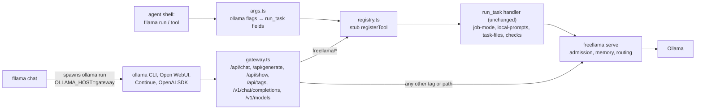

# RFC 0001: `fllama`, an agent CLI, and FreeLlama virtual models over the Ollama and OpenAI APIs

FreeLlama now ships `fllama`, a second binary of `@octocodeai/freellama-mcp-server`, with two
faces over one engine:

1. **`fllama run`** works like `ollama run`, with the same flags, piping and exit behavior, but
   executes through the registered MCP `run_task` handler. It gets job and workflow model picks,
   documented prompts and options, file reading, admission, memory checks and `check:` lines.
2. **Virtual models.** Workflows and jobs appear as models named `freellama/<name>` on an
   Ollama- and OpenAI-compatible gateway. `ollama run freellama/fix-bug`, Open WebUI, Continue or an
   OpenAI SDK can therefore use FreeLlama's configuration with no client changes. `fllama chat` is
   the real `ollama` REPL pointed at that gateway.

The main limitation is that answers arrive in one chunk: a managed task is not streamed token by
token.

## Summary

- **Decision:** Reuse, don't reimplement. The CLI and gateway call the MCP tool handlers in process,
  through a stub `registerTool` (`packages/mcp/src/agent-cli/registry.ts`), the same pattern the
  unit tests use. Every input is validated by the tool's own zod schema. `local-prompts.ts` stays
  the single owner of local-model instructions (AGENTS.md).
- **Leverage Ollama instead of rebuilding it:** speak Ollama's own protocol and let the `ollama`
  CLI supply the REPL, history, `/set`, the thinking display and `--verbose` stats. `fllama` builds
  only what the `ollama` CLI cannot express: files and globs, receipts, `check:` lines, exit codes
  and decision questions.
- **Effect:** a shell-only agent gets one-call access to the tested pick for the job:
  `git diff | fllama run -w summarize-diff`. Any OpenAI or Ollama client gets the same through a base
  URL.

## Problem and context

Facts, from the code before this change:

- `freellama task` (Rust, `packages/cli/src/main.rs`) routes by task kind and objective. It has no
  jobs or workflows.
- Job mode (`job-mode.ts`: `pickJobModel`, `applyJob`) and workflows (`local-prompts.ts`) were
  reachable only through MCP `run_task`. That handler also owns file reading, payload validation,
  cancellable execution through deferred jobs, embedding slicing, `nearest` ranking and result
  checks.
- `serve` passes `/api/*` and `/v1/*` through to Ollama byte for byte. Clients that use it get
  admission and telemetry, but no picks or prompts.
- The MCP server autostarts `serve` as a child that lives only as long as the MCP process.
- Ollama 0.40 `ollama run` flags (observed with `ollama run --help`, client 0.40.15): `--format`,
  `--think[=v]`, `--hidethinking`, `--keepalive`, `--verbose`, `--nowordwrap`, `--insecure`,
  `--dimensions`, `--truncate`, `--voice`, `--ask`, `--choice`, `--level`.

Cost of inaction: shell and OpenAI/Ollama-protocol callers use raw tags with Ollama defaults. They
get untuned prompts, no fit check, and nothing that tells them what to verify.

## Goals and scope

1. Every `ollama run` flag is either implemented or refused with the command that supports it. No
   flag that changes the answer is silently ignored.
2. A field the caller passes wins over what job mode would fill in (the `run_task` rule).
3. stdout carries only the answer. Exit codes are 0 success, 1 refused or failed, 2 usage, 130
   interrupted.
4. `serve` starts once and later calls reuse it.
5. Virtual models behave like models to unmodified Ollama and OpenAI clients.

Exclusions: token streaming, new routing logic, Rust changes, and new authority. `fllama pull` is
`ollama pull` and needs the user's approval like any pull. `fllama tool ollama_pull` still requires
`approvedSizeBytes`.

## Proposed design

The user-facing reference is [`docs/AGENT_CLI.md`](../AGENT_CLI.md). This section records the
decisions behind it.

**Positional model rule.** The first word is a model only when nothing else names one and it has
no whitespace. An Ollama tag cannot contain whitespace, so the rule reads syntax, not model
properties.

**stdin rule (decided while testing).** Only a FIFO or a regular file is read. The Claude Code
Bash harness hands commands an open socket (`fstat`: socket). `ollama run` blocks on that socket
waiting for EOF; `fllama` must not.

**Decision flags.** `--ask Q` starts a `noul` question. Later `--choice k=desc` flags make it a
`choice` question, and `--level L` flags make it a `score` question. Questions are named q1, q2, …
in argv order. stdin, files or the prompt words become the `state`.

**Chat-to-task mapping (decided).** Job mode keeps a caller's `messages` whole and adds no system
prompt. That is right for MCP, but OpenAI clients always send messages. The gateway therefore
applies this rule, at the adapter, without changing job mode:

- one user turn with no system message → `run_task {workflow, prompt}`, with the full job mode
  treatment;
- a longer conversation without a system message → the workflow's system prompt is prepended
  (computed with `applyJob`) and the turn runs on the job's live pick;
- a caller system message → `messages` are sent unchanged; job mode applies model, options and
  think only.

**Ollama CLI compatibility details found by testing.**

- The CLI prints `digest[:12]` and panics on an empty digest, so virtual tags carry a SHA-256 of
  their name.
- The CLI's preload request (a chat with no messages) is answered at once with `done_reason:"load"`.
- The heartbeat `HEAD /` gets a 200.
- The CLI appends `:latest` to names, and virtual names accept it.

**Errors.** A tool's JSON refusal reaches clients as its human-readable `error` and `code`.
Refusals that waiting can fix are 503: capacity, memory, Ollama down, inventory unavailable, or no
pick that fits now. Everything else is 500.

**Security.** HTTP requests cannot name files and the gateway fetches no URLs. Images must arrive
as base64. It listens on loopback, and browser requests from non-loopback origins get 403, matching
Ollama's default origin policy.

**serve lifecycle.** `configureServeAutostart({detach:true})` starts `serve` in its own process
group, logging to `<FREELLAMA_HOME>/serve.log`. The CLI lets go of it once `/ready` answers. An
early exit reports the log tail. The MCP server keeps attached mode.

## Alternatives and rationale

Is this the best way? Each option compared:

| Option | Pros | Cons | Verdict |
|---|---|---|---|
| **A. Own CLI + virtual-model gateway over the MCP handlers (chosen)** | One engine; nothing duplicated; contract parity with MCP for free; Ollama's CLI and ecosystem reused as the front end; works for shell agents and OpenAI/Ollama clients | No token streaming; a second listener (11437) beside `serve`; virtual models exist only where the gateway runs | Chosen |
| B. Ollama Modelfiles: `ollama create freellama-fix-bug` with `FROM <pick>`, `SYSTEM`, `PARAMETER` | Zero runtime; every Ollama and OpenAI client sees it natively, streaming included | Pick frozen at create time (no fit-now); no admission, file reading or checks; writes models into the user's store (a mutation needing approval); per-model profiles need one Modelfile per pick | Good complement: a possible `fllama export-modelfiles` for clients that cannot change base URL |
| C. Add jobs and workflows to Rust `freellama task` and `serve` | One binary; streaming possible in `serve` | Ports job mode, workflows, file reading and checks to Rust: two owners of prompts | Rejected for now; revisit if prompts become a shared data file |
| D. A custom chat REPL in `fllama` | Full control | Rebuilds what `ollama run` already does well | Dropped in favor of the `ollama` REPL on the gateway |
| E. CLI as an MCP client over stdio | Zero coupling | A process and a JSON-RPC session per call; summarized output files | Rejected |
| F. Status quo (`OLLAMA_HOST` → `serve`) | Exists | Admission only: no picks, prompts or checks | Kept for raw tags (the gateway forwards them) |

What would change the choice:

- Managed streaming in `serve` would remove A's main con.
- If the MCP SDK changed `registerTool`'s shape, `registry.ts` is the one place to adapt, and the
  registry test fails first.

## Risks and mitigations

- **A background `serve` surprises the user.** The CLI prints its PID, log and stop command;
  `FREELLAMA_MCP_AUTOSTART_SERVE=0` opts out.
- **`fllama pull`/`rm` passthrough.** It grants nothing `ollama` does not already grant, and the
  agent invariants still apply (docs say so).
- **`check:` lines are invisible to plain OpenAI and Ollama clients.** They sit in the `freellama`
  response field. `fllama chat` appends them to the answer for the person reading it.
- **Client quirks beyond the ollama CLI.** Unknown (see Open questions).

## Implementation and rollout

Done in this change:

1. `serve.ts`: detached autostart; test `detached mode…` in `serve.test.ts`.
2. `src/agent-cli/{args,registry,output,gateway,main}.ts` and the entry `src/agent-cli.ts`; tests in
   `test/unit/agent-cli.test.ts` (flag mapping, refusals, output split, the real `run_task` handler
   with `serve-client` mocked, OpenAI and Ollama mapping, HTTP behavior).
3. `scripts/build.mjs` bundles `dist/agent-cli.js`. The `package.json` `bin` adds `fllama` and keeps
   `freellama-mcp-server`. `verify-release-packages.mjs` requires the new file.
4. Docs: `docs/AGENT_CLI.md`, plus index rows in `docs/README.md` and `AGENTS.md`.

Rollback: remove the `fllama` bin and build entries. The `serve.ts` change is inert unless detached
mode is configured.

## Validation and success

Verified (unit tests, `yarn typecheck`, `yarn test:js` 1145 passed, `yarn test:release` 51 passed):

- Given `-w fix-bug "…"`, when run through the registry, then serve receives the catalog's
  installed pick, a system message and the prompt, and `job_profile` names the workflow.
- Given an unknown `run_task` field, then the CLI refuses it with the tool's schema message and
  exit code 2.
- Given `--ask/--choice/--level`, then the questions are typed noul, choice or score, in argv order.
- Given `--dimensions`, `--voice` or `--truncate=false`, then exit code 2 and a message naming the
  supporting command.
- Given a gateway, then `/api/chat` streams NDJSON with Ollama stats and `freellama.checks`;
  `/v1/chat/completions` returns JSON or SSE ending in `[DONE]`; a missing inventory is a 503 with
  its message; another origin gets 403.

Verified live (serve running, Ollama stopped):

- `OLLAMA_HOST=<gateway> ollama list` lists the virtual models.
- `ollama run freellama/fix-bug "x"` reaches the gateway and prints the 503 message.
- `fllama run -w summarize-text hi` exits 1 with `job "summarize": the installed models could not
  be read…`.

Still owed:

- Given an installed pick, when `ollama run freellama/explain-code` runs a multi-turn chat, then
  answers come from the pick and `--verbose` stats appear.
- Given the OpenAI Python SDK, when it calls `chat.completions.create(model="freellama/review-code")`
  with and without `stream=True`, then both succeed.

## Open questions

- Non-blocking: managed token streaming would make chat and `stream:true` incremental. It needs a
  streaming task route in `serve`.
- Non-blocking: `fllama export-modelfiles` (alternative B) for clients that cannot change their
  base URL. Creating models in the user's store needs explicit approval per tag.
- Non-blocking: whether the Rust `freellama` launcher should forward `run`, `chat` and `gateway` to
  `fllama`, so one command name covers both.
- Non-blocking: server-side chat history (`scope`) for resumable chats. Job mode currently refuses
  `scopeId`.

## References

- Ollama CLI flags: `ollama run --help` (client 0.40.15); [Ollama API](https://docs.ollama.com/api/introduction);
  [OpenAI compatibility](https://docs.ollama.com/api/openai-compatibility).
- Engine: `packages/mcp/src/tools/run-task.ts`, `job-mode.ts`, `local-prompts.ts`.
- Handler-reuse precedent: `packages/mcp/test/unit/batch-context.test.ts`.
