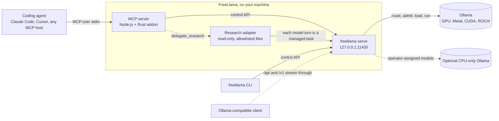
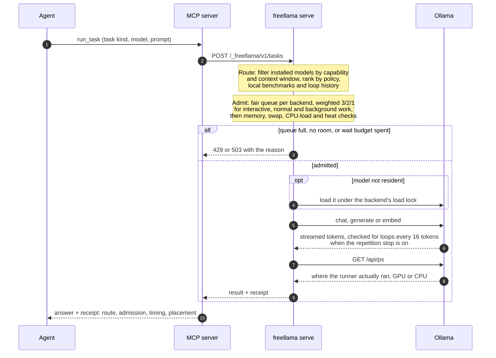
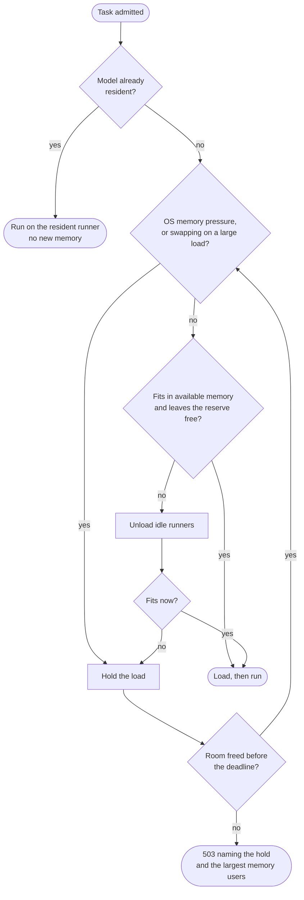

# FreeLlama


**Run your agent's bulk work on local models without overloading your machine.**

FreeLlama lets coding agents offload bounded work (embeddings, OCR and vision, bulk rewrites,
classification, summaries) to local [Ollama](https://ollama.com) models instead of spending paid
tokens and context. For each task it picks an installed model that fits, loads and switches models
only when they fit in memory, and returns the result with a receipt of where and how it ran. Your
agent still decides what to offload and verifies the answer.



## Why FreeLlama

Coding agents spend paid tokens and context on work a model on your own machine can do: embedding a
repository, reading screenshots and scans, summarizing or classifying hundreds of files. Pointing
the agent straight at Ollama does not fix that, because the agent cannot see:

- **Which model fits the job.** A tag name does not show capabilities, context window or memory
  footprint.
- **Whether there is room.** One more load can push the machine into swap, several agents can pile
  onto one GPU, and a hot or busy machine slows everything.
- **Whether it worked.** A model can repeat itself until its token cap, and nothing says whether the
  task ran on the GPU or fell back to the CPU.

FreeLlama answers all three on every call, which makes offloading safe to do by default: the paid
model keeps the judgment, the local model does the volume, and each answer comes back with a receipt
you can check. The name means less metered inference, not only Meta's Llama models. More in
[Features](https://github.com/bgauryy/FreeLlama/blob/main/docs/FEATURES.md#why-freellama).

## Requirements

| You need | Why |
|---|---|
| [Ollama](https://ollama.com/download) running (`ollama list` works) with at least one model | FreeLlama manages Ollama; it does not install, start or replace it, and never downloads a model without your approval |
| Node.js 22 or newer | Runs the MCP server and the `freellama` npm launcher |
| One of the platforms below | npm installs the matching prebuilt binary as an optional dependency; do not install with `--omit=optional` |

| Platform | Prebuilt package |
|---|---|
| macOS, Apple silicon (arm64) | `@octocodeai/freellama-native-darwin-arm64` |
| Linux x64, glibc | `@octocodeai/freellama-native-linux-x64-gnu` |
| Linux arm64, glibc | `@octocodeai/freellama-native-linux-arm64-gnu` |
| Windows x64 | `@octocodeai/freellama-native-win32-x64-msvc` |
| Windows arm64 | `@octocodeai/freellama-native-win32-arm64-msvc` |

Intel Macs and musl Linux (such as Alpine) have no prebuilt binary: build from source with Rust 1.89
or newer ([Build from source](https://github.com/bgauryy/FreeLlama/blob/main/docs/BUILD_AND_NOTES.md#build-from-source)). Optional: a second,
CPU-only Ollama process for small helper models ([CPU/GPU routing](https://github.com/bgauryy/FreeLlama/blob/main/docs/CPU_GPU_ROUTING.md)).

## Install

### MCP server (for your agent)

Claude Code:

```bash
claude mcp add freellama -- npx -y @octocodeai/freellama-mcp-server
```

Claude Desktop, Cursor and other hosts:

```json
{ "mcpServers": { "freellama": { "command": "npx", "args": ["-y", "@octocodeai/freellama-mcp-server"] } } }
```

At launch the server starts its own FreeLlama service on `127.0.0.1:11435` if none is running, so
the CLI is optional. It does not install or start Ollama.

Required for `delegate_research` in a published install: `FREELLAMA_MCP_ALLOWED_ROOTS` lists the
directories that tool may read (`:`-separated on macOS and Linux, `;` on Windows). Unset, every local
`delegate_research` call is refused (its `adapter:"github"` runs without a workspace); the other tools
do not need it, and `run_task` `files` uses `FREELLAMA_FILE_ROOTS` instead. Add it with
`claude mcp add freellama -e FREELLAMA_MCP_ALLOWED_ROOTS=/absolute/path/to/your-project -- npx -y @octocodeai/freellama-mcp-server`
or an `"env": { ... }` entry in JSON. All settings: [MCP configuration](https://github.com/bgauryy/FreeLlama/blob/main/packages/mcp/CONFIGURATION.md).

How `delegate_research` picks its model, grounds answers and resumes sweeps: [research model and sweeps](https://github.com/bgauryy/FreeLlama/blob/main/packages/mcp/CONFIGURATION.md#research-model-and-sweeps).

### CLI (for the terminal)

```bash
npm install -g @octocodeai/freellama
freellama --version
```

Without installing, prefix commands with `npx @octocodeai/freellama`. Without Node.js, use
`cargo install freellama-cli` (Rust 1.89+; the command is still `freellama`).

### Agent CLI and gateway (`fllama`)

```bash
npx -p @octocodeai/freellama-mcp-server fllama --help   # from 0.11.0; before that, from a checkout
```

`fllama` works like `ollama run`, but runs each request through FreeLlama: the job's tested
model, its prompts, file reading and the memory gate. `fllama gateway` serves the same workflows as
models (`freellama/fix-bug`) to any Ollama, OpenAI or Anthropic client. See
[`fllama`](https://github.com/bgauryy/FreeLlama/blob/main/docs/AGENT_CLI.md).

## Quick start

### From your agent

Ask in plain words; the agent picks the tool ([MCP reference](https://github.com/bgauryy/FreeLlama/blob/main/packages/mcp/README.md)):

- "List my local models and tell me which one fits coding tasks."
- "Use FreeLlama to summarize these 40 files with a local model, then check three summaries."
- "Read this screenshot with a local OCR model."

Or call the tools directly: take the tested pick for the job from the catalog, then run it with
that `model` (without one, routing picks by capability alone and may choose a model that does
not fit now).

```jsonc
{ "tool": "models",   "arguments": { "view": "catalog", "job": "coding" } }
{ "tool": "run_task", "arguments": { "task": "coding", "model": "<catalog pick>", "prompt": "Rename foo to bar in: ...", "options": { "num_predict": 512 } } }
```

`run_task {preview:true}` shows the route without running or reserving anything.

### From the terminal

```bash
freellama init          # check prerequisites; JSON with `status` and `next_steps`; changes nothing
freellama doctor        # Ollama reachability, versions, hardware, effective settings
freellama catalog       # tested model picks per job, what is installed, what fits now
freellama serve         # keep running: the service on http://127.0.0.1:11435
# in another terminal
freellama ready         # can work be served now, or what is it waiting for
freellama models
freellama task --task completion --model MODEL_TAG "Reply with exactly OK."
freellama status        # queues, memory holds, loaded models
```

Or let FreeLlama choose the model and prompts, as `ollama run` would run one:

```bash
git diff | fllama run -w summarize-diff                       # the summarize pick that fits now
fllama run -w fix-bug -f src/parser.ts "drops the last token"  # answer on stdout, check: lines on stderr
fllama gateway   # then: OLLAMA_HOST=127.0.0.1:11437 ollama run freellama/explain-code
```

Replace `MODEL_TAG` with a tag from `models`. These commands print JSON receipts: the answer of
`task` is `.response.message.content` (`freellama task … | jq -r .response.message.content`), and
`fllama run` prints the answer alone. `init`, `doctor` and `catalog` work without `serve`.
Every command has `--help`; the [CLI guide](https://github.com/bgauryy/FreeLlama/blob/main/docs/CLI.md) covers the rest. While `serve` runs, a
status page is at `http://127.0.0.1:11435/_freellama/ui`.

## Under the hood

Every managed call, from the MCP server, `fllama`, the CLI or the HTTP API, runs through the same Rust core
and the same gates: route, admit, load, run, observe. Nothing is decided from a model's name.

| Owner | Does |
|---|---|
| Your agent | Decides what to offload, writes the prompt, verifies the answer |
| FreeLlama | Picks the model, queues fairly, checks memory and host signals, coordinates loads, writes the receipt |
| Ollama | Stores models, loads runners, generates tokens |

### Life of one task



An explicit `model` always wins over routing; FreeLlama never swaps in another model. With
`defer:true` the same path runs in the background and `task_jobs` returns the receipt.

Long answers are saved whole and returned as a short view with the file that holds them; see [where an answer goes](https://github.com/bgauryy/FreeLlama/blob/main/packages/mcp/CONFIGURATION.md#where-an-answer-goes).

### The memory gate

A model load has to fit before it starts, so a new load cannot push the machine into swap:



Resident models keep serving through a hold, except at critical OS memory pressure. Load estimates
come from model metadata (including the K/V cache at the requested context), and Ollama stays the
final authority on memory. `--low-memory advisory` admits a tight load with a warning instead of
waiting. Details: [Architecture](https://github.com/bgauryy/FreeLlama/blob/main/docs/ARCHITECTURE.md#managed-task-execution).

## What to offload

Offload bounded work whose result your agent can check; keep judgment in the agent.

| Offload | Keep in your agent |
|---|---|
| Embeddings, search and deduplication | Small lookups (describing the task costs more than doing it) |
| OCR and image reading | High-stakes judgment: security review, design, merge decisions |
| Bulk rewrites, summaries, classification of many files | Edits across files |
| Questions about workspace files (`delegate_research`) | Final verification of any local answer |

Many independent items: `run_task {tasks}`. Long work: `run_task {defer:true}` then `task_jobs`.
Treat local answers as candidates and spot-check some before relying on the rest.

## Safety

- Never pulls a model without approval for one exact tag and size; never deletes one unless you name
  the exact installed tag.
- Checks each load against live available memory; a load that does not fit waits, then is refused
  with a reason, and resident models keep serving.
- Unloads only models it warmed or that you name; idle models are unloaded under memory pressure.
- Holds CPU-bound work on a busy or hot machine and names the signal in the receipt.
- Binds to loopback; for remote access see [Production](https://github.com/bgauryy/FreeLlama/blob/main/docs/PRODUCTION.md).

## Documentation

| Topic | Page |
|---|---|
| All guides | [Documentation index](https://github.com/bgauryy/FreeLlama/blob/main/docs/README.md) |
| Every API on one page: MCP tools, `fllama`, gateway, CLI, control API, passthrough | [Every API](https://github.com/bgauryy/FreeLlama/blob/main/docs/API.md) |
| CLI commands and flags | [CLI](https://github.com/bgauryy/FreeLlama/blob/main/docs/CLI.md) |
| `ollama run`-style CLI; workflows as models for Ollama, OpenAI and Anthropic clients | [`fllama`](https://github.com/bgauryy/FreeLlama/blob/main/docs/AGENT_CLI.md) |
| MCP tools, schemas, agent workflow | [MCP reference](https://github.com/bgauryy/FreeLlama/blob/main/packages/mcp/README.md), [MCP configuration](https://github.com/bgauryy/FreeLlama/blob/main/packages/mcp/CONFIGURATION.md) |
| Operating procedure for agents | [FreeLlama skill](https://github.com/bgauryy/FreeLlama/blob/main/skills/freellama/SKILL.md) |
| Features, routing and admission in depth, why FreeLlama | [Features](https://github.com/bgauryy/FreeLlama/blob/main/docs/FEATURES.md) |
| How it compares with Ollama, llama.cpp, llama-swap, LocalAI, fabric, aichat, llm, LiteLLM | [Comparison](https://github.com/bgauryy/FreeLlama/blob/main/docs/COMPARISON.md) |
| Choosing a model | [Model selection](https://github.com/bgauryy/FreeLlama/blob/main/docs/MODEL_SELECTION.md), [local model catalog](https://github.com/bgauryy/FreeLlama/blob/main/docs/LOCAL_MODELS.md) |
| Model forms, measured results | [Model forms and results](https://github.com/bgauryy/FreeLlama/blob/main/docs/MODEL_FORMS_AND_RESULTS.md) |
| Recipes per job | [Cookbooks](https://github.com/bgauryy/FreeLlama/blob/main/docs/cookbooks/README.md) |
| CPU/GPU setup and placement | [CPU/GPU routing](https://github.com/bgauryy/FreeLlama/blob/main/docs/CPU_GPU_ROUTING.md) |
| Queues, memory, live tuning | [Monitoring](https://github.com/bgauryy/FreeLlama/blob/main/docs/MONITORING.md) |
| Faster, lighter local models; Ollama settings | [Tuning](https://github.com/bgauryy/FreeLlama/blob/main/docs/TUNING.md) |
| Background jobs and recovery | [Deferred jobs](https://github.com/bgauryy/FreeLlama/blob/main/docs/DEFERRED_JOBS.md) |
| History, affinity, warming | [Scopes and warming](https://github.com/bgauryy/FreeLlama/blob/main/docs/SCOPES_AND_WARMING.md) |
| Deployment and releases | [Production](https://github.com/bgauryy/FreeLlama/blob/main/docs/PRODUCTION.md) |
| Build from source, operating notes | [Build and notes](https://github.com/bgauryy/FreeLlama/blob/main/docs/BUILD_AND_NOTES.md), [Testing](https://github.com/bgauryy/FreeLlama/blob/main/docs/TESTING.md) |
| Architecture and ownership | [Architecture](https://github.com/bgauryy/FreeLlama/blob/main/docs/ARCHITECTURE.md) |
| Embedding the Rust core | [Rust core](https://github.com/bgauryy/FreeLlama/blob/main/packages/rust-core/README.md) |

## License

Copyright (c) 2026 Guy Bary. Licensed under [Apache-2.0](https://github.com/bgauryy/FreeLlama/blob/main/LICENSE-APACHE) or [MIT](https://github.com/bgauryy/FreeLlama/blob/main/LICENSE-MIT),
at your option.
