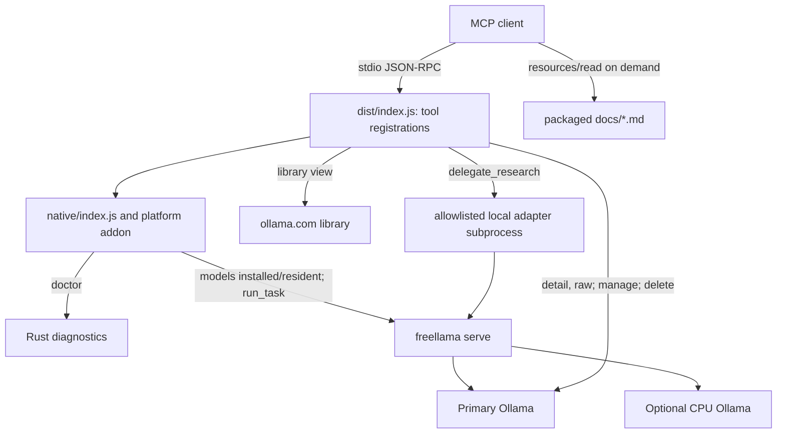

# FreeLlama MCP server


This package exposes FreeLlama's management layer as Model Context Protocol (MCP) tools.
Agents offload bounded tasks to local Ollama models; FreeLlama handles model selection, resource
admission, memory checks, and routing to configured CPU/GPU backends. Results include execution
evidence for the calling agent to inspect.

The agent owns prompts, task dependencies, and answer verification. The operator configures
Ollama and model lifecycle permissions; Ollama performs inference. See
[architecture](https://github.com/bgauryy/FreeLlama/blob/main/docs/ARCHITECTURE.md) for the full ownership boundary.
The server uses the official [TypeScript SDK](https://github.com/modelcontextprotocol/typescript-sdk).

## Understand the tools

`doctor`, `models`, `run_task`, `task_jobs`, `scope`, and `session` call the Rust core through native NAPI bindings
(`packages/rust-core/src/napi.rs`), with no CLI subprocess and no routing decisions in TypeScript; the
TypeScript layer validates request shapes and derives presentation fields (see
[what the MCP layer computes](#what-the-mcp-layer-computes)). `run_task` has four modes: one task,
`tasks[]` (independent batch), `preview: true` (decision only, no inference), and `warm: true`
(load an exact installed model, no generation). Preview and execution are separate calls: preview
accepts routing fields only and rejects task payloads or runtime controls instead of silently
ignoring them. `ollama_manage` and `ollama_delete` call Ollama's HTTP API directly for lifecycle
operations the routing layer does not perform.

Use the smallest tool that owns the operation; the canonical per-tool table is [Tools](#tools).

## Follow the agent workflow

The task lifecycle uses the UUID returned as `job.id` by `run_task {defer:true}`. A job is one
submitted task; pass that UUID as `jobId` for every subsequent operation.

| Operation | MCP call |
|---|---|
| List models | `models {view:"installed"}` |
| Submit a task and receive its ID | `run_task {prompt:"Explain this code", defer:true}` |
| List tasks with their states | `task_jobs {action:"list"}` |
| Get one task's state, result, or error | `task_jobs {action:"get", jobId:"<returned UUID>"}` |
| Stop one task and retain its record | `task_jobs {action:"cancel", jobId:"<returned UUID>"}` |
| Stop one task and remove its record | `task_jobs {action:"remove", jobId:"<returned UUID>"}` |

Removal waits for local permits to be released before deleting the record. It returns the ID and
terminal status; subsequent lookup returns `404`. It does not unload a shared Ollama model or
prove that physical computation has stopped. Receipts are bounded and lost on server restart;
see [retention and task states](https://github.com/bgauryy/FreeLlama/blob/main/docs/MONITORING.md#read-the-live-status).

Follow this workflow. The server's initialization instructions carry a compressed form of the
same contract (inventory first, preview semantics, evidence levels, ownership, and pull approval):

1. Start with `models {view:"installed"}`, then `models {view:"resident"}`. This gives a routing
   agent the smallest current inventory first.
2. Call `doctor` only for runtime or configuration diagnosis. It returns `summary` by default;
   use `view:"status"` for live queues and limits or `view:"full"` for the complete diagnostic. If Ollama is missing or unreachable, ask the operator to install or start it.
3. Classify the task. Offload embeddings, OCR/vision, bulk transforms, and sufficiently large
   grounded lookups; retain small lookups and high-stakes judgment in the calling agent.
4. Prefer a qualified installed model and preview consequential work.
5. If none fits, collect the operator's modality, quality, context, latency, privacy, disk/download,
   and memory constraints. Search the Ollama library, inspect exact tags and host-memory fit, and
   present at most two candidates.
6. Ask the operator to approve one exact tag and its reported size before calling
   `ollama_manage {action:"pull"}`. Searching or recommending never authorizes a download.
7. Execute, inspect the route/execution/admission receipt, and verify the result at the returned
   confidence level.

### Use context and delegation deliberately

FreeLlama reduces the **calling agent's context burden**. It does not make an Ollama response more
accurate or eliminate the local model tokens needed to produce it. Its compact text cue avoids a
second serialized copy of the canonical `structuredContent`; its delegated adapter keeps full tool
observations on disk and presents them in pages when requested.

Use this economical sequence:

1. Request `models {view:"installed"}` before `doctor`; inventory is normally the smaller and
   more relevant first decision.
2. Preview consequential generation with `run_task {preview:true}`. Preview is decision-only: it
   neither generates nor reserves capacity.
3. Execute in a separate `run_task` call. Set `contextTokens` for the complete Ollama window and
   `options.num_predict` for its output cap. A lower cap or window can lower cost **and** damage a
   difficult answer, so choose it from the task rather than a global default.
4. Use `delegate_research` only for a self-contained question requiring files under
   `workspacePath`. Bound `agent.maxTurns`, `agent.contextTokens`, and `agent.outputTokens`.
5. Keep the compact text cue in the active conversation; inspect `structuredContent`, a paged tool
   result, or a bundled documentation resource only when its detail changes the next action.

For a delegated agent, estimated usable input is `contextTokens - outputTokens - safetyMarginTokens`
(the default margin is 256). The adapter pins the system instruction and question, preserves the
newest observations, compacts older observations into breadcrumbs, and refuses a pinned overflow
by default. `FREELLAMA_AGENT_PINNED_OVERFLOW=clip` is a deliberate quality-risk override. Initial token counting
is conservative; successful Ollama calls calibrate later estimates.

Do not confuse operational evidence with answer quality. A receipt can prove admission, token
counts, placement, or unloading. It cannot prove research correctness, coding judgment, sustained
throughput, or fairness from one run. Check the returned confidence, policy evidence, and benchmark
evidence before accepting a consequential answer.

### Token economics

Offloading keeps source material and intermediate tool output out of the calling agent's context;
the local model still spends tokens, power, and time. Per-call rows below come from one machine
(M4 Pro, 48 GB unified memory); `~` values are estimates.

| Work | Source tokens | Returned tokens | Preserved |
|---|---:|---:|---:|
| 6 grounded code questions | 59,208 | 1,742 | **97.1%** |
| 4 text embeddings (307 ms) | 17,600 | ~200 | **98.9%** |
| 1 image, OCR, byte-exact | 1,970 | 37 | **98.1%** |

A dated MCP-envelope audit (2026-09-03, `characters / 4` as a rough token estimate) measured the
duplicate text copy FreeLlama does not emit beside `structuredContent`: `doctor {view:"summary"}`
avoids ~3,064 chars, `doctor {view:"full"}` ~10,651, `models {view:"raw", limit:1}` ~404. These
are **not billed-token savings** unless the host would otherwise feed both representations to a
model. The tool schema itself is per-turn rent, bounded by the
[protocol context-budget test](https://github.com/bgauryy/FreeLlama/blob/main/packages/mcp/test/integration/protocol.test.ts);
read documentation resources on demand and filter unneeded tools where the client supports it.

| Cost side | Measured |
|---|---|
| Grounded question latency | **7–62 s** vs ~1 s for a frontier model that already holds the file |
| Scaling | turn-dominated: `seconds ≈ 9.8 × tool_calls`, correlation 0.811 over 60 runs |
| Break-even | past ~1k tokens of source the token maths wins; below that, read the file directly |
| Judgment ceiling | ~67% accurate, in the same confident tone as the ~99% case |

Ollama prefix-cache reuse works on this path (a warm 2,462-token prefix re-prefilled in ~281 ms
versus ~18.6 s cold, and survived an interleaved conversation), so per-turn cost is new-token
prefill plus generation. Context compaction rewrites old observations and invalidates the cache
from that point; leave headroom (for example `OLLAMA_KV_CACHE_TYPE=q8_0`) so compaction stays rare.
Session-scale projections depend on provider, caching, and pricing; measure the client's actual
transcript before claiming a token or billing reduction.

#### Avoided external cost

Every successful `run_task`, batch item, and `delegate_research` result includes `telemetry.local`
when Ollama reports input/output token counts. To add `telemetry.externalEquivalent`, configure one
operator-owned rate card when starting the MCP server:

```text
FREELLAMA_EXTERNAL_COST_MODEL=EXTERNAL_MODEL_LABEL
FREELLAMA_EXTERNAL_COST_INPUT_USD_PER_M=INPUT_USD_PER_MILLION
FREELLAMA_EXTERNAL_COST_OUTPUT_USD_PER_M=OUTPUT_USD_PER_MILLION
```

The receipt multiplies observed local input/output counts by those configured rates. It is an
equivalent avoided-API-cost estimate only when the local result replaces an external call. It
excludes provider caching and reasoning-token differences, retries, local electricity, and hardware
amortization; it is not a provider bill or net-profit calculation. Partial or invalid rate-card
configuration stops the MCP server at startup instead of emitting a misleading estimate.

### Route images

Use `run_task` for supplied image bytes, not `delegate_research`. Preview
`{task:"vision", requiredCapabilities:["vision"], preview:true}` before a consequential image
task. Execute separately with a prompt and base64 `images` values without data-URI prefixes. The
`images` field needs an explicit trialed vision `model`, or an operator `[policies.vision]` entry in
the serve policy file; without either the core refuses rather than trusting a `vision` capability
tag. Inspect the execution receipt for admission and observed placement.

Use the prompt the model documents; dedicated OCR models expect their own task prompts.
FreeLlama adds no stop sequence or other option because of which model was chosen.

Some models repeat their answer until the output cap. Set `stopOnRepetition:true` to stream the
task and stop once the output repeats itself; everything generated is kept, and the result
carries `output_check: {stopped_early: true, stop_reason, unique_prefix_chars, ...}`. Without it, a
length-capped answer that ends in a loop gets `output_check: {repetition_loop: true,
unique_prefix_chars, period_chars}`. Either way the MCP answer text shows one copy and the
untrimmed output stays in `structuredContent.response`.

Routing learns from these loops, not from model names: a model that keeps looping on a task kind
(at least two loops in at most twice as many runs, listed as `observed_loops` by `models`) ranks
last for automatic selection of that task. An explicit `model` or an operator policy still wins.

FreeLlama can prove that it routed and ran a request. It cannot infer OCR or visual-reasoning
quality from a capability tag, a model name, or GPU placement. Quality depends on the exact
installed model build, prompt and decoding settings, context/output budget, and available host
memory and accelerator performance. Validate representative held-out images on the target machine
and supply policy/benchmark evidence before automatically accepting a quality-sensitive result.

Ownership of decomposition, CPU assignments, placement, and physical execution follows the
[responsibility boundary](https://github.com/bgauryy/FreeLlama/blob/main/docs/ARCHITECTURE.md#responsibility-boundary).

## Follow the architecture



`doctor`, the installed/resident model views, and `run_task` use the NAPI binding instead of a CLI
subprocess. Direct lifecycle and no-serve model views use Ollama HTTP. `delegate_research` starts a
bounded adapter against an allowlisted workspace; each adapter model turn re-enters managed
`run_task` as `coding`, so it shares routing, admission, and placement evidence. The adapters are
TypeScript in `src/research/`, compiled to `dist/research/{bash-agent,octocode-agent}.js`, and run as
`node <file>` in their own process group with the server's Node.js; no Python is required.

### What the MCP layer computes

Model selection, confidence floors, admission, and placement are decided only in the Rust core.
The TypeScript server adds a small set of derived fields on top of core results:

- request-shape validation (preview-only fields, embedding versus chat payloads, scope pairs);
- answer text, embedding summaries, and optional avoided-cost telemetry for `run_task`;
- `models {view:"resident"}` placement labels: `gpu_percent` from `resident_vram / resident_size`,
  a processor label (core-observed processor first, otherwise derived from that ratio), and
  mismatch or partial-offload warnings;
- library-tag `fitsInMemory` against a conservative host-memory budget and a trial candidate;
- the `delegate_research` verification verdict from per-model evidence and tool-call facts.

## Read packaged documentation through MCP

The published MCP package includes the Markdown guides from the repository `docs/` directory.
The repository directory remains the source of truth; the package build copies it into `docs/`.

MCP clients can list resources and read `freellama://docs/index` (the repository `docs/README.md`),
then fetch exactly one relevant guide such as `freellama://docs/PRODUCTION` or
`freellama://docs/CLI`. Resources are deliberately lazy: do not load every guide into an agent
context. The server fails on startup if the index is absent.


## Run

**From npm (recommended):**

```bash
npx @octocodeai/freellama-mcp-server
```

**From the repository root after building:**

```bash
node packages/mcp/dist/index.js
```

The server speaks MCP over stdio — configure it in your MCP client, do not run it interactively.
At launch it starts `freellama serve` in the background when the default endpoint does not answer;
see `FREELLAMA_MCP_AUTOSTART_SERVE` in [Configuration](CONFIGURATION.md#environment-variables).

**Claude Desktop (`claude_desktop_config.json`):**

```json
{
  "mcpServers": {
    "freellama": {
      "command": "npx",
      "args": ["@octocodeai/freellama-mcp-server"]
    }
  }
}
```

**Cursor / other clients** — use the same `command`/`args` shape in their MCP server config.

## Tools

| Tool | Needs `freellama serve`? | What it does |
|---|---|---|
| `doctor` | No (except `status`/`usage`) | Runtime/configuration diagnostic. Target another Ollama with `ollamaEndpoint` and serve with `serveEndpoint`. `summary` (default) returns endpoint, version, resident count, host/profile signals, and next step; `full` adds all non-duplicated diagnostics, including admission and categorized Ollama settings; `status` returns serve's live view (per-backend queues, current and adaptive limits, circuit breakers, loaded models, host memory, Ollama's effective settings, today's usage); `usage` returns task and token totals per day and model (`days`, default 7). The report distinguishes an observed same-user macOS process from configuration hints and never claims remote process visibility. |
| `models` | `installed` (default) and `resident` do; `detail`/`raw`/`library` don't | Views: `installed` (capabilities, use explanations, derived `model_type`, VRAM, context, policy_rank), `resident` (loaded now + managed GPU/CPU split), `detail` (one model, maximum context), paged `raw` (`GET /api/tags`), `library` (two-step ollama.com search: omit `model` for families, pass `model:"<family>"` for all tags/`fitsInMemory`). `includeLibrary:true` enriches installed/detail views with sourced public guidance; `includeReadme:true` returns bounded README text in library step 2 or enriched detail. |
| `run_task` | Yes | **Routes or executes** a chat/generate/embed call. `preview: true` accepts routing fields only and returns a decision without generation. Execution omits preview and supplies the payload. Embedding results withhold raw vectors by default (`returnEmbeddings: true` to get them). `tasks: [{id, independent:true, task}]` (max 64, `maxParallelism` bounds fan-out) runs a batch whose nested `task` takes the same fields; it is not a dependency scheduler. `warm: true` warms an exact installed `model` through managed admission with residency/profile controls and optional `defer:true`. |
| `scope` | Yes | Creates, inspects, forks, or deletes process-local message history; history inclusion requires `includeMessages:true`. |
| `session` | Yes | Creates, deletes, or kills model affinity without storing messages or KV; `kill` cancels the session's in-flight work. |
| `task_jobs` | Yes | Inspects, cancels, or removes a deferred task or warming operation. |
| `ollama_manage` | No (direct to Ollama) | `action: "pull"` downloads a model (additive); `action: "stop"` force-unloads it. Both are idempotent |
| `ollama_delete` | No (direct to Ollama) | **Destructive**: permanently removes a model. Call only on an explicit human instruction naming the exact model |
| `delegate_research` | Yes (and spawns the adapter) | Answers a grounded question from files under `workspacePath`; managed coding turns return placement receipts, citations, and an independent verification verdict |

### Inspect capabilities and intended uses

Use `models {view:"installed", includeLibrary:true}` to enrich each installed model, or
`models {view:"detail", model:"gemma3:1b", includeLibrary:true, includeReadme:true}` for one model.
Website access is optional for installed/detail views. Public guidance requires a matching exact tag
and digest prefix; local capabilities remain authoritative and benchmark/policy evidence stays separate.
Family claims have source excerpts and fetch dates, and lookup failures retain local inventory.
Search reports `cloudAvailable` (a cloud variant exists), not whether a family is cloud-only; inspect
exact tags to establish local availability.
See [Model metadata](https://github.com/bgauryy/FreeLlama/blob/main/docs/MODEL_SELECTION.md#model-metadata) for response fields, lookup states, cache bounds,
custom models, and variant limitations.

### Preserve Ollama request controls

The tools declare an MCP object `outputSchema`. Schemas type the stable fields FreeLlama owns
(such as route decision, page, answer, and session identifiers) while leaving Ollama-owned nested
payloads forward-compatible. `structuredContent` is canonical; normal text is a concise cue
(`run_task` and `delegate_research` return the answer text).

Use `models {view:"raw", limit:20}` and continue with its opaque `page.next_cursor`; a cursor
refuses continuation if the live model list changed. Library tag responses use the same paging
shape. Do not request `doctor {view:"full"}` in an agent loop: use `summary`, `status`, or `usage` for
the smallest diagnostic that answers the question.

### Preview and execution

For ordinary chat, `run_task {prompt:"Hello"}` is enough once the server and an eligible model
are available. `task` defaults to `completion`, including inside batch items. Task profiles are
optional routing presets, not restrictions on what you can ask the model.

Default `balanced` routing prefers policy-qualified candidates when available. Without an eligible
policy candidate, it falls back to capability/context-compatible models and reports low confidence,
`quality_evidence:"none"`, and `balanced_without_quality_policy`. Set `minConfidence:"medium"`
to require evidence, or `objective:"quality"` to require policy-based selection unless you pin a model.
Memory admission, authentication, and capability requirements apply in every mode.

`run_task` has two deliberately exclusive request shapes:

- Preview: set `preview: true`; pass routing fields such as `task`, `objective`, `model`,
  `contextTokens`, `requiredCapabilities`, and placement/confidence gates. To preview tool use,
  pass `requiredCapabilities: ["tools"]` rather than function definitions.
- Execution: omit `preview` (or set it to `false`) and pass `prompt`, `systemPrompt`, or `messages` for generative
  tasks or `input` for embeddings, plus any applicable Ollama runtime controls.

Preview rejects `prompt`, `systemPrompt`, `messages`, `input`, `images`, `tools`, `keepAlive`, `format`, `think`,
`options`, `logprobs`, `topLogprobs`, `returnEmbeddings`, `priority`, `maxWaitSeconds`, `timeoutSeconds`,
`stopOnRepetition`, `defer`, `scopeId`, and `scopeRevision`. This prevents a client from attaching
work to a decision-only call and mistakenly assuming it ran.

`run_task.messages` preserves Ollama message fields beyond `role` and `content`, including images,
thinking, tool calls, and tool names. Managed requests also accept `format`, `think`, `options`,
`logprobs`, and `topLogprobs`. Use `contextTokens` for `num_ctx`; placement owns `num_gpu`, so both
keys are rejected inside `options`. The raw proxy remains available when a caller needs an Ollama
endpoint or feature that the managed MCP tool does not expose, including streaming.

Managed execution waits for a slot and safe host capacity within the server's waiting budget
(120 seconds by default). Set `maxWaitSeconds` on `run_task` or each batch task to request a
shorter budget; the server caps it at its configured limit. Resource waiters remain counted in
the bounded queue after returning their execution slots. They resume when capacity becomes
available, and session cancellation removes pending work. A full queue or an expired deadline
returns a capacity error with retry guidance.

Set `defer:true` on `run_task` to return a job ID immediately. Use `task_jobs {action:"list"}` for
metadata, `{action:"get", jobId}` for a retained result, and `{action:"cancel", jobId}` to cancel
that task and wait for local permits to be released. `get` summarizes embedding vectors by default;
set `returnEmbeddings:true` to include them. Cancellation does not unload a shared model or confirm
physical runner shutdown. Jobs expire on restart; see [CLI controls](https://github.com/bgauryy/FreeLlama/blob/main/docs/CLI.md#execute-tasks)
for input, result, registry, and retention limits. Batch items cannot defer.

Set `timeoutSeconds` on a task or batch item for a total deadline covering discovery, queueing,
loading, and inference. The server caps it at its task timeout. The admission wait budget remains
separate; a queue refusal can happen before the total deadline. `priority` selects a fair scheduling
class without bypassing resource checks.

You own the task instructions. Pass system prompts as `messages` entries with `role:"system"`,
or use `systemPrompt` to prepend one caller-supplied system message. FreeLlama preserves existing
messages and adds no task instructions of its own. A plain `prompt` becomes one user message,
and a supplied `messages` array takes precedence over `prompt`. This also applies to
`task:"code_review"` (an alias for `coding`) and `run_task {tasks}` batches: no review wrapper, mandatory
JSON review format, or review-specific output-token minimum is added.

The separate `delegate_research` adapter retains internal protocol prompts for its own bounded job. Those prompts are not injected into `run_task`
conversations. Ollama can still apply the selected model's own template or Modelfile defaults.

`model_type` is a display-oriented value derived from Ollama's additive capabilities:
`generative`, `multimodal`, `embedding_only`, or `unknown`. Routing continues to use the original
capability set, not this summary label. Unknown future Ollama capabilities are omitted from the
typed routing set instead of being treated as a known capability.

### Call the control API directly

Scripts that bypass MCP post the same fields in snake_case to `POST /_freellama/v1/tasks`:
`task`, `objective`, `model`, `session_id`, `required_capabilities`, `prompt` or `messages`,
`images`, `priority`, `keep_alive`, `max_wait_seconds`, `timeout_seconds`, `stop_on_repetition`,
and `request_options: {options, format, think, logprobs, top_logprobs}`. A batch is
`POST /_freellama/v1/task-batches` with `{tasks: [{id, independent: true, task: {...}}], max_parallelism}`; sessions are
`POST /_freellama/v1/sessions` with `{}`. `model` accepts a bare name (`name` resolves to
`name:latest`, or the one installed tag of that family); an ambiguous or unknown name is refused
with the installed candidates. See [Request shapes](https://github.com/bgauryy/FreeLlama/blob/main/docs/ARCHITECTURE.md#request-shapes)
for a full body and the receipt fields.

### Retain history and warm models

Use `scope {action:"create",messages}` to retain a caller-owned prefix. Pass its returned ID and
revision as `scopeId` and `scopeRevision` with only the new input to `run_task`; successful execution
returns the next scope revision. Fork a snapshot before parallel branches. `sessionId` continues to
mean model affinity only.

Use `run_task {warm:true,model,contextTokens,keepAlive?}` for a matching runner profile. It accepts no task
payload and does not pull a model. Add `defer:true` to inspect its progress through `task_jobs`.
Explicit `keepAlive` wins over finite adaptive retention. See the canonical
[Scope history and model warming reference](https://github.com/bgauryy/FreeLlama/blob/main/docs/SCOPES_AND_WARMING.md) for schemas, limits,
concurrency, privacy, and cache boundaries.

### Use CPU assignments through MCP

`run_task` delegates to `freellama serve`, so it honors the server's `--cpu-upstream` and
`--cpu-model` configuration. Exact assigned models can execute on the CPU process while other
managed tasks execute on the primary GPU-capable process.

Set `executionPreference` on `run_task` to `auto` (default), `prefer_cpu`, or `prefer_gpu`. This is a
guarded hint: only exact operator-assigned CPU models are eligible, explicit model/session pins win,
and `preview: true` returns `execution.preference_satisfied`, placement, upstream, admission, and a
reason without generating. Automatic feedback normalizes work by tokens and requires three
comparable warm serial samples on both backends with a 10% advantage. It matches model digest,
explicit observed context, effective controls, endpoint-attributed process settings, and managed
admission class. Unknown identity, parallel intervals, and decision-only payload-free previews
use capacity and policy signals. Stored legacy totals do not qualify speed hints. Feedback does
not steer the `quality` objective. See [automatic feedback](https://github.com/bgauryy/FreeLlama/blob/main/docs/CPU_GPU_ROUTING.md#understand-automatic-feedback).
`minPlacementEvidence:"observed"` fails closed unless resident
`/api/ps` evidence matches the configured processor; warm cold models once with `"configured"`.
`keepAlive:"0"` uses an observe-then-unload transaction: FreeLlama retains the runner long enough
to inspect `/api/ps`, accepts feedback only for verified placement, requests an explicit unload,
then reports the unload verification in `execution.lifecycle`.

Preview `execution.agent_plan` separates `queue_readiness`, `resource_readiness`, and combined
`dispatch_readiness`. Inspect `execution.resource_assessment` for required bytes and missing telemetry;
the preview shares execution's footprint estimate but never reserves memory. Low available RAM alone
never refuses work: previews report `runnable_low_memory_estimate`, and execution dispatches with
`resource_admission.status: "admitted_low_memory_estimate"`. Local inference requires
RAM telemetry by default; configure an explicit alternative on `serve`, not in a model prompt.
Resource errors retain a human-readable `error` plus machine-readable `code` and `resource_admission`
fields in the HTTP response. MCP preserves JSON refusals in both error text and `structuredContent`,
including queue-full codes, `retry_after_seconds`, resource assessments, and unload receipts.
Agents can use those fields to back off or explain a capacity hold without parsing human prose.

`models {view: "resident"}` uses the managed catalog, so it includes resident models from both
Ollama processes and labels explicitly assigned CPU models instead of querying only the primary
server. The per-model `placement` object is derived in the MCP layer from the catalog's
`resident_size`/`resident_vram` bytes and the core's placement observation; it is a display summary,
not new placement evidence.

Before relying on that placement, query `/_freellama/v1/health` and require
`contracts.placement_observation:"ollama_api_ps_after_execution"` and
`contracts.placement_evidence_gate:"configured_or_observed"`. A missing contract means the running server
predates the dual-backend build even if the MCP package itself is current.

The direct Ollama tools do not infer that assignment. `ollama_manage`, `ollama_delete`, and the
no-serve model views target their explicit `ollamaEndpoint` or `FREELLAMA_OLLAMA_ENDPOINT`, which
defaults to the primary Ollama server. Point them at the CPU endpoint only when you intend to
inspect or modify that separate server. Read
[CPU and GPU model routing](https://github.com/bgauryy/FreeLlama/blob/main/docs/CPU_GPU_ROUTING.md) for the complete contract.

## More

- [Configuration](CONFIGURATION.md): environment variables, research-adapter settings, security,
  and runtime evidence.
- [Developing](DEVELOPING.md): build, test tiers, platform packages, publishing, and why the server
  uses native bindings.
