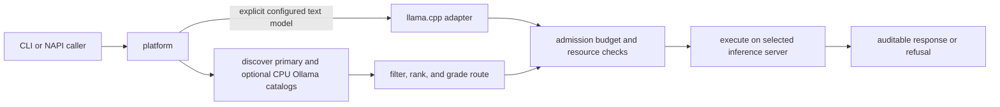

# `freellama-core`

`freellama-core` implements the management layer between calling agents and local inference servers.
Ollama has the complete managed lifecycle; the explicit local llama.cpp adapter supports bounded
text tasks with shared admission and resource policy.
The CLI and MCP server share this core for task offloading and resource coordination. It owns model
discovery, deterministic routing, session affinity, scope history, admission control, managed execution,
and benchmarking. `platform::policy_eval` renders routing policies from harness quality aggregates
for `freellama policy from-eval`.

The crate is named `freellama-core`; its library is named `freellama`, so consumers import
`freellama::…`. For this checkout's 0.12 API, a local dependency is:

```toml
[dependencies]
freellama = { package = "freellama-core", path = "../FreeLlama/packages/rust-core" }
```

Adjust the path for your workspace. For a published build, use the matching crates.io version
instead of `path`. The `napi` feature builds the Node.js addon and is off by default.

## Follow the core flow



| Module | Responsibility |
|---|---|
| `platform` | Control API, discovery, routing, sessions, managed task execution, and admission |
| `proxy` | Ollama-compatible passthrough, retries, timeout, jitter, and optional restart |
| `model_bench` | Capability-grouped Ollama throughput measurements bound to host, endpoint and model artifact |
| `napi` | Feature-gated Node.js binding and the only FFI boundary |
| `lib` | Diagnostics (`doctor`), shared endpoints, and timeouts |

Scopes retain bounded process-local transcripts with expected revisions; each engine still validates
its message subset. Ollama warming reuses managed admission and placement; adaptive keep-alive remains finite unless a caller explicitly overrides it.
See [Scope history and model warming](https://github.com/bgauryy/FreeLlama/blob/main/docs/SCOPES_AND_WARMING.md) for the shared HTTP, CLI,
and MCP contract.

## Understand admission

The platform uses independent 3:2:1 priority-fair weighted CPU and GPU admission pools. Ollama
backends also have separate load locks. Configured llama.cpp requests share the selected admission
pool without acquiring Ollama lifecycle locks. Embedding costs `ceil(input_items / 4)`, chat costs 2, and vision
costs 4 (capped to the pool size).

- A compatible resident Ollama runner takes a per-model use lease and no backend load lock.
- A cold Ollama request holds the backend load lock until a compatible runner is observed; its
  use lease continues through completion.
- Independent CPU and GPU backends can therefore progress concurrently.
- A task that cannot acquire its weighted permit before the queue deadline receives HTTP 503.
- Each backend also bounds retained waiters (16 primary, 8 CPU by default; excess work gets HTTP
  429); cancellation removes a
  waiter immediately and health reports the queue/in-flight counters. Resource-blocked tasks
  release execution units while retaining a bounded queue registration; readmission transfers
  that ticket atomically after resources are reserved.

The primary/GPU pool derives its default weighted budget from observed Ollama parallelism;
the optional CPU pool defaults to one. Inspect resolved values with `config`. Runtime
feedback records successful resident-task work-unit latency by task and backend: decode
nanoseconds/output token for generation and total nanoseconds/input token for embeddings. Only
after three samples exist on each backend and one is more than 10% faster may `auto` steer; it never
does so for quality routing, explicit models, or session-pinned routes. A historical speed winner
must also have enough available cost units; otherwise an eligible ready backend wins.

The llama.cpp adapter requires an exact configured model, fixed context and finite output limit;
it reserves an operator-set memory amount without residency credit. It does not support tools,
media, embeddings, streaming, automatic selection, warm/unload or observed placement. Configure it
with `proxy::load_upstreams` and `PlatformConfig::with_upstreams`; see
[Managed llama.cpp](https://github.com/bgauryy/FreeLlama/blob/main/docs/LLAMACPP.md).

Every upstream HTTP client has a timeout. Without it, a stalled request could retain an exclusive
transition lock and block later managed tasks.

## Understand confidence

Ollama confidence is derived from independent quality and throughput evidence. A schema-2 local
benchmark qualifies only when host identity, observed hardware, exact loopback endpoint and model
digest match. Policy evidence also matches the installed digest and excludes smoke-only policies:

| Policy for task | Local benchmark | Confidence | Evidence label |
|---|---|---|---|
| Yes | Yes | Medium | `configured_task_policy` |
| Yes | No | Low | `configured_task_policy` |
| No | Yes | Low | `functional_throughput_screen` |
| No | No | Low | `capability_metadata_only` |

`policy_eval::qualify` reads correctness pass rates from a harness aggregate. It never
uses `bench-all` throughput as a quality signal. It also refuses expired evidence, fewer than three
trials unless explicitly marked as smoke data, and models that are not installed.

## Embed the platform

```rust
use freellama::platform::{serve, PlatformConfig};

let config = PlatformConfig::new(
    "127.0.0.1:11435",
    "http://127.0.0.1:11434",
    None,
    None,
)
.with_cpu_backend(
    "http://127.0.0.1:11436",
    vec!["nomic-embed-text:latest".to_owned()],
)
.with_store(freellama::store::Store::open("/var/lib/freellama/freellama.sqlite".as_ref())?)
.with_auth_token("replace-with-a-secret-of-at-least-32-bytes");

serve(config).await?;
```

The CPU backend is optional. When configured, exact assigned model names use it and receive
`options.num_gpu=0` on managed requests. Native Ollama passthrough uses the primary upstream.
Configured OpenAI-compatible `/v1/*` upstreams can route by model; they do not apply `--cpu-model`. See [CPU and GPU model routing](https://github.com/bgauryy/FreeLlama/blob/main/docs/CPU_GPU_ROUTING.md) for the operational
contract.

`/_freellama/v1/health` exposes the `explicit_cpu_assignment` contract and configured backends.
Tests pin that receipt, CPU option injection for tasks, and byte-exact raw
passthrough to the primary backend.

Bearer authentication, when configured, covers control and passthrough routes. Binding a
nonloopback address requires both an authentication token and explicit remote opt-in. Aggregate
placement feedback uses a bounded, versioned snapshot in the shared SQLite store when configured.
A corrupt or unsupported feedback snapshot starts with empty feedback and a visible persistence
warning, and is not overwritten silently. An incompatible database schema separately fails startup.
Admission pools and memory reservations are process-local even when processes share SQLite.

Ollama-managed `/_freellama/v1/tasks` requests accept structured message objects without reducing
them to role/content pairs. Their nested `request_options` supports `format`, `think`, `options`,
`logprobs`, and `top_logprobs`. The route's `context_tokens` owns `num_ctx`, and backend placement
owns `num_gpu`; callers cannot override those two keys through `options`. Raw passthrough remains the
full-control escape hatch, including streaming.

When `context_tokens` is omitted, Ollama-managed text execution sizes context from the supplied prompt,
schemas and the expected output (what this model revision has needed before, `output_reserve_tokens`
in the route), up to 32K and the selected model's limit. No output cap is sent unless the caller or a
policy sets `num_predict`. Explicit context and multimodal
profiles are preserved. `execution.context_sizing` reports the estimate. Chat uses `truncate:false`
and `shift:false`; embeddings use `truncate:false`. Unsupported upstream versions may ignore these
fields, so qualify overflow behavior when deploying a different Ollama version.

Installed-model metadata includes a derived `model_type`: `generative`, `multimodal`,
`embedding_only`, or `unknown`. It is a display summary only. Capability filtering and routing use
Ollama's additive capability set, and unrecognized future values are not converted into a known
routable capability.

`proxy::serve` runs passthrough alone. `platform::serve` composes the proxy as its fallback, making
the platform a strict superset of the proxy.

## Build and verify

```bash
cargo build --release
cargo test
cargo fmt --all -- --check
cargo clippy --all-targets -- -D warnings
```

The Node addon is a separate feature-gated build because its FFI symbols resolve only inside Node:

```bash
yarn --cwd ../.. build:native
```

This writes `packages/mcp/native/freellama.<triple>.node`. The crate denies unsafe code except in
`napi.rs`, where generated NAPI glue requires an explicit exception.

Machine discovery is OS-specific behind one serialized contract: `memory_bytes` is total host RAM,
while `memory_kind` is `unified` only on a known unified-memory host. Recommendations use
`memory_bytes` as a conservative preflight. They never equate host RAM with discrete-GPU VRAM; Ollama's
resident-runner data remains the execution proof.
