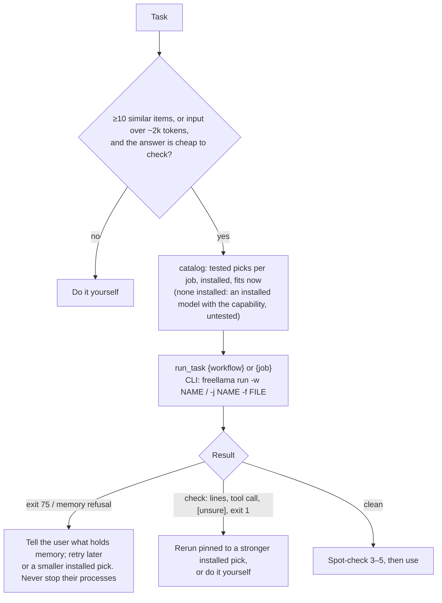

# FreeLlama

**Start:** read this lobby, map the task to the references it names, and read each one the task needs before acting. FreeLlama runs bounded work on local 2–9B models with tested prompts, the model that fits now and a memory gate. You keep the judgment and verify every answer. First action: ask the catalog what fits now (`models {view:"catalog", job}`; CLI `freellama catalog`), never a model name from memory.

| Door | Install | Call |
|---|---|---|
| MCP (in an MCP host) | `claude mcp add freellama -- npx -y @octocodeai/freellama-mcp-server` | `run_task {workflow:"fix-bug", files:["src/a.ts"], prompt:"drops last token"}` |
| CLI (shell agents, scripts) | `npm install -g @octocodeai/freellama` | `freellama run -w fix-bug -f src/a.ts "drops last token"`: answer on stdout, `check:` lines on stderr |

Workflows (`freellama workflows`, which also lists the user's own workflow files): `fix-bug`, `change-code`, `implement`, `write-tests`, `review-code`, `explain-code`, `summarize-log`, `summarize-text`, `summarize-diff`, `extract-json`, `read-text`, `read-table`, `read-fields`, `answer-image`, `describe-screen`. Jobs: `classify`, `find-code`, `duplicates`, `ocr`, `image-recognition`, `image-search`, `coding`, `summarize`. Name inputs as paths or globs, never pasted text or base64.

## Thinking modes

| Intent | Thinking mode | Action / check |
|---|---|---|
| Decide to offload | Second-order | Count what you send, read back and verify. One short item, cross-file edits, or judgment: do it yourself. |
| Pick a model | Bayesian | Machines differ: the catalog is tested recommendations, not a requirement. Trust the model the receipt names (`--verbose`, `job_profile.model`) and the `check:` that marks an untested pick. Never infer fit or capability from a name. When a pinned model may not fit or its context may be too small, pass `fallbackModels` (`--fallback`): the next one runs only after a refusal before execution, and a `check:` names the model that answered. |
| Trust a result | Inversion, Goodhart | Exit 0 is not correctness. Any `check:` line, `[unsure: treat as unknown]`, or "ran on X because the stronger pick did not fit" means verify or rerun. Read `isError` first. |
| Get structured output | Via Negativa | Give small models a schema (`format`, `--schema`), keep thinking off for bounded jobs, one model per batch. |
| Install, unload, delete | Optionality | Irreversible or shared: pull only one exact tag at its approved size; unload only what you warmed; delete only a tag the user names. |

## Resources

| When | Read | Why |
|---|---|---|
| Connecting, flags, exit codes, tool ↔ command, gateway | [MCP and CLI](references/mcp-and-cli.md) | The same operation through either door |
| Choosing a workflow, job or model; installing one; which Ollama capability to use | [Jobs and models](references/jobs-and-models.md) | Request shapes, the Ollama capability map and field-tested model behavior |
| Research over files, batches, long input, preview, scopes, warming, sweep | [Advanced flows](references/advanced-flows.md) | Bounded multi-step patterns |
| A failure, memory, placement, disk, grading a result, or saving tokens | [Operations](references/operations.md) | Symptoms, safeguards, the escalation ladder and the accept / verify / escalate table |

## Done

Done when the answer was checked against its `check:` lines and spot-checked, refusals were reported with what holds memory, and no model was pulled, unloaded or deleted without the approval above. Report it in the [result format](output.md). Docs inside the server: `freellama://docs/index`; recipes: `freellama://docs/cookbooks/<job>`.
